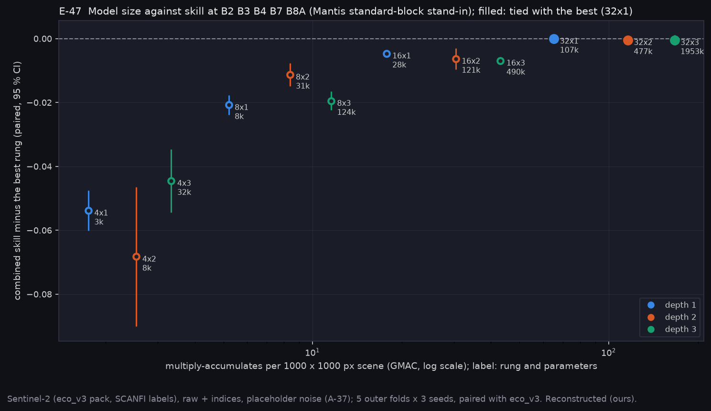
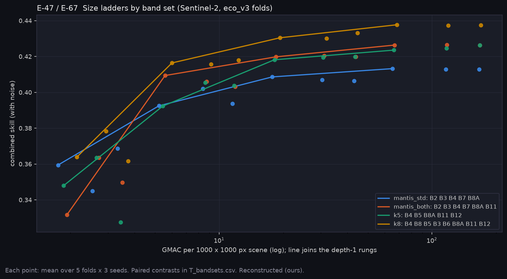

# P12c: the onboard model's size (E-47)

Run on Narval: `narval_results/arch_mantis_std/20261109-2051`, 15 of 15 tasks (5 outer folds × 3 seeds). Each task trains all 12 TinyEcologyUNet rungs (base_ch 4–32 × depth 1–3) on its fold and scores them with sensor noise.

The bands are B2, B3, B4, B7 and B8A in raw + indices: a Sentinel-2 stand-in for the Mantis standard multispectral block that CUBICS flies.
- B7 (783/20) matches the Mantis 780/20 band.
- B2, B3 and B4 approximate its blue, green and red.
- B8A (865) stands in for 900 nm.
- The panchromatic band has no Sentinel-2 equivalent and is left out.

The pack, folds and seeds are eco_v3's (same freeze hash), so every rung pairs with eco_v3 and with E-46's consensus re-scores. Labels are SCANFI v2 2020 and the sensor noise is a placeholder (A-37). All values are Reconstructed (ours).

**At a glance:** [experiments.md](experiments.md). Tables: [T_arch.csv](T_arch.csv) (every rung: size, cost, skill, per-head errors, FPGA time from [P12/p12_convert](../p12_convert/README.md)), [T_compare.csv](T_compare.csv) (the stand-in against E-46's sets at 8×2), [T_ladders.csv](T_ladders.csv) and [T_bandsets.csv](T_bandsets.csv) (four band sets' ladders and their paired contrasts).

```bash
python scripts/make_arch_package.py --run narval_results/arch_mantis_std/20261109-2051 \
    --others mantis_both=narval_results/arch_mantis_both/20261109-2213 \
    k5=narval_results/arch_k5/20261109-2213 k8=narval_results/arch_k8/20261109-2213
python scripts/make_phase_docs.py --phase P12c
```



## What it found

| Rung | Parameters | GMAC per scene | Combined skill | Gap to the best (paired) | Q8 AI engine, s per scene | Q7 FINN, s per scene (W4A4, minimal folding) |
|---|---|---|---|---|---|---|
| 8×2 | 31 k | 8.4 | 0.402 | −0.011 ± 0.002 | 0.015 | 8.6 (24 % of logic) |
| 16×1 | 28 k | 17.7 | 0.409 | −0.005 ± 0.001 | 0.032 | 34.6 (19 %) |
| **32×1** | 107 k | 65.3 | **0.413** | best | 0.112 | 138 (over the 43 s budget) |
| 32×2 | 477 k | 116 | 0.413 | −0.001 ± 0.001, tied | 0.194 | 138 |

The full ladder is in [T_arch.csv](T_arch.csv). FPGA times come from the conversion pre-check, which used 22 inputs against 11 here, so they are upper bounds.

- **E-47: REFUTED.** The hypothesis was that the 8×2 rung the bands were ranked with is within one paired SE of the best. It is 0.011 ± 0.002 below. Only base_ch 32 ties the best, the case the hypothesis named as wrong. Width matters more than depth: at base_ch 16 and 32, extra depth adds nothing.
- **The differences are small in the products.** From 8×2 to 32×1, percent-conifer RMSE goes from 23.7 to 23.2 points, closure from 13.8 to 13.5, height from 4.54 to 4.44 m, and fuel-family balanced accuracy from 0.528 to 0.532. The family confusion barely changes after 8×2 ([qual_E-47_family_confusion.png](qual_E-47_family_confusion.png)). Mixedwood is read as conifer at every size.
- **Size and board are one decision.** The best rung runs in about 0.1 s on the Q8's AI engine. On the Q7 at minimal folding it needs 138 s, about 3.2 times the budget. FINN can fold it more widely, at more logic, but whether that still fits the Q7 is unmeasured. 16×1, 0.005 below the best, fits the Q7 in 35 s with 19 % of its logic.
- **VNIR-only costs little on Sentinel-2 at 8×2, but not at the best size** (see the four ladders below: 0.013 at width 32). At 8×2, the Mantis stand-in is 0.004 ± 0.002 below E-46's stable SWIR set (B4 B5 B8A B11 B12) and 0.014 ± 0.002 below the 8-band consensus. This is a stand-in without the panchromatic band, so the real Mantis block may differ either way.

## Four band sets, four ladders (2026-11-10)

Three more ladders ran on the same folds and seeds, 15 of 15 tasks each (`20261109-2213`):
- `arch_mantis_both`: the stand-in plus B11, E-67's Sentinel-2 half;
- `arch_k5` and `arch_k8`: E-46's two band options.



| Band set | Best rung | Best skill | 8×2 below its best | 16×1 below its best | Best minus the VNIR stand-in's best (paired) |
|---|---|---|---|---|---|
| VNIR stand-in (B2 B3 B4 B7 B8A) | 32×1 | 0.413 | 0.011 | 0.005 | – |
| + B11 | 32×2 | 0.427 | 0.021 | 0.007 | **+0.013 [+0.010, +0.016]** |
| k = 5 (B4 B5 B8A B11 B12) | 32×3 | 0.426 | 0.021 | 0.008 | +0.013 [+0.008, +0.018] |
| k = 8 (B4 B8 B5 B3 B6 B8A B11 B12) | 32×1 | **0.438** | 0.022 | 0.007 | +0.025 [+0.019, +0.030] |

- **Width 32 is best for every band set.** 8×2 is 0.011–0.022 below the best and 16×1 0.005–0.008 below. The more bands there are, the more a larger network gains, so E-46's band scores at 8×2 understate the SWIR sets.
- **SWIR's value on Sentinel-2 grows with model size.** Adding B11 to the VNIR stand-in gains +0.004 at 8×2 (not significant), +0.011 at 16×1 and +0.013 at 32×1. The 8×2 comparison above, 0.004 below the stable SWIR set, undersold SWIR.
- **The stand-in plus B11 ties the stable k = 5 set** (−0.000 [−0.008, +0.007]). The 8-band set leads every other set by 0.011 or more.

## Options (A-49: James chooses)

| Option | Pros | Cons |
|---|---|---|
| 32×1 on the Q8 | Best skill; 0.1 s per scene, real-time capable | Q8 draws 5 W against the Q7's 2 W; 107 k parameters |
| 16×1 on the Q7 | 0.005 below the best; fits the Q7 within budget (35 s, 19 % logic); lowest-power board | Not real-time; Q7 buffers must still be sized (FINN FIFOs) |
| 16×1 or 32×1 on the Q8 | Either fits with large margin | Paying Q8 power for a model the Q7 could run (16×1) |
| 8×2 on either | The size every conversion and band result so far used | 0.011 below the best |

## Next

1. James chooses the size and board.
2. E-48: FINN with sized FIFOs on the Q7 for 16×1 (and 32×1 with wider folding). This needs Vivado on Linux. The Q8 DPU needs INT8 quantisation of the trained network and an accuracy check.
3. Confirm on AVIRIS-NG with the true Mantis bands, including the panchromatic band. That needs a size option in `run_hs_search.py`, which only trains 8×2 today.

## Limits

- Sentinel-2 stand-in bands (no panchromatic band; 865 for 900 nm), placeholder noise, SCANFI labels.
- FPGA figures come from untrained conversions with 22 inputs; FINN BRAM is a floor until FIFOs are sized.

<!-- qual:start -->
## Qualitative view per experiment

- **E-47** Architecture decision (family confusion): [qual_E-47_family_confusion.png](qual_E-47_family_confusion.png)
<!-- qual:end -->
