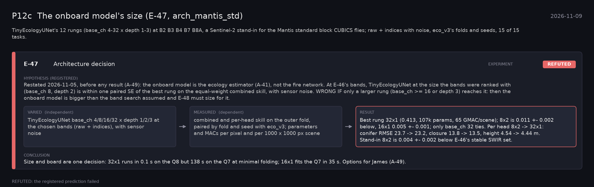

# P12c: The onboard model's size (E-47, arch_mantis_std) (2026-11-09)

What this phase ran and concluded. Generated by `scripts/make_phase_docs.py` from `src/safari_bands/phases.py`; registered hypotheses are quoted from the register, verbatim. Full results: [README.md](README.md).

TinyEcologyUNet's 12 rungs (base_ch 4-32 x depth 1-3) at B2 B3 B4 B7 B8A, a Sentinel-2 stand-in for the Mantis standard block CUBICS flies; raw + indices with noise, eco_v3's folds and seeds, 15 of 15 tasks.

## E-47: Architecture decision (experiment): **REFUTED**

| | |
|---|---|
| Hypothesis (registered) | Restated 2026-11-05, before any result (A-49): the onboard model is the ecology estimator (A-41), not the fire network. At E-46's bands, TinyEcologyUNet at the size the bands were ranked with (base_ch 8, depth 2) is within one paired SE of the best rung on the equal-weight combined skill, with sensor noise. WRONG IF only a larger rung (base_ch >= 16 or depth 3) reaches it: then the onboard model is bigger than the band search assumed and E-48 must size for it. |
| Varied (independent) | TinyEcologyUNet base_ch 4/8/16/32 x depth 1/2/3 at the chosen bands (raw + indices), with sensor noise |
| Measured (dependent) | combined and per-head skill on the outer fold, paired by fold and seed with eco_v3; parameters and MACs per pixel and per 1000 x 1000 px scene |
| Result | Best rung 32x1 (0.413, 107k params, 65 GMAC/scene); 8x2 is 0.011 +- 0.002 below, 16x1 0.005 +- 0.001; only base_ch 32 ties. Per head 8x2 -> 32x1: conifer RMSE 23.7 -> 23.2, closure 13.8 -> 13.5, height 4.54 -> 4.44 m. Stand-in 8x2 is 0.004 +- 0.002 below E-46's stable SWIR set. |
| Verdict | **REFUTED**: the registered prediction failed |
| Conclusion | Size and board are one decision: 32x1 runs in 0.1 s on the Q8 but 138 s on the Q7 at minimal folding; 16x1 fits the Q7 in 35 s. Options for James (A-49). |
