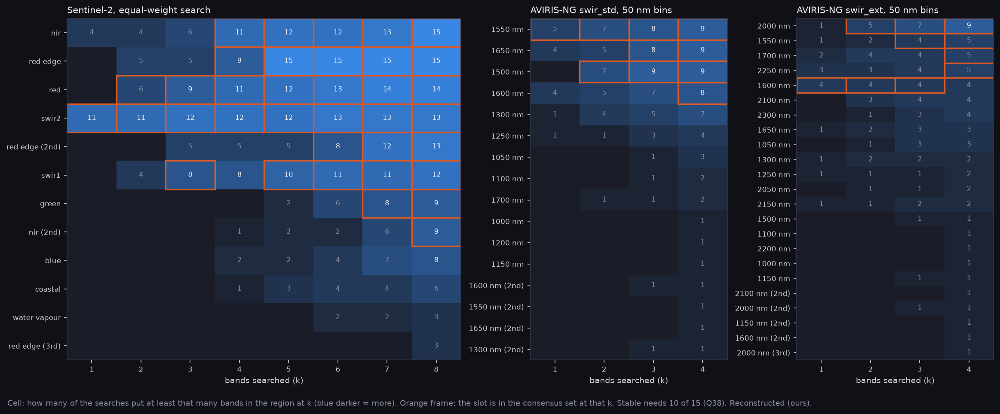

# P12a: band options, the consensus sets (E-46, Q38)

The first stage of P12's band decision. Each band search runs inside a training fold, so eco_v3 (Sentinel-2) and hs_v4 (AVIRIS-NG) return 15 sets per k (5 outer folds × 3 seeds), and the sets differ. Q38 (James, 2026-11-05, option 1): count them by region, form the consensus set, and score that exact set on the same folds. **Both re-scores are in** (2026-11-09): every consensus set is scored as a fixed set on the same folds and seeds, beside the search scores. All values are Reconstructed (ours).

**At a glance:** [experiments.md](experiments.md). Generated tables: [options.md](options.md), [T_consensus.csv](T_consensus.csv), [T_options_s2.csv](T_options_s2.csv), [T_options_swir.csv](T_options_swir.csv). Re-score commands: [rescore_commands.md](rescore_commands.md).

```bash
python scripts/make_band_options.py --eco-rescore narval_results/bands_consensus narval_results/bands_consensus_v2 \n    --hs-rescore narval_results/hs_consensus/20261106-1202
python scripts/make_phase_docs.py --phase P12a
```

## How the consensus is formed (A-49, fixed before any re-score)

- **Regions.**
  - Sentinel-2: by band role. B5–B7 are one red-edge region and B8/B8A one NIR region. SWIR1 and SWIR2 stay apart because they sit on different detectors.
  - AVIRIS-NG SWIR: 50 nm bins, as the hs packager counts them. A-40's role windows leave out 1000–1550 and 1750–2080 nm, where searched bands do land.
- **Slots.** A k-band set can hold two bands of one region, so a region's second slot is supported by searches that put two bands there. The k best-supported slots form the set, and each region takes its most-chosen bands.
- **Stable** means every slot is supported by at least 10 of 15 searches.
- **The set is not forced to nest across k.** Each k's consensus stands on its own and is re-scored as a fixed set.



## What the counting shows

**Sentinel-2 (equal-weight search):**

| k | consensus set | weakest slot | stable |
|---|---|---|---|
| 1 | B12 | 11 / 15 | yes |
| 2 | B4, B12 | 6 / 15 | no |
| 3 | B4, B11, B12 | 8 / 15 | no |
| 4 | B4, B6, B8A, B12 | 9 / 15 | no |
| 5 | **B4, B5, B8A, B11, B12** | 10 / 15 | **yes** |
| 6 | B4, B5, B6, B8A, B11, B12 | 8 / 15 | no |
| 7 | B3, B4, B5, B6, B8, B11, B12 | 8 / 15 | no |
| 8 | B3, B4, B5, B6, B8, B8A, B11, B12 | 9 / 15 | no |

- **SWIR is in at every k.** How many of the 15 searches' sets hold each region:

  | region | k = 1 | k = 4 | k = 5–8 |
  |---|---|---|---|
  | SWIR2 (B12) | 11 | 12 | 12–13 |
  | SWIR1 (B11) | 0 | 8 | 10–12 |
  | red edge (B5–B7) | 0 | 9 | 15 |
  | red (B4) | 0 | 11 | 12–14 |
  | NIR (B8, B8A) | 4 | 11 | 12–15 |

  From k = 5 these five regions are each chosen by at least 10 searches. What the searches disagree on is the extra band or two (green, blue, a second NIR or red-edge band) and which band within a region.
- **k = 5 is the only multi-band set that passes Q38's rule.** It is red, one red edge, narrow NIR, SWIR1 and SWIR2.

**AVIRIS-NG SWIR:** no consensus set is stable. The weakest 50 nm slot is in 5–8 of 15 standard-InGaAs searches and 4–5 of 15 extended ones. The searches agree on a broad window (around 1500–1650 nm, and around 2000 nm in the extended arm) but not on a 50 nm placement. The fixed configurations then remain the clearer SWIR options: config C (1610 + 2190 nm) is the best score in hs_v4.

## The option tables (provisional)

`options.md` has both tables, with A-49's paired ties.
- **Sentinel-2:** the best option is still the percent-conifer search at k = 8 (0.4158). The equal-weight search at k = 7–8 ties with it, and k = 5–6 sit about 0.008 below. All of these are *search procedure* scores: each fold scored its own set, which no single fixed set reproduces. Each row says so under its cons.
- **The consensus sets are listed below each table with no score.** They enter the option table, with pros and cons, only once re-scored.

## The Sentinel-2 re-score (2026-11-06 to 2026-11-09)

All eight Sentinel-2 consensus sets, scored as fixed sets with `run_eco_arch` at 8×2, paired with eco_v3 by fold and seed (15 of 15 tasks each):
- k = 1 from `narval_results/bands_consensus`.
- k = 2–8 from `narval_results/bands_consensus_v2`, the rerun after the first run's k ≥ 2 tasks passed only their first band (`sbatch --export` split `BANDS` at its commas; fixed in FW `6b1499a`). The combiner rejects the invalid first-run tasks by their band lists.

| k | consensus set | stable (Q38) | fixed-set score | consensus − search at the same k (paired) | gap to the best option (paired) |
|---|---|---|---|---|---|
| 1 | B12 | yes | 0.2693 | +0.009 ± 0.008 | 0.146 ± 0.007 |
| 2 | B4 B12 | no | 0.3618 | −0.010 ± 0.005 | 0.054 ± 0.005 |
| 3 | B4 B11 B12 | no | 0.3943 | −0.001 ± 0.003 | 0.021 ± 0.003 |
| 4 | B4 B6 B8A B12 | no | 0.3983 | −0.006 ± 0.003 | 0.017 ± 0.003 |
| 5 | B4 B5 B8A B11 B12 | **yes** | 0.4055 | −0.003 ± 0.004 | 0.010 ± 0.003 |
| 6 | B4 B5 B6 B8A B11 B12 | no | 0.4114 | +0.003 ± 0.003 | 0.004 ± 0.003 |
| 7 | B4 B8 B5 B3 B6 B11 B12 | no | 0.4082 | −0.006 ± 0.003 | 0.008 ± 0.003 |
| 8 | B4 B8 B5 B3 B6 B8A B11 B12 | no | 0.4157 | +0.001 ± 0.002 | **tied** (0.000 ± 0.002) |

The best option is the percent-conifer-weighted search at k = 8 (0.4158).

- **Fixing the set neither gains nor loses on Sentinel-2.** At every k, the consensus set is within about two SE of the search procedure that produced it. Unlike AVIRIS-NG, where fixed placements beat the per-fold searches, the Sentinel-2 searches pick nearly the same bands each time, so there is little search noise to remove.
- **Neither stable set ties the best.** The stable k = 5 set (red, two red edges, narrow NIR, both SWIR) is 0.010 ± 0.003 below the best and 0.010 ± 0.003 below the k = 8 consensus. Only k = 8, unstable in its weakest slot, ties.
- **For the decision (A-49, James's).** Two options:
  - Take the stable k = 5 set and accept 0.010.
  - Take k = 8, which ties the best but whose weakest slot is held by 9 of 15 searches.

  Both carry SWIR1 and SWIR2. The VNIR-only Mantis configuration chosen for CUBICS sits outside this Sentinel-2 ladder; its score is in [P12/p12_sensors](../p12_sensors/README.md).

## The AVIRIS-NG re-score (2026-11-06)

`narval_results/hs_consensus/20261106-1202`: 15 of 15 tasks, every task's pixels matching hs_v4's (`aviris_v4`). A duplicate submission, `20261106-1201`, is ignored. Each consensus SWIR set is scored as a fixed set:
- **Best overall:** the extended-InGaAs consensus at k = 4 (1530, 1690, 1990, 2270 nm), 0.2895, tied with config C (0.2881). No Dragonfly mode reaches these (A-18).
- **Best on standard InGaAs, which Mantis SWIR is:** the configured slots 1240, 1550, 1610, 1680 (`sensor_mantis_ms_plus_swir`), 0.2853, 0.0042 ± 0.0009 below the best. They are ahead of every standard-InGaAs consensus (best: k = 4, 0.2796) and searched set. A short band near 1240 plus three across the 1550-1680 shoulder beats the placements the searches converge on.
- DFA's nearest filters to those slots are scored as fixed sets next ([P12/p12_sensors](../p12_sensors/README.md)).

## Next

1. James chooses between the stable k = 5 set and the tied k = 8 set (A-49), or records that the VNIR-only CUBICS configuration supersedes the Sentinel-2 ladder.
2. E-47's size ladder at the chosen set (or at the Mantis standard block).

## Limits

- SCANFI labels, mapped from Landsat (Q35), and placeholder noise (A-37).
- Cost is qualitative (Q6 open) and never chooses (A-41).

<!-- qual:start -->
## Qualitative view per experiment

- **E-46** Band and index decision (band placement): [qual_E-46_band_placement.png](qual_E-46_band_placement.png)
<!-- qual:end -->
