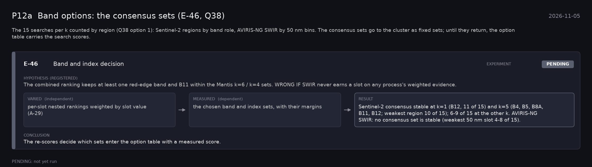

# P12a: Band options: the consensus sets (E-46, Q38) (2026-11-05)

What this phase ran and concluded. Generated by `scripts/make_phase_docs.py` from `src/safari_bands/phases.py`; registered hypotheses are quoted from the register, verbatim. Full results: [README.md](README.md).

The 15 searches per k counted by region (Q38 option 1): Sentinel-2 regions by band role, AVIRIS-NG SWIR by 50 nm bins. The consensus sets go to the cluster as fixed sets; until they return, the option table carries the search scores.

## E-46: Band and index decision (experiment): **PENDING**

| | |
|---|---|
| Hypothesis (registered) | The combined ranking keeps at least one red-edge band and B11 within the Mantis k=6 / k=4 sets. WRONG IF SWIR never earns a slot on any process's weighted evidence. |
| Varied (independent) | per-slot nested rankings weighted by slot value (A-29) |
| Measured (dependent) | the chosen band and index sets, with their margins |
| Result | Sentinel-2 consensus stable at k=1 (B12, 11 of 15) and k=5 (B4, B5, B8A, B11, B12; weakest region 10 of 15); 6-9 of 15 at the other k. AVIRIS-NG SWIR: no consensus set is stable (weakest 50 nm slot 4-8 of 15). |
| Verdict | **PENDING**: not yet run |
| Conclusion | The re-scores decide which sets enter the option table with a measured score. |
