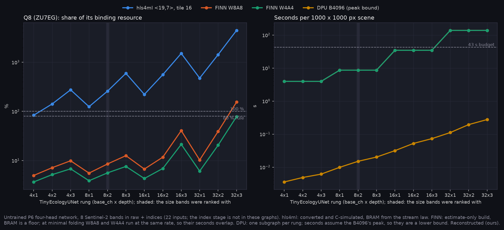

# E-48 pre-check: does the ecology network convert through the FPGA flows?

James (2026-11-05): test whether the onboard model converts through the FPGA flows. Under A-41 and E-47's restated hypothesis, the onboard model is the P6 ecology estimator, `TinyEcologyUNet` with four heads (percent conifer, closure, height, fuel family; 10 output channels). Until now only the fire network, `TinyFireUNet`, had been through the flows.

This is a conversion check, not the hardware decision. The networks are untrained, because resources and op coverage depend on geometry and bit widths, not on weights. All values are Reconstructed (ours).



Table: [T_convert.csv](T_convert.csv) (one row per flow × precision × rung × tile). Regenerate with:

```bash
# Fire_Risk_FW
python scripts/check_eco_convert.py --bands B4,B6,B12,B11,B8,B8A,B5,B3 --tile 16 --csim --out runs/eco_convert/ri_t16.json   # and --tile 32, 64
bash scripts/vitis_ai.sh inspect --model ecology --in-ch 22 --base-ch 8 --depth 2 --name eco_8x2 --out hls_projects/_vai/eco_8x2
bash scripts/finn.sh python scripts/export_eco_qonnx.py --in-ch 22 --base-ch 8 --depth 2 --w-bits 4 --a-bits 4 --out hls_projects/_finn/eco_8x2_w4a4.onnx
bash scripts/finn.sh python finn_flow/build_finn.py --model hls_projects/_finn/eco_8x2_w4a4.onnx --out hls_projects/_finn/eco_8x2_w4a4
# Fire_Risk_Statistics
python scripts/make_convert_package.py
```

## Set-up

- **Model:** all 12 E-47 rungs, base_ch {4, 8, 16, 32} × depth {1, 2, 3}, with the P6 heads.
- **Inputs:** 22 channels, the provisional 8 bands (B4, B6, B12, B11, B8, B8A, B5, B3) in raw + indices.
  - **The index front end is not in any graph.** It divides (normalised differences), which none of the flows maps inside the network.
  - Its precedent is the pointwise ratios front end in `hls_src/ratios_frontend/`: 0 BRAM, 10 DSP and 6 % of the ZU7's LUTs, synthesised, for 4 ratios. Fourteen indices would cost more, and it is unmeasured on the Q7.
- **Boards** (`configs/boards.json`):
  - Q7: Zynq-7020, 280 BRAM18K and 53,200 LUTs, no DPU target.
  - Q8: ZU7EG, 624 BRAM18K, 230,400 LUTs and a B4096 DPU.
  - Q9 (Versal) is not installed in these tools, so nothing here measures it.
- **Rule (A-29):** at most 80 % of every resource, and at most 43 s per 1000 × 1000 px scene.

## What it found

| flow | converts | fits at ≤ 80 % | seconds per scene | how far to trust it |
|---|---|---|---|---|
| hls4ml `<19,7>` | 12 / 12 at tiles 16, 32 and 64; C simulation agrees with torch to 0.0014 | **none**; nearest is 4x1 at tile 16, 84 % of the Q8's BRAM. 8x2 needs 258 % | not measured (no synthesis here) | BRAM from the stream law, exact on TinyFireUNet's two synthesis runs; ROM is an estimate |
| Vitis AI DPU, INT8 (Q8 only) | 12 / 12, each **one DPU subgraph**; only `fix2float` runs on the CPU | the B4096 is a fixed overlay; the model changes only how busy it is | 0.004–0.28 s at peak (8x2: 0.015 s) | a lower bound: the B4096 at full peak, 300 MHz |
| FINN W4A4 / W8A8 | 24 / 24 | **Q8: 23 of 24; Q7: 20 of 24** (8x2 W4A4: 6 % of the Q8 and 24 % of the Q7, LUT-bound) | 4.0 s (base_ch 4), 8.6 s (8), 34.6 s (16), 138 s (32), at minimal folding | **BRAM is a floor:** an estimate-only build leaves the FIFOs unsized, and those are the skip buffers that sink hls4ml |

- **The ecology network behaves like the fire network.** Under hls4ml io_stream the U-Net's stream count sets the BRAM, as `feasibility.md` found for TinyFireUNet. The four heads add streams: 58 at depth 2 against TinyFireUNet's 41, so 8x2 needs 258 % of the Q8 at tile 16, against 204 %. Raw-only inputs (8 instead of 22) barely change it (254 %). hls4ml is not a route for this model at any rung that would be trained.
- **The DPU takes every rung whole.** No structural op falls back to the ARM cores, unlike TinyFireUNet's sigmoid; the heads emit logits. The 8x2 rung is 18.6 GOP per scene, under 2 % of a B4096 at one scene per second. The engine would sit mostly idle, which under a power-first rule (Q28) is the DPU's cost rather than a risk to time.
- **FINN is the only flow that reaches the Q7, on these estimates.** Base_ch 4–16 meet 43 s at minimal folding, and base_ch 32 needs more parallel folding (`--target-fps`), which costs resources. The Q7 fits stop being estimates only once FINN sizes its FIFOs. That step needs RTL simulation (Vivado 2024.2 on Linux), which this machine does not have.

## What this changes

- E-48 is no longer blocked on conversion. It still needs E-47's size, then an option table per board. That table would draw on:
  - the DPU on the Q8;
  - FINN on the Q7 and the Q8, with FIFOs sized;
  - power from Vivado, or the board measurements in `boards.json`.
- If E-47 lands on 8x2, the options are the Q8 with a DPU (a 5 W typical board per the Rev C spec sheet in the repo; `boards.json` says 3.5 W; timing safe, mostly idle) and FINN on the Q7 (a 2 W typical board, if the sized FIFOs still fit). That trade is James's to make (A-49).

## Limits

- **The DPU's own footprint was not checked here** (added 2026-11-11, P12/p12_hw_mantis). A B4096 core takes 82 % of the Q8's block RAM in its default build, over the 80 % rule but under 100 %. The UltraRAM build takes 71 % of the UltraRAM and 4 BRAM18K (AMD PG338 v3.4), so the Q8 option needs that build or a smaller DPU.
- Untrained weights, so nothing here measures fidelity at deployment precision, only that the conversion computes the network.
- No synthesis: hls4ml BRAM comes from the law, FINN from analytic estimates, the DPU from the compiler's workload count.
- The index front end is outside every graph and unmeasured at 14 indices.
- A scene is cut into 64 px tiles without overlap; any halo between tiles adds work.
