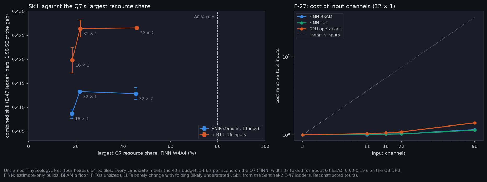

# P12e: the Mantis-track onboard model on the Q7 and Q8 (E-48, Mantis track; E-27)

E-48 on the Mantis track (A-55), which has no SWIR2. The candidate sizes come from E-47's Sentinel-2 ladders at two inputs:
- the Mantis VNIR stand-in (B2, B3, B4, B7, B8A; 11 inputs, raw + indices);
- the stand-in + B11, the one Sentinel-2 band in the SWIR chain's range (16 inputs).

Three sizes were converted:
- 32 × 1, the best rung of the stand-in;
- 32 × 2, the best rung with B11 (32 × 1 within 0.0002);
- 16 × 1, the smaller option.

Each went through the three flows at its real input count. This replaces the pre-check's 22 inputs (P12/p12_convert).

Builds are local and estimate-only, on untrained networks: resources and op coverage depend on geometry and bit width, not on weights. All values are Reconstructed (ours).

**At a glance:** [T_hw_mantis.csv](T_hw_mantis.csv), [T_channels.csv](T_channels.csv), [summary.json](summary.json).



## Results

| Candidate | Inputs | Skill (E-47) | Q8, DPU INT8 | Q7, FINN W4A4 (folded) | Q7 largest share | Q8 largest share (FINN) | hls4ml on the Q8 |
|---|---|---|---|---|---|---|---|
| 16 × 1 | 11 | 0.409 (−0.005) | 0.03 s | 34.6 s | 18 % (LUT) | 4 % | 217 % BRAM |
| 32 × 1 | 11 | **0.413** (best) | 0.11 s | 34.6 s | 22 % (LUT) | 6 % | 468 % |
| 32 × 2 | 11 | 0.413 (−0.0005) | 0.19 s | 34.6 s | 45 % (BRAM) | 20 % | 1420 % |
| 16 × 1 | 16 | 0.420 (−0.007) | 0.03 s | 34.6 s | 18 % (LUT) | 4 % | 219 % |
| 32 × 1 | 16 | 0.426 (−0.0002) | 0.11 s | 34.6 s | 22 % (LUT) | 6 % | 472 % |
| 32 × 2 | 16 | **0.427** (best) | 0.19 s | 34.6 s | 46 % (BRAM) | 21 % | 1424 % |

Budget (A-29): at most 43 s per 1000 × 1000 px scene and at most 80 % of every resource.

At minimal folding the width-32 rungs take 138 s on the Q7. Folded for about 6 tiles/s (`--target-fps 6`) they take 34.6 s, the same as 16 × 1.

- **Every candidate fits both boards on these estimates.**
  - **Q8:** the DPU takes each model as one subgraph, with only `fix2float` on the CPU. It needs at most 0.19 s per scene, about 200 times inside the budget.
  - **Q7:** FINN W4A4 meets 43 s with width 32 folded. The largest share is 46 % (32 × 2, BRAM).
- **E-48's registered prediction holds:** the chosen model fits a Q8 at ≤ 80 % of every resource (SUPPORTED for the Mantis track; the general track waits for E-68's ladders).
- **hls4ml is still not a route at any size** (217–1424 % of the Q8's BRAM), as in the pre-check.
- **The options for James (A-49):**

  | Option | Pros | Cons |
  |---|---|---|
  | **Q8 + DPU, 32 × 1 or 32 × 2** | best skill; real time; a mature flow (Vitis AI) that compiles the whole network | 5 W typical, against the Q7's 2 W |
  | **Q7 + FINN, 32 × 1** | best-skill size at 2 W | the Q7 fit is an estimate until a Vivado build sizes the FIFOs (BRAM is a floor) |
  | **Q7 + FINN, 16 × 1** | the most margin on the Q7 (18 %) at minimal folding | 0.005–0.007 below the best |

## E-27: what an input channel costs

32 × 1 converted at 3, 11, 16, 22 and 96 inputs (96 is the Mantis HS channel count):

| Inputs | FINN BRAM | FINN LUT | FINN s per scene | DPU GOP per tile | Parameters |
|---|---|---|---|---|---|
| 3 | 37 | 11,563 | 138 | 0.517 | 105,034 |
| 11 | 37 | 11,701 | 138 | 0.536 | 107,338 |
| 16 | 38 | 11,782 | 138 | 0.548 | 108,778 |
| 22 | 38 | 11,893 | 138 | 0.562 | 110,506 |
| 96 | 43 | 13,209 | 138 | 0.736 | 131,818 |

Going from 3 to 96 inputs (32 times as many) costs 16 % more BRAM, 14 % more LUT and 42 % more DPU work. Throughput is unchanged.

**E-27 is REFUTED.** It predicted roughly linear scaling, with 96 channels infeasible. The network after the first convolution dominates the cost, so a wide input is cheap. Five more bands (11 to 16 inputs) cost 1 BRAM and about 80 LUTs.

Under hls4ml, 11 to 16 inputs adds 13 BRAM of about 1,360 (+1 %). That is sub-linear too, though hls4ml fits at no input count.

## Limits

- **Untrained networks.** Nothing here measures accuracy at deployment precision (INT8, W4A4).
- **FINN builds are estimate-only.**
  - BRAM is a floor: the FIFOs, the skip buffers, are unsized.
  - Folded and unfolded builds report almost the same LUTs, which is probably understated.
  - The Q7 fit stays provisional until a Linux Vivado build sizes the FIFOs and gives real timing on the Zynq-7020 (FINN's estimate assumes 200 MHz).
- **DPU times are a lower bound:** the B4096 at full peak, 300 MHz.
- **The index front end** (normalised differences) is outside every graph.
- **Skill comes from the Sentinel-2 stand-in**, not the Mantis bands. The input count matches the real camera's, not its spectral response.
- **No power measurement.** Board power is from the datasheets (Q7 2 W, Q8 5 W typical).

## Reproduce

```bash
# Fire_Risk_FW (Docker Desktop running)
python scripts/check_eco_convert.py --bands B2,B3,B4,B7,B8A --mode raw+indices --sizes 16x1,32x1,32x2 --tile 16 --out runs/eco_convert_mantis/std_t16.json
python scripts/check_eco_convert.py --bands B2,B3,B4,B7,B8A,B11 --mode raw+indices --sizes 16x1,32x1,32x2 --tile 16 --out runs/eco_convert_mantis/both_t16.json
bash scripts/finn.sh python scripts/export_eco_qonnx.py --in-ch 11 --base-ch 32 --depth 1 --w-bits 4 --a-bits 4 --out hls_projects/_finn/mantis_std_32x1_w4a4.onnx
bash scripts/finn.sh python finn_flow/build_finn.py --model hls_projects/_finn/mantis_std_32x1_w4a4.onnx --out hls_projects/_finn/mantis_std_32x1_w4a4_fps6 --target-fps 6
bash scripts/vitis_ai.sh inspect --model ecology --in-ch 11 --base-ch 32 --depth 1 --name mantis_std_32x1 --out hls_projects/_vai/mantis_std_32x1
#   ... and the same for each size, for 16 inputs, and for E-27 (--in-ch 3 and 96, 32x1)
# Fire_Risk_Statistics
python scripts/make_hw_mantis_package.py
python scripts/make_phase_docs.py --phase P12e
```
