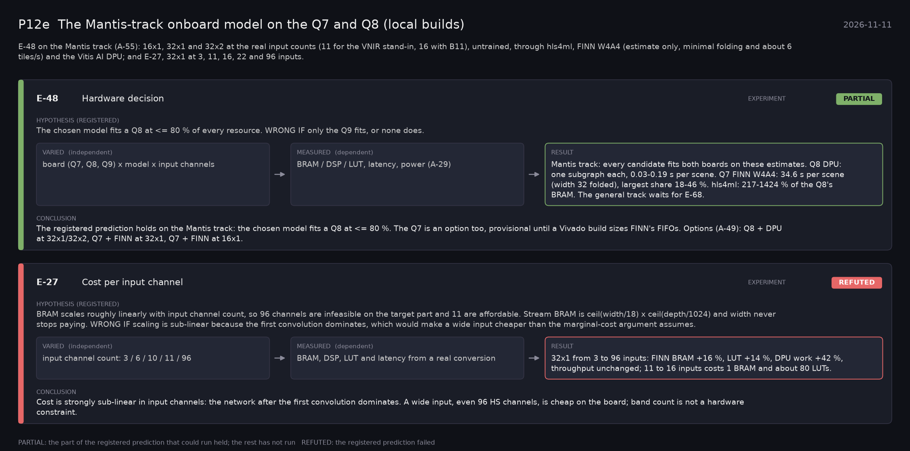

# P12e: The Mantis-track onboard model on the Q7 and Q8 (local builds) (2026-11-11)

What this phase ran and concluded. Generated by `scripts/make_phase_docs.py` from `src/safari_bands/phases.py`; registered hypotheses are quoted from the register, verbatim. Full results: [README.md](README.md).

E-48 on the Mantis track (A-55): 16x1, 32x1 and 32x2 at the real input counts (11 for the VNIR stand-in, 16 with B11), untrained, through hls4ml, FINN W4A4 (estimate only, minimal folding and about 6 tiles/s) and the Vitis AI DPU; and E-27, 32x1 at 3, 11, 16, 22 and 96 inputs.

## E-48: Hardware decision (experiment): **PARTIAL**

| | |
|---|---|
| Hypothesis (registered) | The chosen model fits a Q8 at <= 80 % of every resource. WRONG IF only the Q9 fits, or none does. |
| Varied (independent) | board (Q7, Q8, Q9) x model x input channels |
| Measured (dependent) | BRAM / DSP / LUT, latency, power (A-29) |
| Result | Mantis track: every candidate fits both boards on these estimates. Q8 DPU: one subgraph each, 0.03-0.19 s per scene. Q7 FINN W4A4: 34.6 s per scene (width 32 folded), largest share 18-46 %. hls4ml: 217-1424 % of the Q8's BRAM. The general track waits for E-68. |
| Verdict | **PARTIAL**: the part of the registered prediction that could run held; the rest has not run |
| Conclusion | The registered prediction holds on the Mantis track: the chosen model fits a Q8 at <= 80 %. The Q7 is an option too, provisional until a Vivado build sizes FINN's FIFOs. Options (A-49): Q8 + DPU at 32x1/32x2, Q7 + FINN at 32x1, Q7 + FINN at 16x1. |

## E-27: Cost per input channel (experiment): **REFUTED**

| | |
|---|---|
| Hypothesis (registered) | BRAM scales roughly linearly with input channel count, so 96 channels are infeasible on the target part and 11 are affordable. Stream BRAM is ceil(width/18) x ceil(depth/1024) and width never stops paying. WRONG IF scaling is sub-linear because the first convolution dominates, which would make a wide input cheaper than the marginal-cost argument assumes. |
| Varied (independent) | input channel count: 3 / 6 / 10 / 11 / 96 |
| Measured (dependent) | BRAM, DSP, LUT and latency from a real conversion |
| Result | 32x1 from 3 to 96 inputs: FINN BRAM +16 %, LUT +14 %, DPU work +42 %, throughput unchanged; 11 to 16 inputs costs 1 BRAM and about 80 LUTs. |
| Verdict | **REFUTED**: the registered prediction failed |
| Conclusion | Cost is strongly sub-linear in input channels: the network after the first convolution dominates. A wide input, even 96 HS channels, is cheap on the board; band count is not a hardware constraint. |
