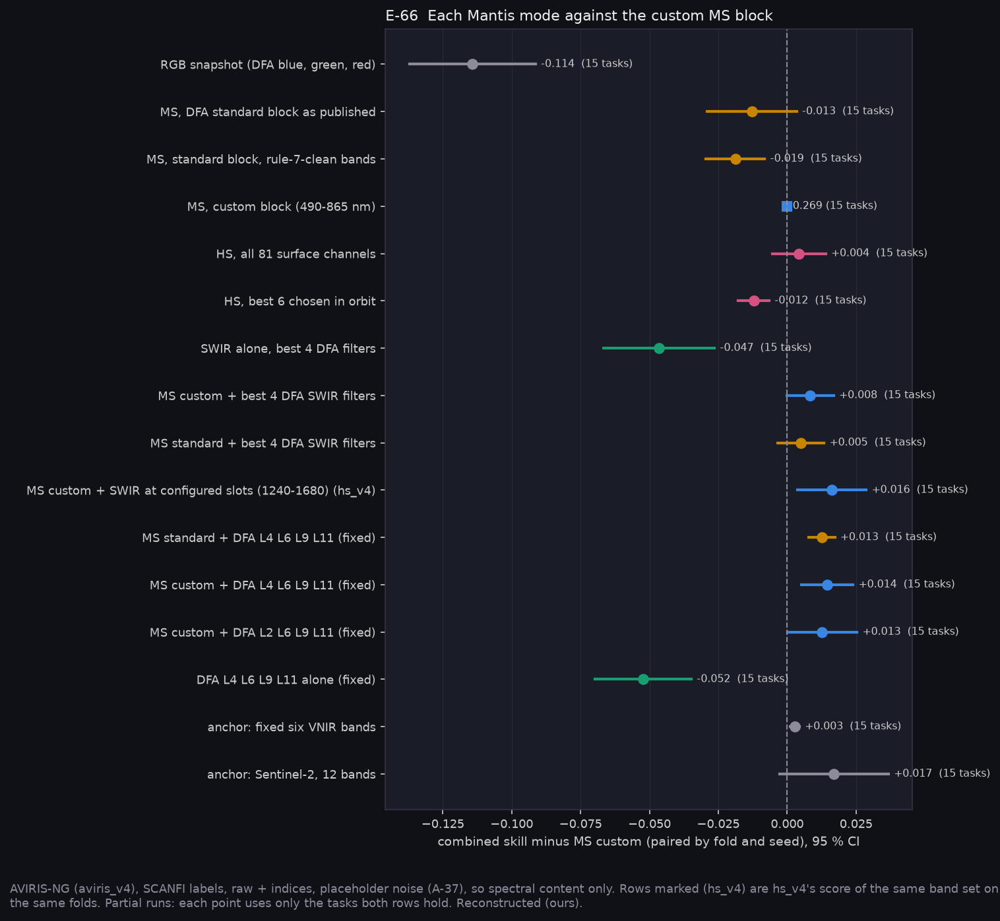

# P12b: what each Dragonfly Mantis mode would offer (E-66)

Run on Narval: `narval_results/sensors_v1/20261106-1218`, 75 of 75 tasks (5 arms × 5 folds × 3 seeds), on `aviris_v4`. The pack, folds and seeds are hs_v4's, and every task's pixels match hs_v4's, so all rows pair by fold and seed. The follow-up `narval_results/sensors_fixed/20261106-1645` (15 of 15 tasks, same pack, folds and seeds) scores DFA's SWIR filters as fixed sets. Labels are SCANFI (percent conifer, closure, height, fuel family). Inputs are raw + indices with placeholder sensor noise (A-37). Mantis publishes no SNR, so this compares spectral content only. All values are Reconstructed (ours).

**At a glance:** [experiments.md](experiments.md). Tables: [T_sensors.csv](T_sensors.csv) (rows, with the datasheet columns), [T_predictions.csv](T_predictions.csv), [T_filters.csv](T_filters.csv) (which filters the searches chose), [T_fixed_filters.csv](T_fixed_filters.csv) (the fixed-filter contrasts).

```bash
python scripts/make_sensor_options.py --run narval_results/sensors_v1/20261106-1218 \n    --fixed narval_results/sensors_fixed/20261106-1645
python scripts/make_phase_docs.py --phase P12b
```



## The rows

| Mantis configuration | Combined skill | Note |
|---|---|---|
| RGB snapshot (DFA blue, green, red) | 0.155 | the floor |
| SWIR alone, best 4 DFA filters | 0.223 | |
| MS, DFA standard block, rule-7-clean bands (480, 545, 660, 900) | 0.250 | |
| MS, DFA standard block as published (+ pan, 780) | 0.256 | |
| HS, best 6 chosen in orbit | 0.257 | searched per fold |
| MS, custom block (490, 560, 665, 705, 740, 865) | 0.269 | |
| HS, all 81 surface channels | 0.273 | |
| MS standard + best 4 DFA SWIR filters | 0.274 | searched per fold |
| MS custom + best 4 DFA SWIR filters | 0.277 | searched per fold |
| MS custom + SWIR at the configured slots 1240, 1550, 1610, 1680 | **0.285** | fixed set (hs_v4) |
| Sentinel-2, 12 bands (anchor) | 0.286 | |

## Registered predictions (E-66)

| Prediction | Paired difference [95 % CI] | Verdict |
|---|---|---|
| 1. Custom MS block beats the standard block | +0.013 [−0.003, +0.029] | **REFUTED** as registered (CI reaches 0) |
| 2. MS custom beats SWIR alone | +0.047 [+0.026, +0.067] | **SUPPORTED** |
| 3. All HS channels within one SE of MS custom | +0.004 [−0.005, +0.014] | **SUPPORTED** |
| 4. MS custom + searched DFA SWIR beats MS custom | +0.008 [−0.000, +0.017] | **REFUTED** as registered (CI reaches 0) |
| 5. RGB below every MS row | −0.095 vs the lowest MS row | **SUPPORTED** |

## What it means

- **MS, not SWIR, if only one.** The MS custom block beats SWIR alone by 0.047. SWIR alone still beats RGB by 0.068, since DFA's 1059 nm filter stands in for NIR.
- **The custom block's gain over the standard block is smaller than expected** (+0.013, CI reaching 0). The standard block lacks red edge and 865 nm, but its broad pan and 780 nm bands recover part of that. All 81 HS channels beat the standard block by +0.017 [+0.011, +0.024]. The custom block remains the better choice on point estimate; as registered, the advantage is not shown.
- **More HS channels add almost nothing over 6 well-placed bands** (+0.004). Choosing 6 HS channels in orbit by search does worse than the custom block (−0.012 [−0.018, −0.007]): with 81 neighbouring channels, the search overfits its split.
- **SWIR does add to MS, at a fixed filter set.** Prediction 4 fails with *searched* filters, where each fold picks its own four and search noise costs about what SWIR gains (the same issue Q38 settled for bands). At the fixed configured slots, SWIR adds +0.016 [+0.004, +0.029] over MS custom. That set (1240/20, 1550/40, 1610/40, 1680/40) is also the best standard-InGaAs option in the AVIRIS-NG consensus re-score ([P12/p12_bands](../p12_bands/README.md)). It is 0.004 below the extended-InGaAs best, and ahead of every searched or consensus standard placement.
- **Which DFA filters.** On the custom block, L6 (1557/45), L9 (1599/43) and L11 (1674/39) are each in 10 of 15 searches. The fourth slot varies: L2 or L1 near 1060, or L3 near 1190. DFA's nearest filters to the configured slots are L4 (1213/83), L6, L9 and L11.

## DFA's SWIR filters as fixed sets (sensors_fixed, 2026-11-09)

Each block plus DFA's four filters nearest the configured slots (L4 1213/83, L6 1557/45, L9 1599/43, L11 1674/39), scored as one fixed set. The three anchors rerun here (the custom block, the standard block and the configured MS + SWIR set) reproduce their sensors_v1 and hs_v4 scores exactly on every task, so the rows pair cleanly.

| Mantis configuration | Combined skill |
|---|---|
| MS standard block alone | 0.256 |
| MS standard + L4 L6 L9 L11 | **0.282** |
| MS custom + L4 L6 L9 L11 | 0.284 |
| MS custom + L2 L6 L9 L11 (the searches' consensus) | 0.282 |
| MS custom + the configured slots 1240, 1550, 1610, 1680 | 0.285 |
| L4 L6 L9 L11 alone | 0.217 |
| Sentinel-2, 12 bands (anchor) | 0.286 |

| Contrast (paired, fold and seed) | Difference [95 % CI] |
|---|---|
| SWIR on the standard block | **+0.025 [+0.006, +0.045]** |
| SWIR on the custom block | +0.015 [+0.005, +0.024] |
| Custom against standard block, both with SWIR | +0.002 [−0.004, +0.008] |
| DFA's nearest filters against the configured slots | −0.002 [−0.005, +0.002] |
| Consensus filters (L2) against nearest (L4) | −0.002 [−0.005, +0.002] |
| Fixed against searched filters, custom block | +0.006 [+0.001, +0.012] |
| Fixed against searched filters, standard block | +0.008 [−0.002, +0.017] |
| Standard MS alone against the four filters alone | +0.040 [+0.012, +0.067] |

- **SWIR helps once its filters are fixed.** Four DFA filters add 0.025 to the standard block and 0.015 to the custom one. Searched per fold (sensors_v1), the same gain was lost to search noise. Fixing the filters recovers 0.006–0.008 of it.
- **With SWIR, the filter block stops mattering.** Custom and standard blocks are within 0.002 of each other. SWIR supplies what the custom block's red edge added, so the standard block plus four filters reaches the Sentinel-2 12-band skill (0.282 against 0.286).
- **DFA's off-the-shelf filters are as good as the configured slots.** L4/L6/L9/L11 is within 0.002 of the ideal 1240/1550/1610/1680 set, and swapping L4 for the consensus L2 changes nothing. No custom SWIR filter is needed.
- **For CUBICS (VNIR-only, standard block):** the SWIR mode is worth 0.025 combined skill, about 10 % of the standard block's score. That is the cost of leaving it out, set against the second Mantis chain (≈6 W, 0.5 kg, 1U and a co-registration task). It is an option for James, not a recommendation (A-49).

## Limits

- Spectral only: GSD (Mantis MS 32 m against 20 m labels), swath and SNR are not modelled (Q40).
- The RGB row uses DFA's MS blue, green and red as a proxy for the Bayer filters.
- SCANFI labels are mapped from Landsat; the plot and lidar checks of P6/p6a_external_labels_v2 are not repeated per sensor.

<!-- qual:start -->
## Qualitative view per experiment

- **E-66** What each Dragonfly Mantis mode would offer (band placement): [qual_E-66_sensor_bands.png](qual_E-66_sensor_bands.png)
<!-- qual:end -->
