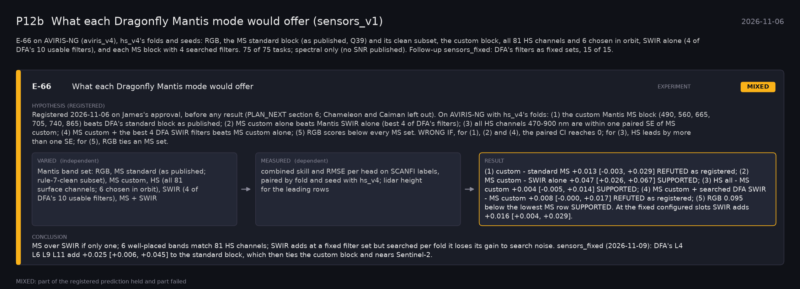

# P12b: What each Dragonfly Mantis mode would offer (sensors_v1) (2026-11-06)

What this phase ran and concluded. Generated by `scripts/make_phase_docs.py` from `src/safari_bands/phases.py`; registered hypotheses are quoted from the register, verbatim. Full results: [README.md](README.md).

E-66 on AVIRIS-NG (aviris_v4), hs_v4's folds and seeds: RGB, the MS standard block (as published, Q39) and its clean subset, the custom block, all 81 HS channels and 6 chosen in orbit, SWIR alone (4 of DFA's 10 usable filters), and each MS block with 4 searched filters. 75 of 75 tasks; spectral only (no SNR published). Follow-up sensors_fixed: DFA's filters as fixed sets, 15 of 15.

## E-66: What each Dragonfly Mantis mode would offer (experiment): **MIXED**

| | |
|---|---|
| Hypothesis (registered) | Registered 2026-11-06 on James's approval, before any result (PLAN_NEXT section 6; Chameleon and Caiman left out). On AVIRIS-NG with hs_v4's folds: (1) the custom Mantis MS block (490, 560, 665, 705, 740, 865) beats DFA's standard block as published; (2) MS custom alone beats Mantis SWIR alone (best 4 of DFA's filters); (3) all HS channels 470-900 nm are within one paired SE of MS custom; (4) MS custom + the best 4 DFA SWIR filters beats MS custom alone; (5) RGB scores below every MS set. WRONG IF, for (1), (2) and (4), the paired CI reaches 0; for (3), HS leads by more than one SE; for (5), RGB ties an MS set. |
| Varied (independent) | Mantis band set: RGB, MS standard (as published; rule-7-clean subset), MS custom, HS (all 81 surface channels; 6 chosen in orbit), SWIR (4 of DFA's 10 usable filters), MS + SWIR |
| Measured (dependent) | combined skill and RMSE per head on SCANFI labels, paired by fold and seed with hs_v4; lidar height for the leading rows |
| Result | (1) custom - standard MS +0.013 [-0.003, +0.029] REFUTED as registered; (2) MS custom - SWIR alone +0.047 [+0.026, +0.067] SUPPORTED; (3) HS all - MS custom +0.004 [-0.005, +0.014] SUPPORTED; (4) MS custom + searched DFA SWIR - MS custom +0.008 [-0.000, +0.017] REFUTED as registered; (5) RGB 0.095 below the lowest MS row SUPPORTED. At the fixed configured slots SWIR adds +0.016 [+0.004, +0.029]. |
| Verdict | **MIXED**: part of the registered prediction held and part failed |
| Conclusion | MS over SWIR if only one; 6 well-placed bands match 81 HS channels; SWIR adds at a fixed filter set but searched per fold it loses its gain to search noise. sensors_fixed (2026-11-09): DFA's L4 L6 L9 L11 add +0.025 [+0.006, +0.045] to the standard block, which then ties the custom block and nears Sentinel-2. |
