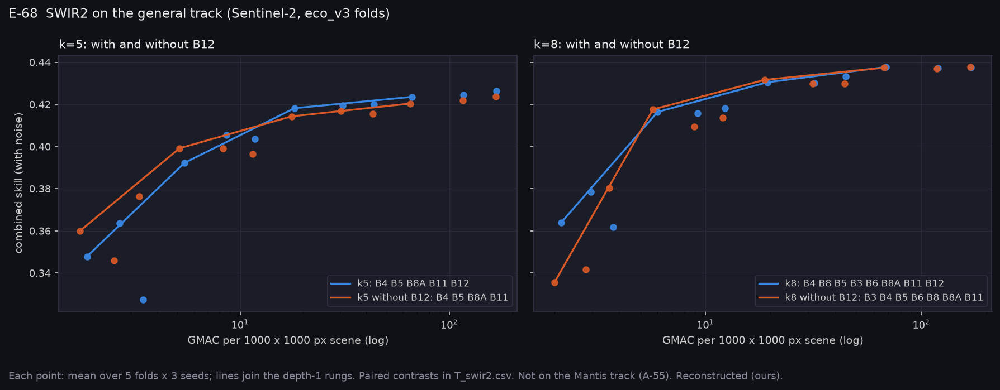

# P12f: what SWIR2 (B12) adds on the general track (E-68, 2026-11-11)

E-68 prices SWIR2 on the general (Sentinel-2) track only (A-55): SWIR2 will most likely not fly, so it is kept out of every Mantis run.

The two consensus sets were each run with and without B12:
- k = 5 (B4 B5 B8A B11 B12);
- k = 8 (B3 B4 B5 B6 B8 B8A B11 B12).

Each ran through E-47's U-Net size ladder (12 sizes, 5 folds × 3 seeds). All four ladders share eco_v3's folds and seeds, so every rung pairs. All values are Reconstructed (ours).

**Runs:**
- `narval_results/arch_k5/20261109-2213` and `arch_k8/20261109-2213`, with B12;
- `arch_k5_no_b12/20261111-0021` and `arch_k8_no_b12/20261111-0021`, without B12, each 15/15.

**At a glance:** [T_swir2.csv](T_swir2.csv), [T_ladders.csv](T_ladders.csv), [summary.json](summary.json).



## Result

The prediction, registered before the run: B12 raises the best rung's skill in both pairs. It is wrong if either pair's CI reaches 0.

| Pair | Best rung without B12 − best rung with | At 8 × 2 | At 16 × 1 | At 32 × 1 |
|---|---|---|---|---|
| k = 5 | **−0.0025** [−0.0041, −0.0009] (both 32 × 3) | −0.0064 [−0.0130, +0.0002] | −0.0039 [−0.0076, −0.0001] | −0.0032 [−0.0067, +0.0004] |
| k = 8 | **+0.0001** [−0.0015, +0.0018] (32 × 3 vs 32 × 1) | −0.0062 [−0.0114, −0.0010] | +0.0011 [−0.0010, +0.0032] | −0.0003 [−0.0027, +0.0021] |

**E-68: REFUTED** as registered: the k = 8 pair's CI reaches 0. The k = 5 half holds.

**What it means:**
- **B12 adds a little to the five-band set and nothing to the eight-band set at its best size.** With B3, B6 and B8 present, the larger networks recover what B12 carried.
- **B12 matters most for a small model.** At 8 × 2, the size every band search used, it is worth about 0.006 in both sets. That is why the searches ranked it so highly (B12 is the stable k = 1 choice, E-46).
- **At the smallest widths (base_ch 4) the five-band set is better without B12** (see the figure). B12's value appears only once the network is wide enough to use it.
- **For P12's options table (A-49):**

  | Option | Pros | Cons |
  |---|---|---|
  | A SWIR2 band | worth about 0.0025 on the best k = 5 model, about 0.006 on an 8 × 2 model | worth nothing on the best k = 8 model; needs extended InGaAs, on no Mantis mode |

  The general track's best model reaches 0.438 (k = 8, 32 × 1) with or without B12.

## Limits

- Sentinel-2 bands and SCANFI labels; the sensor noise is a placeholder (A-37).
- B12 is a 180 nm-wide band. A narrower SWIR2 filter, or one placed differently, was not tested here; on AVIRIS-NG, the extended-InGaAs consensus (1530, 1690, 1990, 2270 nm) and config C tie at the top (E-46).

## Reproduce

```bash
python scripts/make_swir2_package.py --k5 narval_results/arch_k5/20261109-2213 \
    --k5-no-b12 narval_results/arch_k5_no_b12/20261111-0021 \
    --k8 narval_results/arch_k8/20261109-2213 --k8-no-b12 narval_results/arch_k8_no_b12/20261111-0021
python scripts/make_phase_docs.py --phase P12f
```
