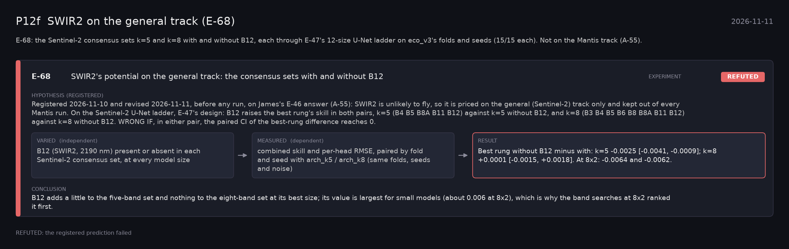

# P12f: SWIR2 on the general track (E-68) (2026-11-11)

What this phase ran and concluded. Generated by `scripts/make_phase_docs.py` from `src/safari_bands/phases.py`; registered hypotheses are quoted from the register, verbatim. Full results: [README.md](README.md).

E-68: the Sentinel-2 consensus sets k=5 and k=8 with and without B12, each through E-47's 12-size U-Net ladder on eco_v3's folds and seeds (15/15 each). Not on the Mantis track (A-55).

## E-68: SWIR2's potential on the general track: the consensus sets with and without B12 (experiment): **REFUTED**

| | |
|---|---|
| Hypothesis (registered) | Registered 2026-11-10 and revised 2026-11-11, before any run, on James's E-46 answer (A-55): SWIR2 is unlikely to fly, so it is priced on the general (Sentinel-2) track only and kept out of every Mantis run. On the Sentinel-2 U-Net ladder, E-47's design: B12 raises the best rung's skill in both pairs, k=5 (B4 B5 B8A B11 B12) against k=5 without B12, and k=8 (B3 B4 B5 B6 B8 B8A B11 B12) against k=8 without B12. WRONG IF, in either pair, the paired CI of the best-rung difference reaches 0. |
| Varied (independent) | B12 (SWIR2, 2190 nm) present or absent in each Sentinel-2 consensus set, at every model size |
| Measured (dependent) | combined skill and per-head RMSE, paired by fold and seed with arch_k5 / arch_k8 (same folds, seeds and noise) |
| Result | Best rung without B12 minus with: k=5 -0.0025 [-0.0041, -0.0009]; k=8 +0.0001 [-0.0015, +0.0018]. At 8x2: -0.0064 and -0.0062. |
| Verdict | **REFUTED**: the registered prediction failed |
| Conclusion | B12 adds a little to the five-band set and nothing to the eight-band set at its best size; its value is largest for small models (about 0.006 at 8x2), which is why the band searches at 8x2 ranked it first. |
