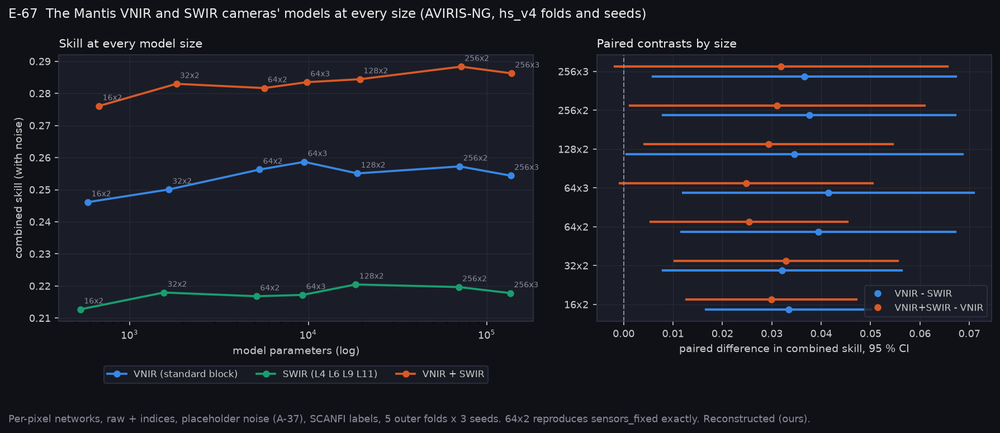

# P12d: the Mantis VNIR camera's model against the SWIR camera's model (E-67)

Run on Narval: `narval_results/hs_arch/20261109-2213`, 15 of 15 tasks (5 outer folds × 3 seeds) on `aviris_v4`, with hs_v4's folds and seeds. Each task trains three cameras at seven sizes of the per-pixel network (16×2 to 256×3, hidden units × layers), in raw + indices, with and without noise:
- VNIR, the standard block with the panchromatic band;
- SWIR, Dragonfly filters L4, L6, L9 and L11;
- both together.

**Anchor:** the 64×2 rows, the size every band search used, reproduce `sensors_fixed` exactly on every task (max difference 0.0). The Sentinel-2 half, prediction 4, is in [P12/p12_arch](../p12_arch/README.md). Labels are SCANFI and the sensor noise is a placeholder (A-37). All values are Reconstructed (ours).

**At a glance:** [experiments.md](experiments.md). Tables: [T_ladder.csv](T_ladder.csv) (every camera × size: parameters, MACs, skill, per-head errors), [T_contrasts.csv](T_contrasts.csv), [T_predictions.csv](T_predictions.csv).

```bash
python scripts/make_vnir_swir_package.py --run narval_results/hs_arch/20261109-2213
python scripts/make_phase_docs.py --phase P12d
```



## Registered predictions (2026-11-10, before any run)

| Prediction | Result | Verdict |
|---|---|---|
| 1. VNIR beats SWIR alone at every size | +0.032 to +0.042 at every size; the lowest CI bound is +0.001 (128×2) | **SUPPORTED** |
| 2. VNIR + SWIR beats VNIR at the largest size (256×3) | +0.032 [−0.002, +0.066] | **REFUTED**, narrowly |
| 3. Each camera's best size within 0.005 of 64×2 | VNIR +0.002 (64×3), SWIR +0.004 (128×2), both +0.007 (256×2) | **REFUTED** by the combined camera |
| 4. Adding B11 to the Sentinel-2 VNIR stand-in raises the best rung | +0.013 [+0.010, +0.016] | **SUPPORTED** |

**E-67: MIXED.**

## Each camera at its best size

| Camera | Best size | Parameters | Skill | Conifer RMSE (pts) | Closure RMSE (pts) | Height RMSE (m) | Family bal. acc. |
|---|---|---|---|---|---|---|---|
| SWIR (L4 L6 L9 L11) | 128×2 | 18 k | 0.220 | 26.0 | 17.3 | 4.05 | 0.44 |
| VNIR (standard block) | 64×3 | 9.5 k | 0.259 | 24.2 | 16.3 | 3.97 | 0.48 |
| VNIR + SWIR | 256×2 | 72 k | **0.288** | 24.0 | 15.2 | 3.77 | 0.49 |

## What it means

- **VNIR beats SWIR at every model size.** A larger network does not let the SWIR camera catch up: its best size is 0.039 behind VNIR's.
- **Adding SWIR helps by about the same amount at every size:** +0.025 to +0.033, and +0.031 [+0.001, +0.061] at 256×2. The registered test at 256×3 misses by 0.002 because VNIR's skill varies more between folds at that size, not because the gain shrinks.
- **Model size matters little on the hyperspectral data.** Each camera's per-pixel model is within 0.007 of 64×2, and the combined camera gains most from size. On Sentinel-2 tiles the U-Net gains up to 0.02 from width ([P12/p12_arch](../p12_arch/README.md)), so the onboard model's size is set by the spatial network, not this one.
- **On Sentinel-2, B11's gain depends on model size:** +0.004 at 8×2 (not significant), +0.013 at each set's best size. The earlier reading, that VNIR alone costs only 0.004 against the stable SWIR set, was a small-model result.
- **Where SWIR helps** ([qual_E-67_family_confusion.png](qual_E-67_family_confusion.png)): SWIR alone separates open ground better than VNIR (0.64 against 0.57 correct), and slash (S) far better. VNIR separates broadleaf (D) and mixedwood from conifer better. Together they keep both strengths.

## For the CubeSat (A-49: options, James chooses)

| Option | Combined skill (AVIRIS-NG, best size) | Notes |
|---|---|---|
| VNIR only | 0.259 | TRL 9; the baseline |
| VNIR + SWIR | 0.288 (+0.029) | second focal plane; SWIR geometry and TRL to confirm |
| SWIR only | 0.220 (−0.039) | worse on every product; not an option on this evidence |

## Limits

- Per-pixel networks on AVIRIS-NG pixels: spectral content only, no spatial context. The U-Net ladders are on Sentinel-2, where the SWIR camera's filters have one counterpart (B11).
- Placeholder noise, SCANFI labels, and the panchromatic band at the AVIRIS-NG pixel size.

<!-- qual:start -->
## Qualitative view per experiment

- **E-67** VNIR against SWIR: the Mantis cameras' models at every size (family confusion): [qual_E-67_family_confusion.png](qual_E-67_family_confusion.png)
<!-- qual:end -->
