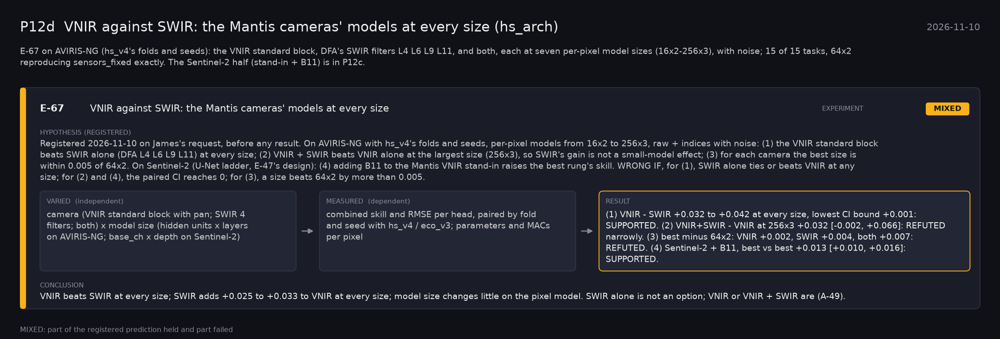

# P12d: VNIR against SWIR: the Mantis cameras' models at every size (hs_arch) (2026-11-10)

What this phase ran and concluded. Generated by `scripts/make_phase_docs.py` from `src/safari_bands/phases.py`; registered hypotheses are quoted from the register, verbatim. Full results: [README.md](README.md).

E-67 on AVIRIS-NG (hs_v4's folds and seeds): the VNIR standard block, DFA's SWIR filters L4 L6 L9 L11, and both, each at seven per-pixel model sizes (16x2-256x3), with noise; 15 of 15 tasks, 64x2 reproducing sensors_fixed exactly. The Sentinel-2 half (stand-in + B11) is in P12c.

## E-67: VNIR against SWIR: the Mantis cameras' models at every size (experiment): **MIXED**

| | |
|---|---|
| Hypothesis (registered) | Registered 2026-11-10 on James's request, before any result. On AVIRIS-NG with hs_v4's folds and seeds, per-pixel models from 16x2 to 256x3, raw + indices with noise: (1) the VNIR standard block beats SWIR alone (DFA L4 L6 L9 L11) at every size; (2) VNIR + SWIR beats VNIR alone at the largest size (256x3), so SWIR's gain is not a small-model effect; (3) for each camera the best size is within 0.005 of 64x2. On Sentinel-2 (U-Net ladder, E-47's design): (4) adding B11 to the Mantis VNIR stand-in raises the best rung's skill. WRONG IF, for (1), SWIR alone ties or beats VNIR at any size; for (2) and (4), the paired CI reaches 0; for (3), a size beats 64x2 by more than 0.005. |
| Varied (independent) | camera (VNIR standard block with pan; SWIR 4 filters; both) x model size (hidden units x layers on AVIRIS-NG; base_ch x depth on Sentinel-2) |
| Measured (dependent) | combined skill and RMSE per head, paired by fold and seed with hs_v4 / eco_v3; parameters and MACs per pixel |
| Result | (1) VNIR - SWIR +0.032 to +0.042 at every size, lowest CI bound +0.001: SUPPORTED. (2) VNIR+SWIR - VNIR at 256x3 +0.032 [-0.002, +0.066]: REFUTED narrowly. (3) best minus 64x2: VNIR +0.002, SWIR +0.004, both +0.007: REFUTED. (4) Sentinel-2 + B11, best vs best +0.013 [+0.010, +0.016]: SUPPORTED. |
| Verdict | **MIXED**: part of the registered prediction held and part failed |
| Conclusion | VNIR beats SWIR at every size; SWIR adds +0.025 to +0.033 to VNIR at every size; model size changes little on the pixel model. SWIR alone is not an option; VNIR or VNIR + SWIR are (A-49). |
