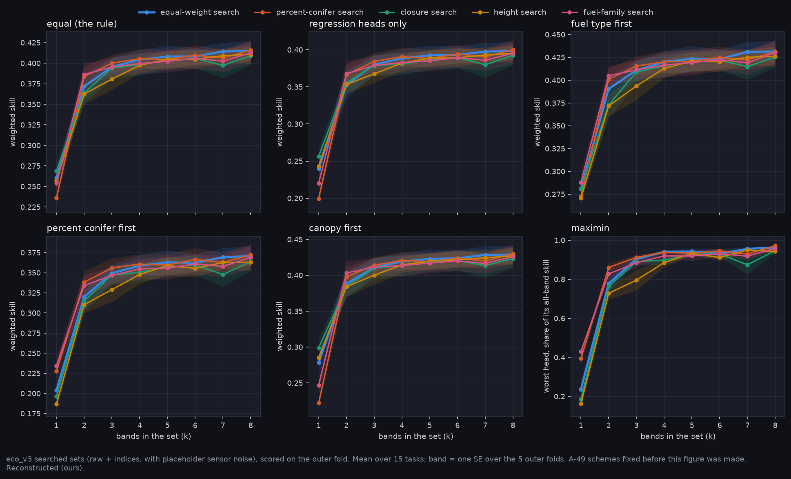

# P12 input: does the band choice depend on how the structure heads are weighted? (A-49)

James (2026-11-05): weigh the four structure heads equally, and try other weightings where feasible. This note does that on data already held: eco_v3's searched band sets (`narval_results/eco_v3/20261102-1959`, 15 tasks: 5 outer folds × 3 seeds), raw + indices, with placeholder sensor noise (A-37). No new run. All values are Reconstructed (ours).

Generated with:

```bash
python scripts/compare_head_weights.py --run narval_results/eco_v3/20261102-1959
```

Tables: [T_weight_decisions.csv](T_weight_decisions.csv) (one row per scheme) and [T_weights.csv](T_weights.csv) (every scheme × search × k).

## What was compared

eco_v3 ran five greedy searches per task: one on the equal-weight combined skill and one per head (percent conifer, closure, height, fuel family). Every searched set was scored on the outer fold for all four heads. Each set is re-scored here under six schemes, fixed in A-49 before the first output:

| scheme | percent conifer | closure | height | fuel family |
|---|---|---|---|---|
| **equal (the rule)** | 1/4 | 1/4 | 1/4 | 1/4 |
| regression heads only | 1/3 | 1/3 | 1/3 | 0 |
| fuel type first | 1/6 | 1/6 | 1/6 | 1/2 |
| percent conifer first | 1/2 | 1/6 | 1/6 | 1/6 |
| canopy first | 1/6 | 1/3 | 1/3 | 1/6 |
| maximin | the worst head's skill, as a share of its all-band skill | | | |

Ties are paired: a set is tied with the best when the paired difference (same fold and seed) is at most one SE of that difference, with the SE taken over the 5 outer folds. The tie test was changed to this after the first output, from an unpaired SE dominated by fold difficulty; no equal-search verdict changed (A-49).

## What it found



| scheme | best set (search, k) | equal-weight search's best, minus the best (paired) | tied with the best? |
|---|---|---|---|
| equal (the rule) | percent-conifer search, k = 8 | −0.0008 ± 0.0020 | yes |
| regression heads only | percent-conifer search, k = 8 | −0.0018 ± 0.0023 | yes |
| fuel type first | equal-weight search, k = 8 | 0 | is the best |
| percent conifer first | percent-conifer search, k = 8 | −0.0014 ± 0.0024 | yes |
| canopy first | percent-conifer search, k = 8 | −0.0010 ± 0.0021 | yes |
| maximin | percent-conifer search, k = 8 | −0.0088 ± 0.0088 | no, by a hair |

- **The weighting barely moves the choice.** Under five of six schemes the equal-weight search's best set is tied with the overall best.
- **Every winning set carries SWIR (B11 or B12) and a red-edge band**, in all 15 tasks, under every scheme.
- **The best sets are 7–8 bands under every scheme.** Skill rises steeply to k = 2, then flattens. Under equal weights, the equal-weight search's smaller sets against the best (paired):
  - k = 7: −0.0015 ± 0.0022, tied;
  - k = 5: −0.0078 ± 0.0038, and k = 6: −0.0076 ± 0.0046, about two SEs below;
  - k = 4: −0.0115 ± 0.0007, clearly below.
  
  So 5- and 6-band sets will appear in E-46 as options with a stated margin of about 0.008, not as ties.
- **Maximin prefers the percent-conifer search's sets.** That search protects percent conifer, the hardest head, and maximin scores the worst head. The gap is the size of its own SE.
- **The searches rarely agree on a whole set** (most common 8-band set: 2 of 15 searches), which is Q38's question.

## Limits

- Only the five searched paths are ranked. A search run under another scheme could find a set none of them holds, so a non-equal scheme's best here is a lower bound. A weighted selector in `run_eco_search.py` would close that gap; it is not built.
- Sentinel-2 bands only. SWIR placement comes from AVIRIS-NG (A-49), which these numbers do not touch.
- SCANFI labels, mapped from Landsat (Q35). Placeholder noise.
- No CFFDRS-value weighting. The slot values that would set it are near zero or unmeasured (E-35 pending, E-36 and E-37 AT RISK, E-39 blocked).
