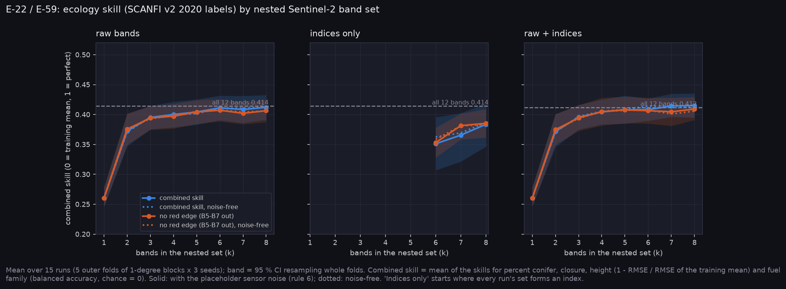
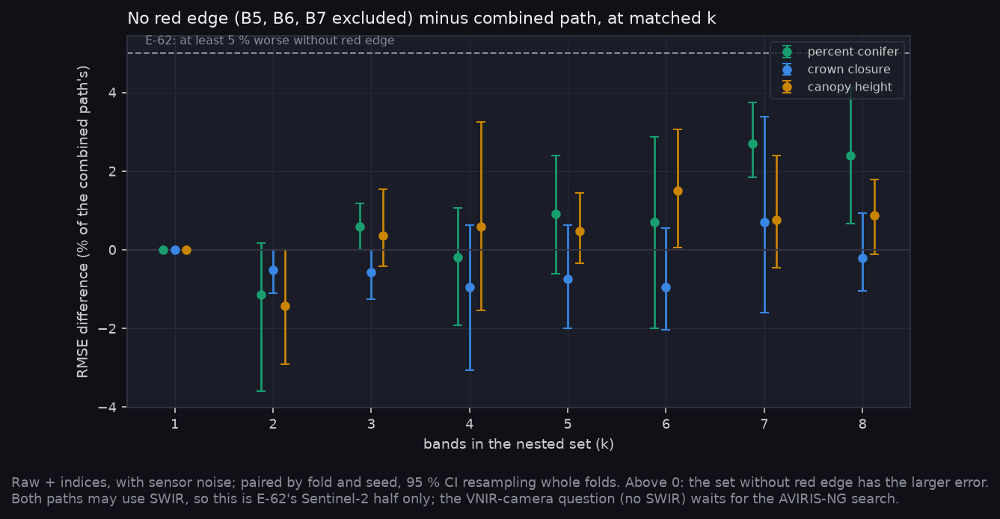
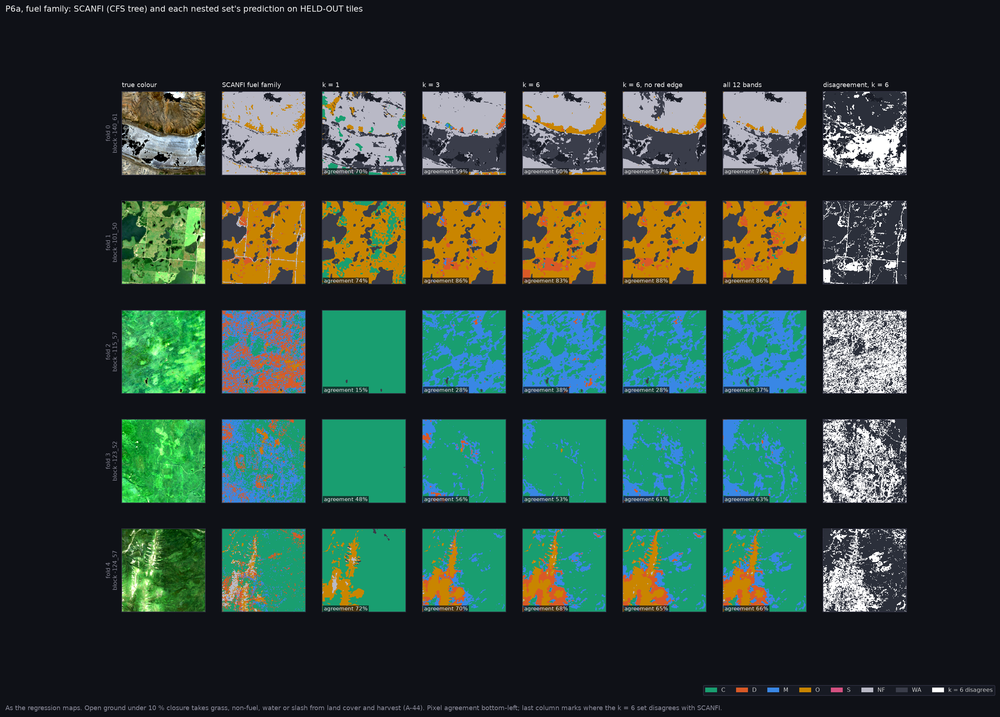

# P6a, eco_v3: the ecology band searches on the corrected family labels

Run on Nibi: `narval_results/eco_v3/20261102-1959`, complete: 15 of 15 tasks (5 outer folds of 1-degree blocks x 3 seeds), with the sensor noise model (placeholder, A-37). Prediction maps for all three input modes. The frozen test set was not opened. This package replaces the provisional seed-0 package of 2026-11-03.

`eco_v3` repeats `eco_v2` (`../p6a_ecology/`) on `ecology_v3`: the same tiles, bands, targets and split, with open ground no longer coded D (A-44). Below 10 % closure, pixels now go to grass (O), non-fuel (NF) or water (WA) by SCANFI land cover, and recent cuts are slash (S).

**At a glance:** [experiments.md](experiments.md). Tables: [tables.md](tables.md).

Generated with:

```bash
python scripts/make_results_package.py --phase P6a --run narval_results/eco_v3/20261102-1959     --eco-pack ../../Fire_Risk_Model/data/ecology_v3/dev.h5 --out docs/results/P6/p6a_ecology_v3
python scripts/make_phase_docs.py --phase P6a-v3
```

The maps come from `sweep_eco_maps.sh` on this run (`maps/` raw + indices, `maps_raw/`, `maps_indices/`), one held-out tile per fold, seed 0.

## What it found



**E-22 holds: SUPPORTED.** The first SWIR band enters the combined path at step 1 in 11 of 15 runs (B12 each time), and at step 3 in the other 4; median 1, against a falsifier at 3.5. Per head, closure opens with B12 in 15 of 15, percent conifer with red edge (B7 47 %, B6 27 %), height with B5 or B12, and fuel family with NIR (B8 80 %).

**E-59 stays MIXED.** Raw + indices beats raw on combined skill only at k = 8, by +0.0030 [+0.0006, +0.0057]. At k <= 4 no combined difference clears 0, the opposite of "most at small k". Indices alone are worse wherever they form: 0.351 against 0.411 at k = 6.

**E-62, Sentinel-2 half: REFUTED.** Red edge is in all 15 best 6-band sets, but removing B5-B7 at k = 6 changes percent-conifer RMSE by +0.7 % [-2.0, +2.9] and closure by -0.9 % [-2.0, +0.5], far inside 5 %. The loss appears only at k = 7-8 on percent conifer (+2.7 % and +2.4 %, CIs above 0). The AVIRIS-NG half (hs_v4) gave the same answer.



**The continuous targets match eco_v2; fuel family does not.** Raw + indices with noise, all seeds:

| nested set | percent conifer RMSE | closure RMSE | height RMSE | family balanced accuracy |
|---|---|---|---|---|
| k = 1 | 29.1 -> 28.7 | 18.0 -> 18.2 | 5.38 -> 5.45 | 0.60 -> 0.42 |
| k = 6 | 22.6 -> 23.1 | 13.9 -> 13.8 | 4.57 -> 4.53 | 0.72 -> 0.53 |
| all 12 | 22.3 -> 23.0 | 13.8 -> 13.7 | 4.49 -> 4.49 | 0.73 -> 0.53 |

The family drop is the label change, not the model. eco_v2's 0.73 mostly measured forest against open ground, because most open ground was D. With seven real classes, the per-class table (k = 8) shows where it fails:

| family | share of pixels | recall | precision |
|---|---|---|---|
| C conifer | 21 % | 0.79 | 0.65 |
| D deciduous | 10 % | 0.38 | 0.53 |
| M mixedwood | 11 % | 0.30 | 0.52 |
| O grass | 34 % | 0.86 | 0.75 |
| S slash | 0.2 % | 0.00 | -- |
| NF non-fuel | 10 % | 0.52 | 0.70 |
| WA water | 15 % | 0.96 | 0.95 |



The maps show the same thing. In fold 2, SCANFI marks most of the tile deciduous or mixedwood, and every set calls it conifer or mixedwood. The percent-conifer map over-predicts across that tile ([maps_pc.png](maps_pc.png)). In the mountain tile (fold 0), bare gravel that SCANFI calls non-fuel is predicted as water.

**Input modes look alike on the maps.** Raw-only and indices-only maps ([maps_pc_raw.png](maps_pc_raw.png), [maps_pc_indices.png](maps_pc_indices.png) and the closure, height and family twins) reproduce the same structure and the same fold-2 error. That matches E-59's small differences.

## What this means

- **For the band decision (E-46).** On Sentinel-2 against SCANFI, SWIR leads closure and the combined path, and red edge leads percent conifer. Both survive in every best 6-band set, but at k = 6 dropping red edge costs under 1 %. SCANFI is Landsat-mapped, SWIR included, so the SWIR lead is checked against independent labels in `P6/p6a_external_labels_v2`: SWIR1 helps there too.
- **For the fuel slot (E-35).** The slot turns the estimated family into an FBP code (A-45). Conifer is recalled at 0.79, but deciduous (0.38) and mixedwood (0.30) are mostly confused with conifer. A replace-form fuel slot will therefore push deciduous and mixed stands towards conifer fuel. That raises P(sustained flaming) and ROS where the inventory says aspen, and it should show in E-35's `agreement.json`.
- **Slash is not learned** (0.2 % of pixels, recall 0).

## Limits

- Labels are SCANFI v2 2020 for every tile, whatever its imagery year (A-38).
- Placeholder noise model (A-37).
- Maps are one held-out tile per fold at seed 0, chosen by the map job, not by error.

<!-- qual:start -->
## Qualitative view per experiment

- **E-22** Ecology arm (tiles): [maps_pc.png](maps_pc.png), [maps_closure.png](maps_closure.png), [maps_height.png](maps_height.png), [maps_family.png](maps_family.png), [tiles.png](tiles.png)
- **E-59** Indices as model inputs (tiles): [maps_pc_raw.png](maps_pc_raw.png), [maps_closure_raw.png](maps_closure_raw.png), [maps_height_raw.png](maps_height_raw.png), [maps_family_raw.png](maps_family_raw.png), [maps_pc_indices.png](maps_pc_indices.png), [maps_closure_indices.png](maps_closure_indices.png), [maps_height_indices.png](maps_height_indices.png), [maps_family_indices.png](maps_family_indices.png)
- **E-62** Best VNIR bands, searched broadly (tiles): [maps_pc.png](maps_pc.png), [maps_closure.png](maps_closure.png)
<!-- qual:end -->
