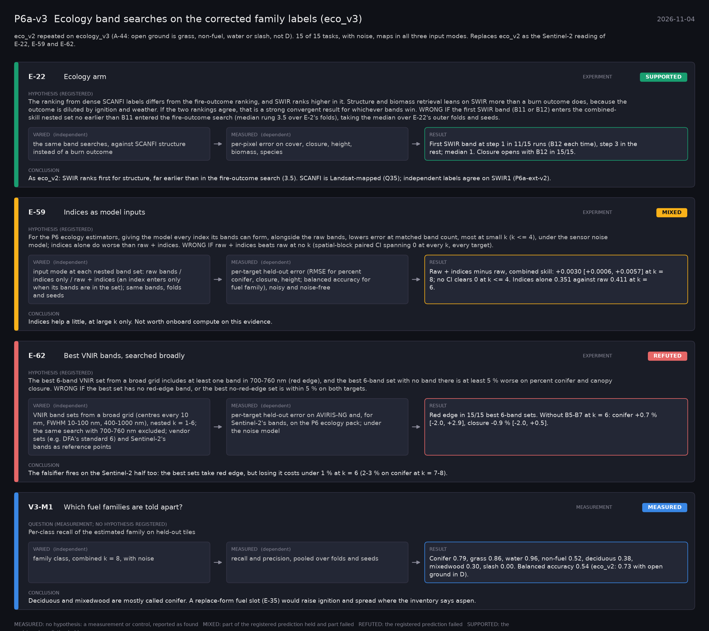

# P6a-v3: Ecology band searches on the corrected family labels (eco_v3) (2026-11-04)

What this phase ran and concluded. Generated by `scripts/make_phase_docs.py` from `src/safari_bands/phases.py`; registered hypotheses are quoted from the register, verbatim. Full results: [README.md](README.md).

eco_v2 repeated on ecology_v3 (A-44: open ground is grass, non-fuel, water or slash, not D). 15 of 15 tasks, with noise, maps in all three input modes. Replaces eco_v2 as the Sentinel-2 reading of E-22, E-59 and E-62.

## E-22: Ecology arm (experiment): **SUPPORTED**

| | |
|---|---|
| Hypothesis (registered) | The ranking from dense SCANFI labels differs from the fire-outcome ranking, and SWIR ranks higher in it. Structure and biomass retrieval leans on SWIR more than a burn outcome does, because the outcome is diluted by ignition and weather. If the two rankings agree, that is a strong convergent result for whichever bands win. WRONG IF the first SWIR band (B11 or B12) enters the combined-skill nested set no earlier than B11 entered the fire-outcome search (median rung 3.5 over E-2's folds), taking the median over E-22's outer folds and seeds. |
| Varied (independent) | the same band searches, against SCANFI structure instead of a burn outcome |
| Measured (dependent) | per-pixel error on cover, closure, height, biomass, species |
| Result | First SWIR band at step 1 in 11/15 runs (B12 each time), step 3 in the rest; median 1. Closure opens with B12 in 15/15. |
| Verdict | **SUPPORTED**: the registered prediction held |
| Conclusion | As eco_v2: SWIR ranks first for structure, far earlier than in the fire-outcome search (3.5). SCANFI is Landsat-mapped (Q35); independent labels agree on SWIR1 (P6a-ext-v2). |

## E-59: Indices as model inputs (experiment): **MIXED**

| | |
|---|---|
| Hypothesis (registered) | For the P6 ecology estimators, giving the model every index its bands can form, alongside the raw bands, lowers error at matched band count, most at small k (k <= 4), under the sensor noise model; indices alone do worse than raw + indices. WRONG IF raw + indices beats raw at no k (spatial-block paired CI spanning 0 at every k, every target). |
| Varied (independent) | input mode at each nested band set: raw bands / indices only / raw + indices (an index enters only when its bands are in the set); same bands, folds and seeds |
| Measured (dependent) | per-target held-out error (RMSE for percent conifer, closure, height; balanced accuracy for fuel family), noisy and noise-free |
| Result | Raw + indices minus raw, combined skill: +0.0030 [+0.0006, +0.0057] at k = 8; no CI clears 0 at k <= 4. Indices alone 0.351 against raw 0.411 at k = 6. |
| Verdict | **MIXED**: part of the registered prediction held and part failed |
| Conclusion | Indices help a little, at large k only. Not worth onboard compute on this evidence. |

## E-62: Best VNIR bands, searched broadly (experiment): **REFUTED**

| | |
|---|---|
| Hypothesis (registered) | The best 6-band VNIR set from a broad grid includes at least one band in 700-760 nm (red edge), and the best 6-band set with no band there is at least 5 % worse on percent conifer and canopy closure. WRONG IF the best set has no red-edge band, or the best no-red-edge set is within 5 % on both targets. |
| Varied (independent) | VNIR band sets from a broad grid (centres every 10 nm, FWHM 10-100 nm, 400-1000 nm), nested k = 1-6; the same search with 700-760 nm excluded; vendor sets (e.g. DFA's standard 6) and Sentinel-2's bands as reference points |
| Measured (dependent) | per-target held-out error on AVIRIS-NG and, for Sentinel-2's bands, on the P6 ecology pack; under the noise model |
| Result | Red edge in 15/15 best 6-band sets. Without B5-B7 at k = 6: conifer +0.7 % [-2.0, +2.9], closure -0.9 % [-2.0, +0.5]. |
| Verdict | **REFUTED**: the registered prediction failed |
| Conclusion | The falsifier fires on the Sentinel-2 half too: the best sets take red edge, but losing it costs under 1 % at k = 6 (2-3 % on conifer at k = 7-8). |

## V3-M1: Which fuel families are told apart? (measurement): **MEASURED**

| | |
|---|---|
| Question (measurement; no hypothesis registered) | Per-class recall of the estimated family on held-out tiles |
| Varied (independent) | family class, combined k = 8, with noise |
| Measured (dependent) | recall and precision, pooled over folds and seeds |
| Result | Conifer 0.79, grass 0.86, water 0.96, non-fuel 0.52, deciduous 0.38, mixedwood 0.30, slash 0.00. Balanced accuracy 0.54 (eco_v2: 0.73 with open ground in D). |
| Verdict | **MEASURED**: no hypothesis: a measurement or control, reported as found |
| Conclusion | Deciduous and mixedwood are mostly called conifer. A replace-form fuel slot (E-35) would raise ignition and spread where the inventory says aspen. |
