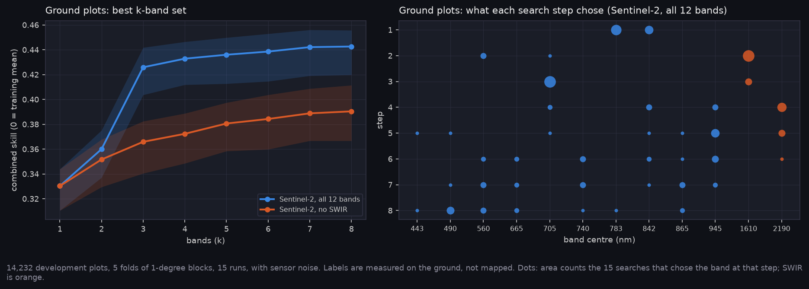
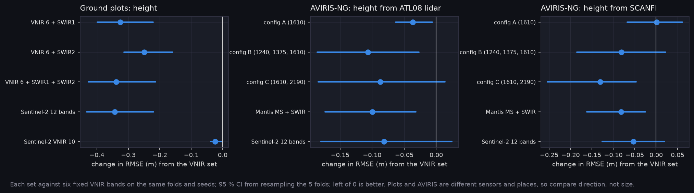

# P6a-ext: Band rankings on labels that owe nothing to Landsat (Q35)

SCANFI is mapped from Landsat, SWIR included, so SWIR ranking first against it could be the labels favouring their own bands (E-22, Q35). Two independent label sources test that with the same search: ground plots (MAGPlot, measured percent conifer and height, Sentinel-2 bands) and ATL08 lidar height (AVIRIS-NG bands). No hypothesis was registered for this test, so it is reported as a measurement.

Runs on Nibi: `hs_plots/20261101-2024` (14,232 plots, 171 blocks) and `hs_lidar/20261101-2024` (98,586 pixels, 11 groups). All 15 tasks per arm finished. Frozen plots and AVIRIS test data were not transferred. Both runs use the placeholder noise model (A-37).

**At a glance:** [experiments.md](experiments.md). Tables and options: [tables.md](tables.md).

Generated with:

```bash
python scripts/make_results_package.py --phase P6x --run narval_results/hs_plots/20261101-2024 \
    --lidar-run narval_results/hs_lidar/20261101-2024 --scanfi-run narval_results/hs_v3/20261101-2024
python scripts/make_experiment_qual.py --only E-22
python scripts/make_phase_docs.py --phase P6a-ext
```

## SWIR holds up against measured labels



| Added to six VNIR bands (ground plots) | Percent conifer RMSE, from 19.07 % | Height RMSE, from 4.12 m | Combined skill, from 0.387 |
|---|---|---|---|
| SWIR1 (1610) | −1.51 [−1.70, −1.25] | −0.33 [−0.40, −0.22] | +0.048 [+0.038, +0.057] |
| SWIR2 (2190) | −0.99 [−1.15, −0.84] | −0.25 [−0.31, −0.16] | +0.034 [+0.026, +0.040] |
| SWIR1 + SWIR2 | −1.78 [−2.06, −1.46] | −0.34 [−0.43, −0.21] | +0.053 [+0.042, +0.062] |

- **The gain is large and consistent.** Every fold improves on every target, and it isn't explained by the labels, because plots aren't mapped from Landsat.
- **SWIR1 does most of the work.** With SWIR1 in, SWIR2 adds +0.005 [+0.002, +0.007]. With SWIR2 in, SWIR1 adds +0.019 [+0.016, +0.022].
- **SWIR isn't first here, but it is second.** The first pick is NIR in all 15 searches (783 or 842 nm), and 1610 nm is second in 11 of 15. On SCANFI labels SWIR came first in 13 of 15 (E-22). That difference doesn't by itself show label bias: plots are forest only, while the SCANFI family target also separates water and open ground.
- **Three bands reach most of the gain.** The first three picks score 0.426, and more bands add at most 0.02. 1610 nm is in all 15 first-three sets and 705 nm in 12, with NIR split between 783 and 842 nm.
- **Noise isn't limiting.** Noise-free scores are within 0.01 of noisy ones on the SWIR sets, under the placeholder noise model.

## Lidar agrees on direction, more weakly



- **Fixed SWIR sets beat fixed VNIR on lidar height.** Config B −0.106 m [−0.186, −0.027], Mantis MS + SWIR −0.099 [−0.173, −0.032], config A −0.036 [−0.063, −0.006]. Config C −0.087 [−0.184, +0.014] reaches 0.
- **The size is about the same as on SCANFI height.** Config C gives −0.131 there, config B −0.081, so SCANFI isn't visibly inflating SWIR's value for height. The sets rank differently, within CIs that overlap.
- **Config B against config C can't be separated:** −0.019 m [−0.111, +0.070].
- **Don't read the lidar searches.** Searched SWIR sets don't beat the fixed VNIR set (standard, k = 4: +0.045 m [−0.150, +0.314]). The inner validation falls to 2,435 pixels on one fold, and folds differ widely (skill 0.07 to 0.27).

## What this says about P12

- **The SWIR ranking from SCANFI is not an artefact of the labels.** The worry behind Q35 point 1 doesn't hold up, at least for forests.
- **Ground plots show a much bigger SWIR gain than AVIRIS-NG on SCANFI.** Percent conifer improves 8 % on plots, and doesn't improve at all on AVIRIS (+0.17 to +0.38 %). The two differ in sensor, region and labels, so this pack can't say which causes it. It is the largest open puzzle in the band evidence.

## Limits

- **Plots are mostly eastern.** Most are in Québec and New Brunswick, with Newfoundland and Yukon; see the map. Western boreal forest is barely covered.
- **Plots only cover forest.** The families are C, D and M, with no open ground, water or slash. Closure isn't measured.
- **Time gap.** Plots from 2014 onward meet a 2019-2021 composite (A-44).
- **Lidar is partial here.** This run used `aviris_lidar_v1`, without groups 15, 16 and 17. `aviris_lidar_v2` adds them (139,848 pixels, 14 groups), and `hs_lidar_v2` will replace these lidar numbers.
- **A wrong label in the result files.** The `labels` field reads SCANFI in all three runs, because it is a fixed string in the runner. Pixel counts confirm the right packs ran.

## Options and cost

`tables.md` lists every option with cost, pros and cons (A-41). Cost is qualitative, as Q6 is open: VNIR low, standard InGaAs moderate, extended InGaAs high.

## Files

| File | What it shows |
|---|---|
| `experiments.png`, `experiments.md` | phase sheet |
| `plots_search.png` | nested skill and what each step chose on ground plots |
| `swir_gain.png` | change in height RMSE from SWIR on the three label sources |
| `qual_E-22_plots_map.png` | where SWIR1 lowers error against plots |
| `qual_lidar_tracks.png` | lidar height along held-out flight lines |
| `tables.md`, `T_options_*.csv`, `summary.json` | the numbers |

<!-- qual:start -->
## Qualitative view per experiment

- **E-22** Ecology arm (cell map and lidar tracks): [qual_E-22_plots_map.png](qual_E-22_plots_map.png), [qual_lidar_tracks.png](qual_lidar_tracks.png)
<!-- qual:end -->
