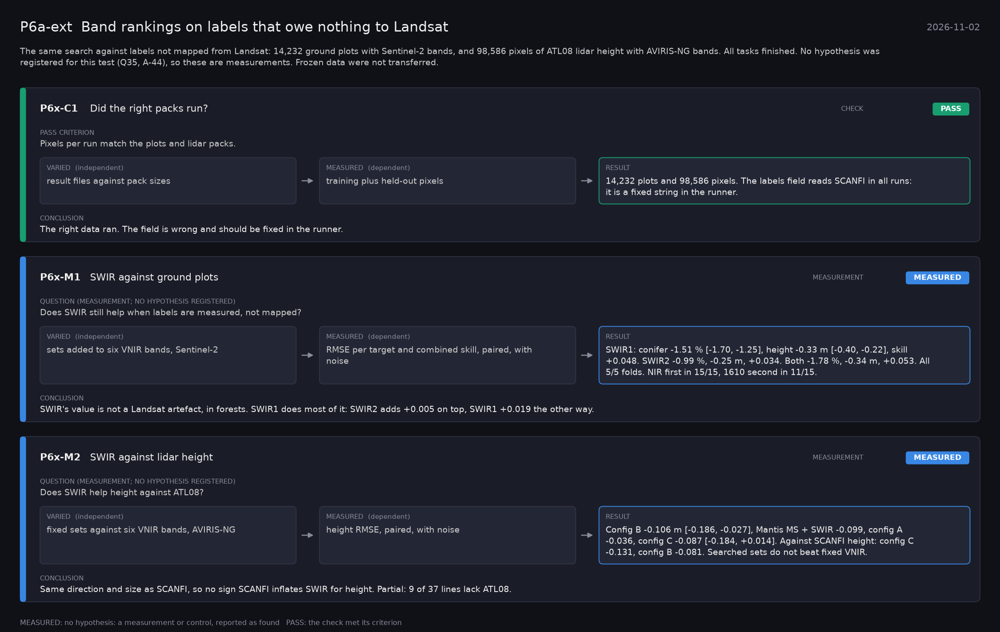

# P6a-ext: Band rankings on labels that owe nothing to Landsat (2026-11-02)

What this phase ran and concluded. Generated by `scripts/make_phase_docs.py` from `src/safari_bands/phases.py`; registered hypotheses are quoted from the register, verbatim. Full results: [README.md](README.md).

The same search against labels not mapped from Landsat: 14,232 ground plots with Sentinel-2 bands, and 98,586 pixels of ATL08 lidar height with AVIRIS-NG bands. All tasks finished. No hypothesis was registered for this test (Q35, A-44), so these are measurements. Frozen data were not transferred.

## P6x-C1: Did the right packs run? (check): **PASS**

| | |
|---|---|
| Pass criterion | Pixels per run match the plots and lidar packs. |
| Varied (independent) | result files against pack sizes |
| Measured (dependent) | training plus held-out pixels |
| Result | 14,232 plots and 98,586 pixels. The labels field reads SCANFI in all runs: it is a fixed string in the runner. |
| Verdict | **PASS**: the check met its criterion |
| Conclusion | The right data ran. The field is wrong and should be fixed in the runner. |

## P6x-M1: SWIR against ground plots (measurement): **MEASURED**

| | |
|---|---|
| Question (measurement; no hypothesis registered) | Does SWIR still help when labels are measured, not mapped? |
| Varied (independent) | sets added to six VNIR bands, Sentinel-2 |
| Measured (dependent) | RMSE per target and combined skill, paired, with noise |
| Result | SWIR1: conifer -1.51 % [-1.70, -1.25], height -0.33 m [-0.40, -0.22], skill +0.048. SWIR2 -0.99 %, -0.25 m, +0.034. Both -1.78 %, -0.34 m, +0.053. All 5/5 folds. NIR first in 15/15, 1610 second in 11/15. |
| Verdict | **MEASURED**: no hypothesis: a measurement or control, reported as found |
| Conclusion | SWIR's value is not a Landsat artefact, in forests. SWIR1 does most of it: SWIR2 adds +0.005 on top, SWIR1 +0.019 the other way. |

## P6x-M2: SWIR against lidar height (measurement): **MEASURED**

| | |
|---|---|
| Question (measurement; no hypothesis registered) | Does SWIR help height against ATL08? |
| Varied (independent) | fixed sets against six VNIR bands, AVIRIS-NG |
| Measured (dependent) | height RMSE, paired, with noise |
| Result | Config B -0.106 m [-0.186, -0.027], Mantis MS + SWIR -0.099, config A -0.036, config C -0.087 [-0.184, +0.014]. Against SCANFI height: config C -0.131, config B -0.081. Searched sets do not beat fixed VNIR. |
| Verdict | **MEASURED**: no hypothesis: a measurement or control, reported as found |
| Conclusion | Same direction and size as SCANFI, so no sign SCANFI inflates SWIR for height. Partial: 9 of 37 lines lack ATL08. |
