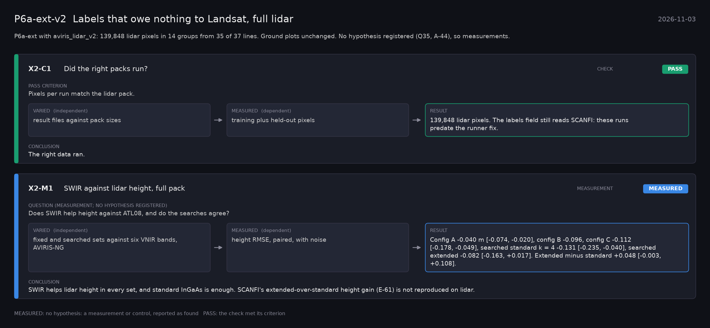

# P6a-ext-v2: Labels that owe nothing to Landsat, full lidar (2026-11-03)

What this phase ran and concluded. Generated by `scripts/make_phase_docs.py` from `src/safari_bands/phases.py`; registered hypotheses are quoted from the register, verbatim. Full results: [README.md](README.md).

P6a-ext with aviris_lidar_v2: 139,848 lidar pixels in 14 groups from 35 of 37 lines. Ground plots unchanged. No hypothesis registered (Q35, A-44), so measurements.

## X2-C1: Did the right packs run? (check): **PASS**

| | |
|---|---|
| Pass criterion | Pixels per run match the lidar pack. |
| Varied (independent) | result files against pack sizes |
| Measured (dependent) | training plus held-out pixels |
| Result | 139,848 lidar pixels. The labels field still reads SCANFI: these runs predate the runner fix. |
| Verdict | **PASS**: the check met its criterion |
| Conclusion | The right data ran. |

## X2-M1: SWIR against lidar height, full pack (measurement): **MEASURED**

| | |
|---|---|
| Question (measurement; no hypothesis registered) | Does SWIR help height against ATL08, and do the searches agree? |
| Varied (independent) | fixed and searched sets against six VNIR bands, AVIRIS-NG |
| Measured (dependent) | height RMSE, paired, with noise |
| Result | Config A -0.040 m [-0.074, -0.020], config B -0.096, config C -0.112 [-0.178, -0.049], searched standard k = 4 -0.131 [-0.235, -0.040], searched extended -0.082 [-0.163, +0.017]. Extended minus standard +0.048 [-0.003, +0.108]. |
| Verdict | **MEASURED**: no hypothesis: a measurement or control, reported as found |
| Conclusion | SWIR helps lidar height in every set, and standard InGaAs is enough. SCANFI's extended-over-standard height gain (E-61) is not reproduced on lidar. |
