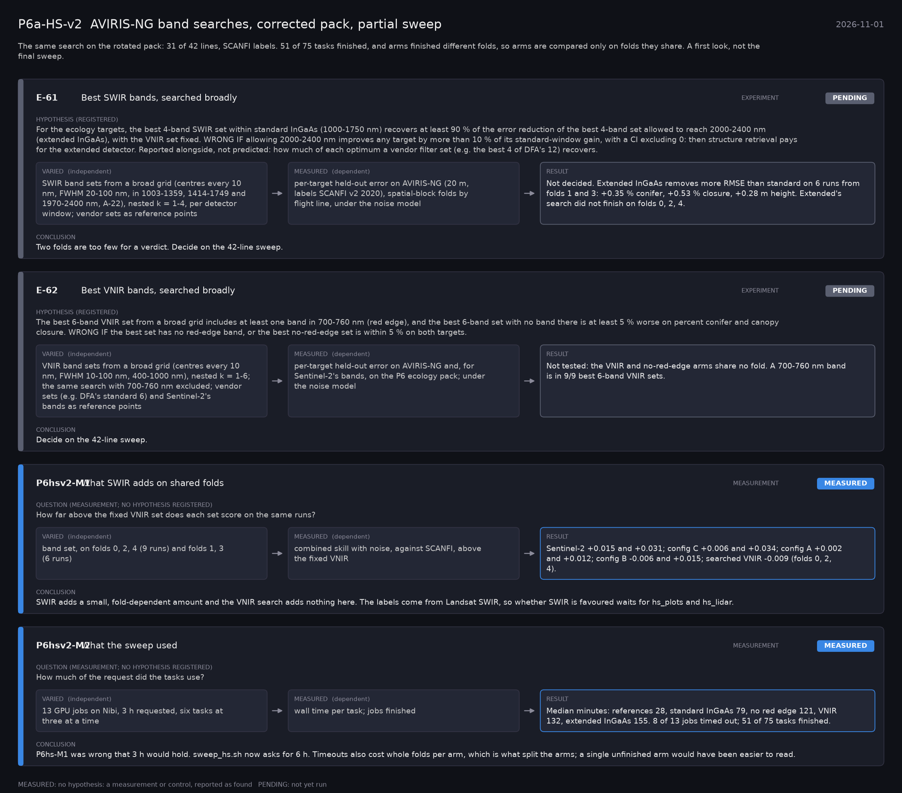

# P6a-HS-v2: AVIRIS-NG band searches, corrected pack, partial sweep (2026-11-01)

What this phase ran and concluded. Generated by `scripts/make_phase_docs.py` from `src/safari_bands/phases.py`; registered hypotheses are quoted from the register, verbatim. Full results: [README.md](README.md).

The same search on the rotated pack: 31 of 42 lines, SCANFI labels. 51 of 75 tasks finished, and arms finished different folds, so arms are compared only on folds they share. A first look, not the final sweep.

## E-61: Best SWIR bands, searched broadly (experiment): **PENDING**

| | |
|---|---|
| Hypothesis (registered) | For the ecology targets, the best 4-band SWIR set within standard InGaAs (1000-1750 nm) recovers at least 90 % of the error reduction of the best 4-band set allowed to reach 2000-2400 nm (extended InGaAs), with the VNIR set fixed. WRONG IF allowing 2000-2400 nm improves any target by more than 10 % of its standard-window gain, with a CI excluding 0: then structure retrieval pays for the extended detector. Reported alongside, not predicted: how much of each optimum a vendor filter set (e.g. the best 4 of DFA's 12) recovers. |
| Varied (independent) | SWIR band sets from a broad grid (centres every 10 nm, FWHM 20-100 nm, in 1003-1359, 1414-1749 and 1970-2400 nm, A-22), nested k = 1-4, per detector window; vendor sets as reference points |
| Measured (dependent) | per-target held-out error on AVIRIS-NG (20 m, labels SCANFI v2 2020), spatial-block folds by flight line, under the noise model |
| Result | Not decided. Extended InGaAs removes more RMSE than standard on 6 runs from folds 1 and 3: +0.35 % conifer, +0.53 % closure, +0.28 m height. Extended's search did not finish on folds 0, 2, 4. |
| Verdict | **PENDING**: not yet run |
| Conclusion | Two folds are too few for a verdict. Decide on the 42-line sweep. |

## E-62: Best VNIR bands, searched broadly (experiment): **PENDING**

| | |
|---|---|
| Hypothesis (registered) | The best 6-band VNIR set from a broad grid includes at least one band in 700-760 nm (red edge), and the best 6-band set with no band there is at least 5 % worse on percent conifer and canopy closure. WRONG IF the best set has no red-edge band, or the best no-red-edge set is within 5 % on both targets. |
| Varied (independent) | VNIR band sets from a broad grid (centres every 10 nm, FWHM 10-100 nm, 400-1000 nm), nested k = 1-6; the same search with 700-760 nm excluded; vendor sets (e.g. DFA's standard 6) and Sentinel-2's bands as reference points |
| Measured (dependent) | per-target held-out error on AVIRIS-NG and, for Sentinel-2's bands, on the P6 ecology pack; under the noise model |
| Result | Not tested: the VNIR and no-red-edge arms share no fold. A 700-760 nm band is in 9/9 best 6-band VNIR sets. |
| Verdict | **PENDING**: not yet run |
| Conclusion | Decide on the 42-line sweep. |

## P6hsv2-M1: What SWIR adds on shared folds (measurement): **MEASURED**

| | |
|---|---|
| Question (measurement; no hypothesis registered) | How far above the fixed VNIR set does each set score on the same runs? |
| Varied (independent) | band set, on folds 0, 2, 4 (9 runs) and folds 1, 3 (6 runs) |
| Measured (dependent) | combined skill with noise, against SCANFI, above the fixed VNIR |
| Result | Sentinel-2 +0.015 and +0.031; config C +0.006 and +0.034; config A +0.002 and +0.012; config B -0.006 and +0.015; searched VNIR -0.009 (folds 0, 2, 4). |
| Verdict | **MEASURED**: no hypothesis: a measurement or control, reported as found |
| Conclusion | SWIR adds a small, fold-dependent amount and the VNIR search adds nothing here. The labels come from Landsat SWIR, so whether SWIR is favoured waits for hs_plots and hs_lidar. |

## P6hsv2-M2: What the sweep used (measurement): **MEASURED**

| | |
|---|---|
| Question (measurement; no hypothesis registered) | How much of the request did the tasks use? |
| Varied (independent) | 13 GPU jobs on Nibi, 3 h requested, six tasks at three at a time |
| Measured (dependent) | wall time per task; jobs finished |
| Result | Median minutes: references 28, standard InGaAs 79, no red edge 121, VNIR 132, extended InGaAs 155. 8 of 13 jobs timed out; 51 of 75 tasks finished. |
| Verdict | **MEASURED**: no hypothesis: a measurement or control, reported as found |
| Conclusion | P6hs-M1 was wrong that 3 h would hold. sweep_hs.sh now asks for 6 h. Timeouts also cost whole folds per arm, which is what split the arms; a single unfinished arm would have been easier to read. |
