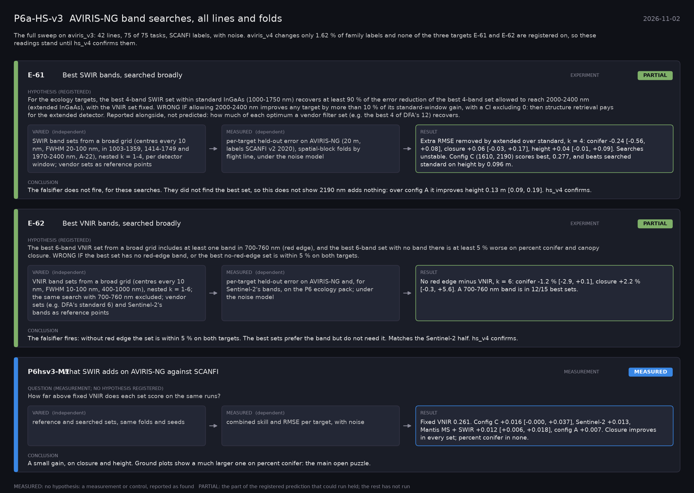

# P6a-HS-v3: AVIRIS-NG band searches, all lines and folds (2026-11-02)

What this phase ran and concluded. Generated by `scripts/make_phase_docs.py` from `src/safari_bands/phases.py`; registered hypotheses are quoted from the register, verbatim. Full results: [README.md](README.md).

The full sweep on aviris_v3: 42 lines, 75 of 75 tasks, SCANFI labels, with noise. aviris_v4 changes only 1.62 % of family labels and none of the three targets E-61 and E-62 are registered on, so these readings stand until hs_v4 confirms them.

## E-61: Best SWIR bands, searched broadly (experiment): **PARTIAL**

| | |
|---|---|
| Hypothesis (registered) | For the ecology targets, the best 4-band SWIR set within standard InGaAs (1000-1750 nm) recovers at least 90 % of the error reduction of the best 4-band set allowed to reach 2000-2400 nm (extended InGaAs), with the VNIR set fixed. WRONG IF allowing 2000-2400 nm improves any target by more than 10 % of its standard-window gain, with a CI excluding 0: then structure retrieval pays for the extended detector. Reported alongside, not predicted: how much of each optimum a vendor filter set (e.g. the best 4 of DFA's 12) recovers. |
| Varied (independent) | SWIR band sets from a broad grid (centres every 10 nm, FWHM 20-100 nm, in 1003-1359, 1414-1749 and 1970-2400 nm, A-22), nested k = 1-4, per detector window; vendor sets as reference points |
| Measured (dependent) | per-target held-out error on AVIRIS-NG (20 m, labels SCANFI v2 2020), spatial-block folds by flight line, under the noise model |
| Result | Extra RMSE removed by extended over standard, k = 4: conifer -0.24 [-0.56, +0.08], closure +0.06 [-0.03, +0.17], height +0.04 [-0.01, +0.09]. Searches unstable. Config C (1610, 2190) scores best, 0.277, and beats searched standard on height by 0.096 m. |
| Verdict | **PARTIAL**: the part of the registered prediction that could run held; the rest has not run |
| Conclusion | The falsifier does not fire, for these searches. They did not find the best set, so this does not show 2190 nm adds nothing: over config A it improves height 0.13 m [0.09, 0.19]. hs_v4 confirms. |

## E-62: Best VNIR bands, searched broadly (experiment): **PARTIAL**

| | |
|---|---|
| Hypothesis (registered) | The best 6-band VNIR set from a broad grid includes at least one band in 700-760 nm (red edge), and the best 6-band set with no band there is at least 5 % worse on percent conifer and canopy closure. WRONG IF the best set has no red-edge band, or the best no-red-edge set is within 5 % on both targets. |
| Varied (independent) | VNIR band sets from a broad grid (centres every 10 nm, FWHM 10-100 nm, 400-1000 nm), nested k = 1-6; the same search with 700-760 nm excluded; vendor sets (e.g. DFA's standard 6) and Sentinel-2's bands as reference points |
| Measured (dependent) | per-target held-out error on AVIRIS-NG and, for Sentinel-2's bands, on the P6 ecology pack; under the noise model |
| Result | No red edge minus VNIR, k = 6: conifer -1.2 % [-2.9, +0.1], closure +2.2 % [-0.3, +5.6]. A 700-760 nm band is in 12/15 best sets. |
| Verdict | **PARTIAL**: the part of the registered prediction that could run held; the rest has not run |
| Conclusion | The falsifier fires: without red edge the set is within 5 % on both targets. The best sets prefer the band but do not need it. Matches the Sentinel-2 half. hs_v4 confirms. |

## P6hsv3-M1: What SWIR adds on AVIRIS-NG against SCANFI (measurement): **MEASURED**

| | |
|---|---|
| Question (measurement; no hypothesis registered) | How far above fixed VNIR does each set score on the same runs? |
| Varied (independent) | reference and searched sets, same folds and seeds |
| Measured (dependent) | combined skill and RMSE per target, with noise |
| Result | Fixed VNIR 0.261. Config C +0.016 [-0.000, +0.037], Sentinel-2 +0.013, Mantis MS + SWIR +0.012 [+0.006, +0.018], config A +0.007. Closure improves in every set; percent conifer in none. |
| Verdict | **MEASURED**: no hypothesis: a measurement or control, reported as found |
| Conclusion | A small gain, on closure and height. Ground plots show a much larger one on percent conifer: the main open puzzle. |
