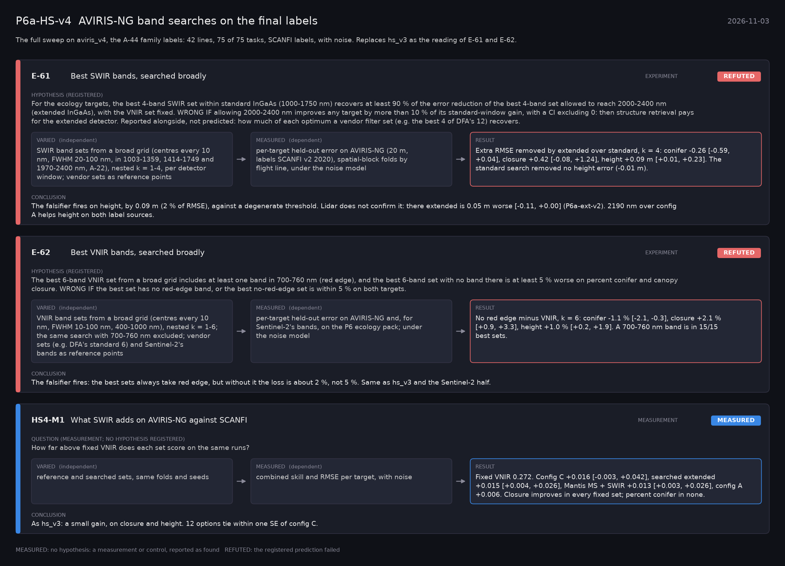

# P6a-HS-v4: AVIRIS-NG band searches on the final labels (2026-11-03)

What this phase ran and concluded. Generated by `scripts/make_phase_docs.py` from `src/safari_bands/phases.py`; registered hypotheses are quoted from the register, verbatim. Full results: [README.md](README.md).

The full sweep on aviris_v4, the A-44 family labels: 42 lines, 75 of 75 tasks, SCANFI labels, with noise. Replaces hs_v3 as the reading of E-61 and E-62.

## E-61: Best SWIR bands, searched broadly (experiment): **REFUTED**

| | |
|---|---|
| Hypothesis (registered) | For the ecology targets, the best 4-band SWIR set within standard InGaAs (1000-1750 nm) recovers at least 90 % of the error reduction of the best 4-band set allowed to reach 2000-2400 nm (extended InGaAs), with the VNIR set fixed. WRONG IF allowing 2000-2400 nm improves any target by more than 10 % of its standard-window gain, with a CI excluding 0: then structure retrieval pays for the extended detector. Reported alongside, not predicted: how much of each optimum a vendor filter set (e.g. the best 4 of DFA's 12) recovers. |
| Varied (independent) | SWIR band sets from a broad grid (centres every 10 nm, FWHM 20-100 nm, in 1003-1359, 1414-1749 and 1970-2400 nm, A-22), nested k = 1-4, per detector window; vendor sets as reference points |
| Measured (dependent) | per-target held-out error on AVIRIS-NG (20 m, labels SCANFI v2 2020), spatial-block folds by flight line, under the noise model |
| Result | Extra RMSE removed by extended over standard, k = 4: conifer -0.26 [-0.59, +0.04], closure +0.42 [-0.08, +1.24], height +0.09 m [+0.01, +0.23]. The standard search removed no height error (-0.01 m). |
| Verdict | **REFUTED**: the registered prediction failed |
| Conclusion | The falsifier fires on height, by 0.09 m (2 % of RMSE), against a degenerate threshold. Lidar does not confirm it: there extended is 0.05 m worse [-0.11, +0.00] (P6a-ext-v2). 2190 nm over config A helps height on both label sources. |

## E-62: Best VNIR bands, searched broadly (experiment): **REFUTED**

| | |
|---|---|
| Hypothesis (registered) | The best 6-band VNIR set from a broad grid includes at least one band in 700-760 nm (red edge), and the best 6-band set with no band there is at least 5 % worse on percent conifer and canopy closure. WRONG IF the best set has no red-edge band, or the best no-red-edge set is within 5 % on both targets. |
| Varied (independent) | VNIR band sets from a broad grid (centres every 10 nm, FWHM 10-100 nm, 400-1000 nm), nested k = 1-6; the same search with 700-760 nm excluded; vendor sets (e.g. DFA's standard 6) and Sentinel-2's bands as reference points |
| Measured (dependent) | per-target held-out error on AVIRIS-NG and, for Sentinel-2's bands, on the P6 ecology pack; under the noise model |
| Result | No red edge minus VNIR, k = 6: conifer -1.1 % [-2.1, -0.3], closure +2.1 % [+0.9, +3.3], height +1.0 % [+0.2, +1.9]. A 700-760 nm band is in 15/15 best sets. |
| Verdict | **REFUTED**: the registered prediction failed |
| Conclusion | The falsifier fires: the best sets always take red edge, but without it the loss is about 2 %, not 5 %. Same as hs_v3 and the Sentinel-2 half. |

## HS4-M1: What SWIR adds on AVIRIS-NG against SCANFI (measurement): **MEASURED**

| | |
|---|---|
| Question (measurement; no hypothesis registered) | How far above fixed VNIR does each set score on the same runs? |
| Varied (independent) | reference and searched sets, same folds and seeds |
| Measured (dependent) | combined skill and RMSE per target, with noise |
| Result | Fixed VNIR 0.272. Config C +0.016 [-0.003, +0.042], searched extended +0.015 [+0.004, +0.026], Mantis MS + SWIR +0.013 [+0.003, +0.026], config A +0.006. Closure improves in every fixed set; percent conifer in none. |
| Verdict | **MEASURED**: no hypothesis: a measurement or control, reported as found |
| Conclusion | As hs_v3: a small gain, on closure and height. 12 options tie within one SE of config C. |
