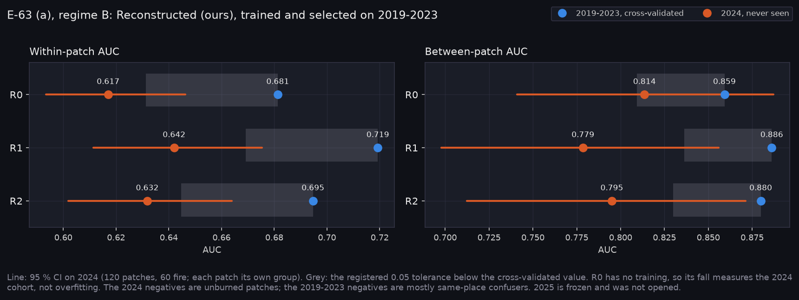
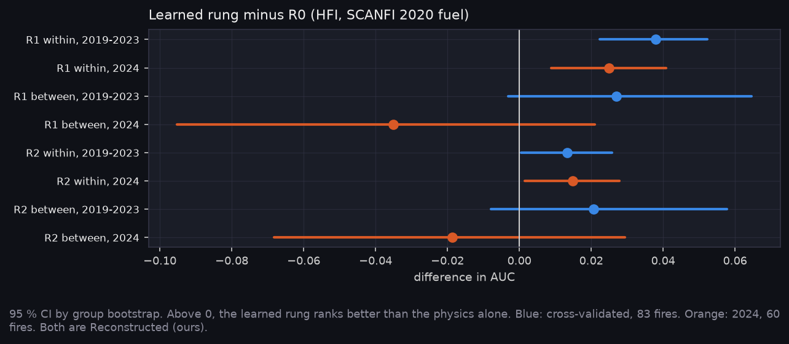

# P6e: Out-of-time generalisation (E-63, 2024 half)

> **Reference key.** Every number here is Reconstructed (ours), unless it is marked **ISSUED by CWFIS**.

Run on Nibi: `e63_regime_b/20261101-2054` and `e63_regime_a/20261101-2054`, 60 fits, none truncated. R1 and R2 use SCANFI fuel and ERA5 weather on D-1. **2025 is frozen and was not opened.** E-63 reads it once, in P10, so hypothesis (b) and the 2024-2025 reading of (a) wait for that.

**At a glance:** [experiments.md](experiments.md). Tables: [tables.md](tables.md).

Generated with:

```bash
python scripts/make_results_package.py --phase P6e --run narval_results/e63_regime_b/20261101-2054 \
    --regime-a narval_results/e63_regime_a/20261101-2054
python scripts/make_experiment_qual.py --only E-63
python scripts/make_phase_docs.py --phase P6e
```

## Hypothesis (a), on 2024: AT RISK



| Rung | Within-patch: CV, then 2024 | Change [95 % CI] | Between-patch: CV, then 2024 | Change [95 % CI] |
|---|---|---|---|---|
| R0, physics (no training) | 0.681, 0.617 | −0.064 [−0.096, −0.028] | 0.859, 0.814 | −0.046 [−0.138, +0.060] |
| R1 | 0.719, 0.642 | −0.077 [−0.119, −0.032] | 0.886, 0.779 | −0.108 [−0.199, −0.008] |
| R2 | 0.695, 0.632 | −0.063 [−0.101, −0.020] | 0.880, 0.795 | −0.085 [−0.172, +0.013] |

- **The drop clause doesn't fire.** Every drop in R1 and R2 is above 0.05, but every CI still includes 0.05, so none is a drop "with a CI excluding it".
- **The positive claim isn't met either.** The hypothesis says skill stays within 0.05, and no point estimate does.
- **The R0 clause fires between patches.** R1 − R0 on 2024 is −0.035 [−0.095, +0.021], so its CI reaches 0. Within patches R1 still beats R0: +0.025 [+0.009, +0.041].
- **This is a 2024 reading.** The clause is registered on 2024-2025, so the verdict stays open until P10.

## Most of the within-patch fall is the cohort



- **R0 falls too, with nothing trained.** Net of R0's fall (not registered), R1 changes −0.013 [−0.035, +0.012] within patches, and R2 +0.001 [−0.018, +0.021]. The models hold their within-patch margin over physics.
- **Between patches, R1 loses its margin.** It goes from +0.027 over R0 in CV to −0.035 on 2024. Net of R0 that is −0.062 [−0.136, −0.000]. R2 changes −0.039 [−0.102, +0.018]. The learned weather ranking carries over worse than the physics does.
- **The year confound explains part of that.** Year alone ranks the CV patches at 0.87 (E-43). On same-year pairs CV gives R1 0.840 and R2 0.846, so a fairer fall is about 0.06 for R1 and 0.05 for R2.
- **The negatives differ.** 2024 has only unburned patches; CV is mostly same-place confusers. Those should be harder, so this comparison flatters 2024 if anything.

For scale, the HFI **ISSUED by CWFIS** gives between-patch AUC 0.834 on 2024 (111 patches, E-56). R0 gives 0.814 on these 120 patches. As point estimates, neither learned rung reaches either figure; the CIs overlap.

## Inside a fuel family, 2024 is close to chance

| Rung | C: CV, then 2024 | D: CV, then 2024 | M: CV, then 2024 |
|---|---|---|---|
| R0 | 0.522, 0.502 | 0.518, 0.512 | 0.541, 0.496 |
| R1 | 0.630, 0.537 | 0.627, 0.596 | 0.593, 0.527 |
| R2 | 0.593, 0.517 | 0.566, 0.570 | 0.564, 0.534 |

The all-pixel within-patch AUC also counts telling one family from another.

- **The physics barely ranks pixels inside a family, in any year.** R0 is 0.50-0.54 in both CV and 2024, so nearly all of its within-patch skill is fuel type.
- **This fall isn't the cohort.** R0 moves 0.01-0.05 inside a family, while R1 falls 0.09 in conifer and 0.07 in mixedwood. Whatever R1 learned inside a family in 2019-2023 mostly didn't carry to 2024. So the heading above holds for all pixels, but not inside a family.
- **So on an unseen year, most within-patch skill is fuel type.** That raises the value of the fuel-type slot (E-35), still unmeasured.

R0 here comes from `runs/20261102-r0_family_dev` and `runs/20261102-r0_family_2024`, reruns that reproduce the earlier scores on all 316 patches and add the by-family columns.

## Regime A, on the 2019-2023 folds only

Adding 2024 to training changes nothing detectable on the same folds and seeds: R1 −0.008 [−0.018, +0.001] within and −0.007 [−0.021, +0.006] between; R2 −0.005 [−0.018, +0.006] and −0.003 [−0.027, +0.015]. This doesn't test (b), which is read on 2025 in P10. It says only that 120 extra patches from another year didn't help the old folds.

## Limits

- **R1 and R2 rankings rest on 60 fires and 60 unburned patches.** The between-patch CIs are wide.
- **R0 here is HFI on SCANFI 2020 fuel.** CWFIS 2024 fuel gives the same signs: R1 − R0 +0.028 within, −0.048 between.
- **Regime order.** Regime B's 2024 scores were read first, as registered.

## Files

| File | What it shows |
|---|---|
| `experiments.png`, `experiments.md` | phase sheet |
| `out_of_time.png` | CV against 2024 for R0, R1, R2 |
| `vs_r0.png` | learned rung minus R0, CV and 2024 |
| `qual_E-63_patch_map.png` | where R1 beats R0 on 2024 |
| `tables.md`, `T_regime_b.csv`, `T_regimes.csv`, `summary.json` | the numbers |

<!-- qual:start -->
## Qualitative view per experiment

- **E-63** Out-of-time generalisation, two training regimes (patch map): [qual_E-63_patch_map.png](qual_E-63_patch_map.png)
<!-- qual:end -->
