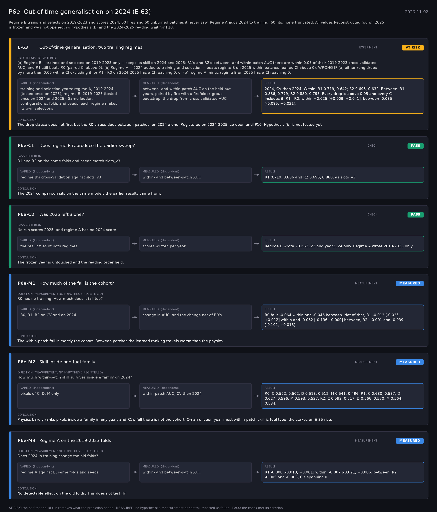

# P6e: Out-of-time generalisation on 2024 (E-63) (2026-11-02)

What this phase ran and concluded. Generated by `scripts/make_phase_docs.py` from `src/safari_bands/phases.py`; registered hypotheses are quoted from the register, verbatim. Full results: [README.md](README.md).

Regime B trains and selects on 2019-2023 and scores 2024, 60 fires and 60 unburned patches it never saw. Regime A adds 2024 to training. 60 fits, none truncated. All values Reconstructed (ours). 2025 is frozen and was not opened, so hypothesis (b) and the 2024-2025 reading wait for P10.

## E-63: Out-of-time generalisation, two training regimes (experiment): **AT RISK**

| | |
|---|---|
| Hypothesis (registered) | (a) Regime B -- trained and selected on 2019-2023 only -- keeps its skill on 2024 and 2025: R1's and R2's between- and within-patch AUC there are within 0.05 of their 2019-2023 cross-validated AUC, and R1 still beats R0 (paired CI above 0). (b) Regime A -- 2024 added to training and selection -- beats regime B on 2025 within patches (paired CI above 0). WRONG IF (a) either rung drops by more than 0.05 with a CI excluding it, or R1 - R0 on 2024-2025 has a CI reaching 0; or (b) regime A minus regime B on 2025 has a CI reaching 0. |
| Varied (independent) | training and selection years: regime A, 2019-2024 (tested once on 2025); regime B, 2019-2023 (tested once on 2024 and 2025). Same ladder, configurations, folds and seeds; each regime makes its own selections |
| Measured (dependent) | between- and within-patch AUC on the held-out years, paired by fire with a fire/block-group bootstrap; the drop from cross-validated AUC |
| Result | 2024, CV then 2024. Within: R1 0.719, 0.642; R2 0.695, 0.632. Between: R1 0.886, 0.779; R2 0.880, 0.795. Every drop is above 0.05 and every CI includes it. R1 - R0: within +0.025 [+0.009, +0.041], between -0.035 [-0.095, +0.021]. |
| Verdict | **AT RISK**: the half that could run removes what the prediction needs |
| Conclusion | The drop clause does not fire, but the R0 clause does between patches, on 2024 alone. Registered on 2024-2025, so open until P10. Hypothesis (b) is not tested yet. |

## P6e-C1: Does regime B reproduce the earlier sweep? (check): **PASS**

| | |
|---|---|
| Pass criterion | R1 and R2 on the same folds and seeds match slots_v3. |
| Varied (independent) | regime B's cross-validation against slots_v3 |
| Measured (dependent) | within- and between-patch AUC |
| Result | R1 0.719, 0.886 and R2 0.695, 0.880, as slots_v3. |
| Verdict | **PASS**: the check met its criterion |
| Conclusion | The 2024 comparison sits on the same models the earlier results came from. |

## P6e-C2: Was 2025 left alone? (check): **PASS**

| | |
|---|---|
| Pass criterion | No run scores 2025, and regime A has no 2024 score. |
| Varied (independent) | the result files of both regimes |
| Measured (dependent) | scores written per year |
| Result | Regime B wrote 2019-2023 and year2024 only. Regime A wrote 2019-2023 only. |
| Verdict | **PASS**: the check met its criterion |
| Conclusion | The frozen year is untouched and the reading order held. |

## P6e-M1: How much of the fall is the cohort? (measurement): **MEASURED**

| | |
|---|---|
| Question (measurement; no hypothesis registered) | R0 has no training. How much does it fall too? |
| Varied (independent) | R0, R1, R2 on CV and on 2024 |
| Measured (dependent) | change in AUC, and the change net of R0's |
| Result | R0 falls -0.064 within and -0.046 between. Net of that, R1 -0.013 [-0.035, +0.012] within and -0.062 [-0.136, -0.000] between; R2 +0.001 and -0.039 [-0.102, +0.018]. |
| Verdict | **MEASURED**: no hypothesis: a measurement or control, reported as found |
| Conclusion | The within-patch fall is mostly the cohort. Between patches the learned ranking travels worse than the physics. |

## P6e-M2: Skill inside one fuel family (measurement): **MEASURED**

| | |
|---|---|
| Question (measurement; no hypothesis registered) | How much within-patch skill survives inside a family on 2024? |
| Varied (independent) | pixels of C, D, M only |
| Measured (dependent) | within-patch AUC, CV then 2024 |
| Result | R0: C 0.522, 0.502; D 0.518, 0.512; M 0.541, 0.496. R1: C 0.630, 0.537; D 0.627, 0.596; M 0.593, 0.527. R2: C 0.593, 0.517; D 0.566, 0.570; M 0.564, 0.534. |
| Verdict | **MEASURED**: no hypothesis: a measurement or control, reported as found |
| Conclusion | Physics barely ranks pixels inside a family in any year, and R1's fall there is not the cohort. On an unseen year most within-patch skill is fuel type: the stakes on E-35 rise. |

## P6e-M3: Regime A on the 2019-2023 folds (measurement): **MEASURED**

| | |
|---|---|
| Question (measurement; no hypothesis registered) | Does 2024 in training change the old folds? |
| Varied (independent) | regime A against B, same folds and seeds |
| Measured (dependent) | within- and between-patch AUC |
| Result | R1 -0.008 [-0.018, +0.001] within, -0.007 [-0.021, +0.006] between; R2 -0.005 and -0.003, CIs spanning 0. |
| Verdict | **MEASURED**: no hypothesis: a measurement or control, reported as found |
| Conclusion | No detectable effect on the old folds. This does not test (b). |
