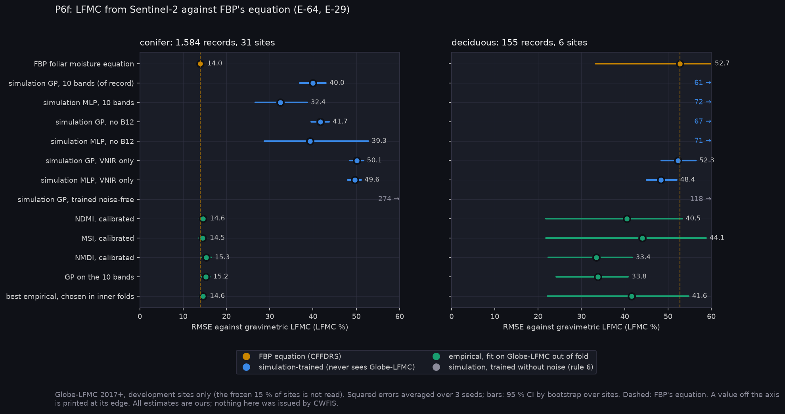
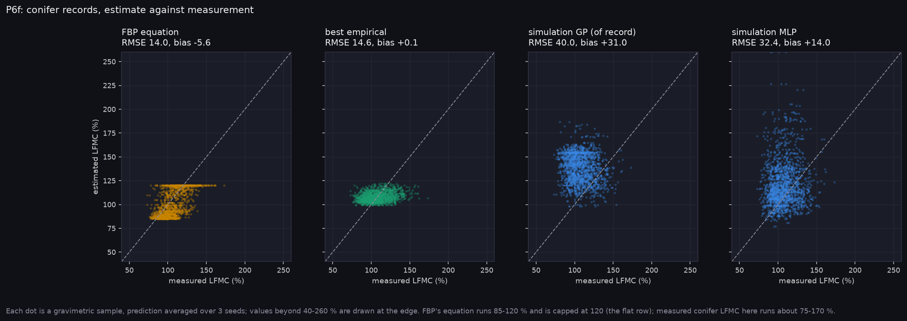
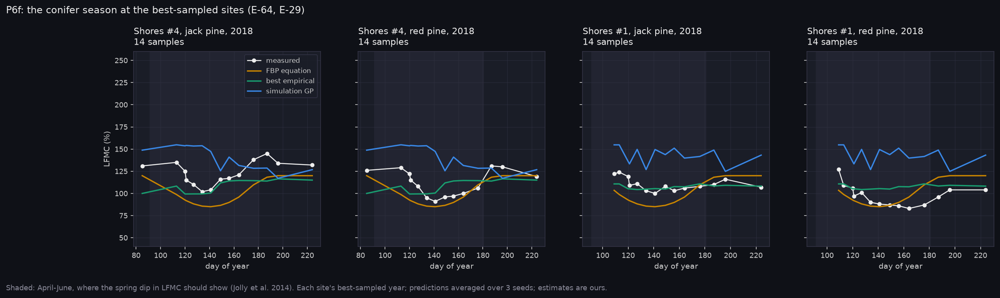

# P6f: LFMC from Sentinel-2 against FBP's equation (E-64, E-29)

Run on Nibi: `narval_results/lfmc_v1/20261103-2123`, 3 seeds, complete. Globe-LFMC 2017+, development sites only: 1,739 records at 37 sites. The frozen 15 % of sites was not read. The design and its placeholders are in A-47. All values are Reconstructed (ours); nothing here was issued by CWFIS.

**At a glance:** [experiments.md](experiments.md). Tables: [tables.md](tables.md).

Generated with:

```bash
python scripts/make_results_package.py --phase P6f --run narval_results/lfmc_v1/20261103-2123
python scripts/make_phase_docs.py --phase P6f
```

## What it found



**E-64 is REFUTED, on every clause.** On conifer records (1,584 at 31 sites), RMSE difference against FBP's foliar moisture equation, CI by bootstrap over sites:

| estimate | RMSE | minus FBP equation (14.0) |
|---|---|---|
| simulation GP, 10 bands (of record) | 40.0 | +26.0 [+22.4, +29.3] |
| best empirical, chosen in inner folds | 14.6 | +0.6 [-0.1, +1.2] |
| simulation MLP, 10 bands | 32.4 | +18.4 [+12.6, +24.7] |

- **(a) Neither spectral estimate beats the equation.** The simulation-trained retrieval is far worse. The empirical one ties.
- **(b) The simulation retrieval loses to the empirical one by 25 points** [+22.1, +28.4], not under 10.

**Read against the spread of the target, nothing does well on conifers.** Conifer LFMC in these records has a standard deviation of 15.2 points (1st-99th percentile 80-149 %). A constant at the mean would score about 15.2. The equation (14.0, R2 0.15) and the empirical models (14.1-15.3, R2 0.01-0.09) are barely below that.

**E-29 is SUPPORTED as registered, but read weakly.** On jack and red pine, dropping B12 raises the simulation GP's RMSE by +1.7 [+0.4, +3.2]. It does so in spring (+1.7 [+0.1, +3.7]) and summer (+1.4 [+0.0, +2.8]); for the MLP the rise is +7.4 [+1.7, +15.6]. The ARD relevances agree: B11 leads, then B8A and B12. But that gain sits inside a retrieval that over-predicts by about 31 points and is worse than a constant. It shows B12 carries information for the simulated canopy, not that B12 recovers LFMC from orbit.



**Why the simulation fails: a bias, not noise.**
- The simulation GP over-predicts conifer LFMC by +31 (+40 in April-June, +13 in July-September). The MLP is +14.
- Both sit far above the 1:1 line, with no slope against the measurement.
- This points at the forward model and priors, not at the regression. A-47 lists the suspects:
  - 4SAIL as a turbid medium for conifer stands;
  - needles as a high-N broadleaf;
  - soil-only backgrounds under open pine;
  - uniform priors from 60 to 250 % LFMC, while measured conifer LFMC stays within 80-149 %.

**Training without the noise model is a disaster (rule 6).** The same GP trained on noise-free simulations scores RMSE 274 (bias +98). The noise model is what keeps the simulation retrieval within reach of real spectra at all.



**The equation follows the conifer spring dip; the spectra don't.** At the best-sampled sites (Shores #1 and #4, jack and red pine, 2018):
- Measured LFMC falls from about 130 % to about 90 % between day 110 and 150 and recovers by July.
- FBP's equation, a function of date and place, dips at about the same time.
- The best empirical model is almost flat.
- The simulation GP stays about 30 points high and jumps from date to date.

By season on all conifers, the empirical models beat the equation in April-June (12.7 against 14.0) and lose in July-September (17.4 against 14.3).

**Deciduous (155 records, 6 sites, all aspen)** is reported, not tested. Every model is poor: the equation 52.7 (bias -36, since it describes conifer foliage), NMDI and the GP on bands about 33-34.

## What this means

- **For T1 (live fuel moisture) and G1 (FMC is computed, never observed).** On Sentinel-2's bands, neither route beats FBP's own equation on conifers:
  - the simulation-trained retrieval, as built (4SAIL, soil backgrounds, wide priors);
  - an empirical index calibration.
  
  The imager's case for T1 is not made by this evidence. It is not refuted for a better forward model or for narrow SWIR bands either.
- **For the band decision (E-46).** B12 helps the simulation retrieval (E-29) and B11 leads its relevance. The empirical side picks MSI and NDMI, which use NIR and B11 only. There is no band ranking from a model that works, so P6f adds only a weak SWIR line to E-46.
- **What would change the answer:**
  1. A discontinuous-canopy model for conifers, with moss and lichen backgrounds (brief Phase 1).
  2. Priors narrowed to the measured range by species and season.
  3. The independent PROSPECT/4SAIL reference check still owed (A-47).
  4. James's own LFMC sampling, where Cw and Cm are measured separately, so the dry-matter half of H1 can be tested directly.

## Limits

- Globe-LFMC has no Canadian sites. US jack and red pine are the analogues (brief section 10). Black spruce has 16 records, so no C-2 claim is made.
- Pairing is +-5 days, 30 m buffer, nearest clear Sentinel-2 date (A-47).
- Placeholder sensor noise (A-37) plus an atmospheric-correction residual.
- 6 deciduous sites: wide CIs.

<!-- qual:start -->
## Qualitative view per experiment

- **E-64** LFMC: simulation-trained, Sentinel-2 empirical, FBP equation (site series): [qual_E-64_series.png](qual_E-64_series.png), [lfmc_scatter.png](lfmc_scatter.png)
- **E-29** T1 live foliar moisture (site series): [qual_E-64_series.png](qual_E-64_series.png)
<!-- qual:end -->
