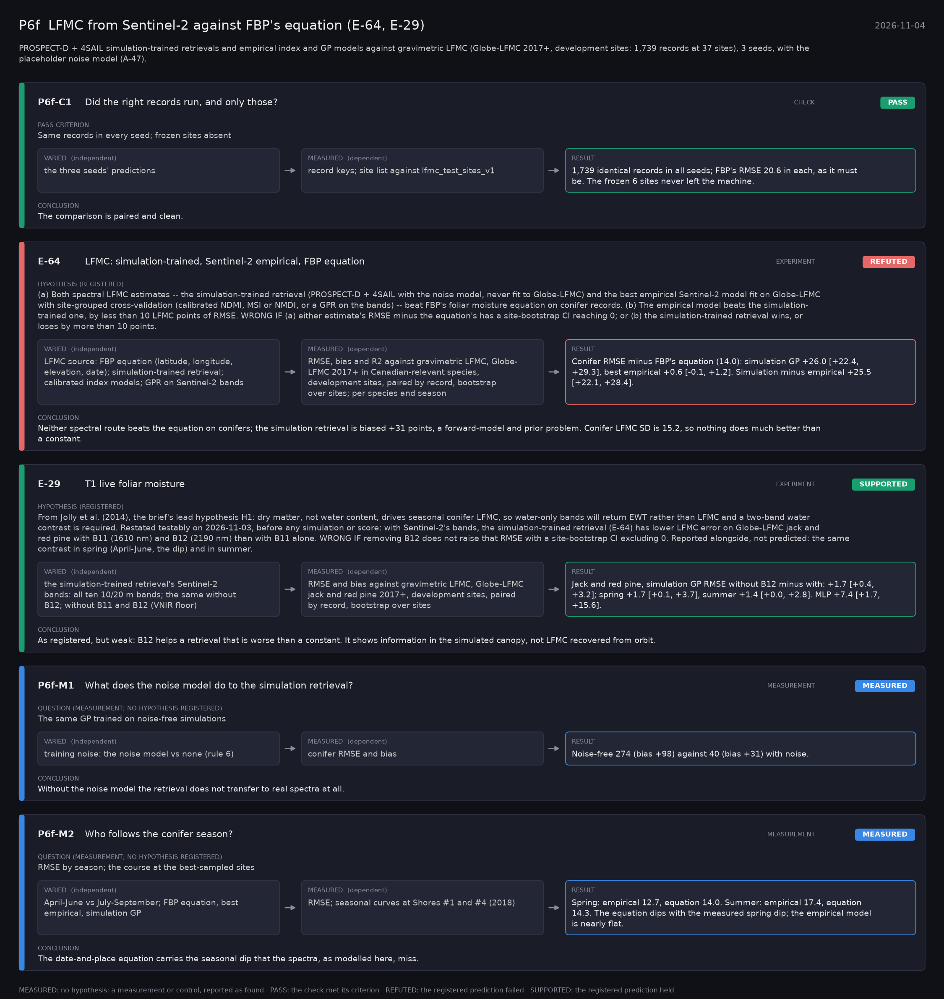

# P6f: LFMC from Sentinel-2 against FBP's equation (E-64, E-29) (2026-11-04)

What this phase ran and concluded. Generated by `scripts/make_phase_docs.py` from `src/safari_bands/phases.py`; registered hypotheses are quoted from the register, verbatim. Full results: [README.md](README.md).

PROSPECT-D + 4SAIL simulation-trained retrievals and empirical index and GP models against gravimetric LFMC (Globe-LFMC 2017+, development sites: 1,739 records at 37 sites), 3 seeds, with the placeholder noise model (A-47).

## P6f-C1: Did the right records run, and only those? (check): **PASS**

| | |
|---|---|
| Pass criterion | Same records in every seed; frozen sites absent |
| Varied (independent) | the three seeds' predictions |
| Measured (dependent) | record keys; site list against lfmc_test_sites_v1 |
| Result | 1,739 identical records in all seeds; FBP's RMSE 20.6 in each, as it must be. The frozen 6 sites never left the machine. |
| Verdict | **PASS**: the check met its criterion |
| Conclusion | The comparison is paired and clean. |

## E-64: LFMC: simulation-trained, Sentinel-2 empirical, FBP equation (experiment): **REFUTED**

| | |
|---|---|
| Hypothesis (registered) | (a) Both spectral LFMC estimates -- the simulation-trained retrieval (PROSPECT-D + 4SAIL with the noise model, never fit to Globe-LFMC) and the best empirical Sentinel-2 model fit on Globe-LFMC with site-grouped cross-validation (calibrated NDMI, MSI or NMDI, or a GPR on the bands) -- beat FBP's foliar moisture equation on conifer records. (b) The empirical model beats the simulation-trained one, by less than 10 LFMC points of RMSE. WRONG IF (a) either estimate's RMSE minus the equation's has a site-bootstrap CI reaching 0; or (b) the simulation-trained retrieval wins, or loses by more than 10 points. |
| Varied (independent) | LFMC source: FBP equation (latitude, longitude, elevation, date); simulation-trained retrieval; calibrated index models; GPR on Sentinel-2 bands |
| Measured (dependent) | RMSE, bias and R2 against gravimetric LFMC, Globe-LFMC 2017+ in Canadian-relevant species, development sites, paired by record, bootstrap over sites; per species and season |
| Result | Conifer RMSE minus FBP's equation (14.0): simulation GP +26.0 [+22.4, +29.3], best empirical +0.6 [-0.1, +1.2]. Simulation minus empirical +25.5 [+22.1, +28.4]. |
| Verdict | **REFUTED**: the registered prediction failed |
| Conclusion | Neither spectral route beats the equation on conifers; the simulation retrieval is biased +31 points, a forward-model and prior problem. Conifer LFMC SD is 15.2, so nothing does much better than a constant. |

## E-29: T1 live foliar moisture (experiment): **SUPPORTED**

| | |
|---|---|
| Hypothesis (registered) | From Jolly et al. (2014), the brief's lead hypothesis H1: dry matter, not water content, drives seasonal conifer LFMC, so water-only bands will return EWT rather than LFMC and a two-band water contrast is required. Restated testably on 2026-11-03, before any simulation or score: with Sentinel-2's bands, the simulation-trained retrieval (E-64) has lower LFMC error on Globe-LFMC jack and red pine with B11 (1610 nm) and B12 (2190 nm) than with B11 alone. WRONG IF removing B12 does not raise that RMSE with a site-bootstrap CI excluding 0. Reported alongside, not predicted: the same contrast in spring (April-June, the dip) and in summer. |
| Varied (independent) | the simulation-trained retrieval's Sentinel-2 bands: all ten 10/20 m bands; the same without B12; without B11 and B12 (VNIR floor) |
| Measured (dependent) | RMSE and bias against gravimetric LFMC, Globe-LFMC jack and red pine 2017+, development sites, paired by record, bootstrap over sites |
| Result | Jack and red pine, simulation GP RMSE without B12 minus with: +1.7 [+0.4, +3.2]; spring +1.7 [+0.1, +3.7], summer +1.4 [+0.0, +2.8]. MLP +7.4 [+1.7, +15.6]. |
| Verdict | **SUPPORTED**: the registered prediction held |
| Conclusion | As registered, but weak: B12 helps a retrieval that is worse than a constant. It shows information in the simulated canopy, not LFMC recovered from orbit. |

## P6f-M1: What does the noise model do to the simulation retrieval? (measurement): **MEASURED**

| | |
|---|---|
| Question (measurement; no hypothesis registered) | The same GP trained on noise-free simulations |
| Varied (independent) | training noise: the noise model vs none (rule 6) |
| Measured (dependent) | conifer RMSE and bias |
| Result | Noise-free 274 (bias +98) against 40 (bias +31) with noise. |
| Verdict | **MEASURED**: no hypothesis: a measurement or control, reported as found |
| Conclusion | Without the noise model the retrieval does not transfer to real spectra at all. |

## P6f-M2: Who follows the conifer season? (measurement): **MEASURED**

| | |
|---|---|
| Question (measurement; no hypothesis registered) | RMSE by season; the course at the best-sampled sites |
| Varied (independent) | April-June vs July-September; FBP equation, best empirical, simulation GP |
| Measured (dependent) | RMSE; seasonal curves at Shores #1 and #4 (2018) |
| Result | Spring: empirical 12.7, equation 14.0. Summer: empirical 17.4, equation 14.3. The equation dips with the measured spring dip; the empirical model is nearly flat. |
| Verdict | **MEASURED**: no hypothesis: a measurement or control, reported as found |
| Conclusion | The date-and-place equation carries the seasonal dip that the spectra, as modelled here, miss. |
