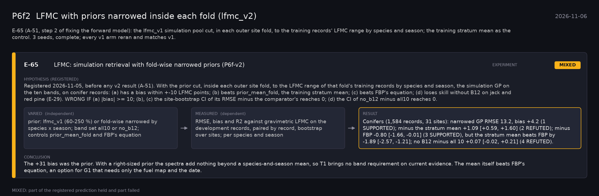

# P6f2: LFMC with priors narrowed inside each fold (lfmc_v2) (2026-11-06)

What this phase ran and concluded. Generated by `scripts/make_phase_docs.py` from `src/safari_bands/phases.py`; registered hypotheses are quoted from the register, verbatim. Full results: [README.md](README.md).

E-65 (A-51, step 2 of fixing the forward model): the lfmc_v1 simulation pool cut, in each outer site fold, to the training records' LFMC range by species and season; the training stratum mean as the control. 3 seeds, complete; every v1 arm reran and matches v1.

## E-65: LFMC: simulation retrieval with fold-wise narrowed priors (P6f-v2) (experiment): **MIXED**

| | |
|---|---|
| Hypothesis (registered) | Registered 2026-11-05, before any v2 result (A-51). With the prior cut, inside each outer site fold, to the LFMC range of that fold's training records by species and season, the simulation GP on the ten bands, on conifer records: (a) has a bias within +-10 LFMC points; (b) beats prior_mean_fold, the training stratum mean; (c) beats FBP's equation; (d) loses skill without B12 on jack and red pine (E-29). WRONG IF (a) |bias| >= 10; (b), (c) the site-bootstrap CI of its RMSE minus the comparator's reaches 0; (d) the CI of no_b12 minus all10 reaches 0. |
| Varied (independent) | prior: lfmc_v1 (60-250 %) or fold-wise narrowed by species x season; band set all10 or no_b12; controls prior_mean_fold and FBP's equation |
| Measured (dependent) | RMSE, bias and R2 against gravimetric LFMC on the development records, paired by record, bootstrap over sites; per species and season |
| Result | Conifers (1,584 records, 31 sites): narrowed GP RMSE 13.2, bias +4.2 (1 SUPPORTED); minus the stratum mean +1.09 [+0.59, +1.60] (2 REFUTED); minus FBP -0.80 [-1.66, -0.01] (3 SUPPORTED), but the stratum mean beats FBP by -1.89 [-2.57, -1.21]; no B12 minus all 10 +0.07 [-0.02, +0.21] (4 REFUTED). |
| Verdict | **MIXED**: part of the registered prediction held and part failed |
| Conclusion | The +31 bias was the prior. With a right-sized prior the spectra add nothing beyond a species-and-season mean, so T1 brings no band requirement on current evidence. The mean itself beats FBP's equation, an option for G1 that needs only the fuel map and the date. |
