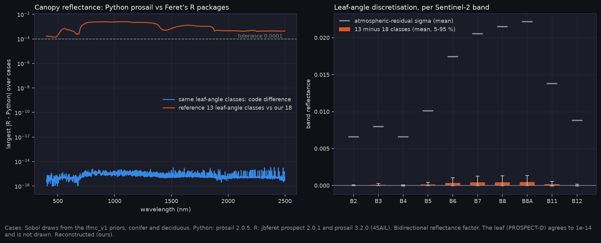

# P6f-v2, step 1: the forward model against an independent reference (A-47, A-51)

James (2026-11-05) chose to try to fix the forward model behind the LFMC retrieval, starting with the two cheap steps (PLAN_NEXT section 3, option a). This is step 1: the reference check A-47 owed. The brief's Phase 1 is "done when spectra reproduce a reference implementation within tolerance". Until now only physical-behaviour tests existed.

Generated with:

```bash
python scripts/check_forward_reference.py        # 64 cases per fuel group; calls scripts/r/prosail_reference.R
```

Tables: [T_reference.csv](T_reference.csv), [summary.json](summary.json). All values are Reconstructed (ours).



## How it was checked

- **Cases:** 128 Sobol draws from the `lfmc_v1` priors (64 conifer, 64 deciduous), covering the whole range the retrieval was trained on.
- **Ours:** Python `prosail` 2.0.5, PROSPECT-D leaf + 4SAIL canopy, bidirectional reflectance factor, exactly as `forward.Prosail` calls it.
- **Reference:** J.-B. Féret's R packages `prospect` 2.0.1 and `prosail` 3.2.0 (4SAIL), installed from github.com/jbferet into R 4.6.1.
- **Three runs of the reference:**
  1. **Code:** R given our PROSPECT-D coefficients and soil spectra, with its leaf-angle classes set to ours. Pass/fail at 1e-4 reflectance.
  2. **Coefficients:** R's own PROSPECT coefficients against ours, on the leaf.
  3. **Leaf angles:** R as released. Reported, not pass/fail.

## What it found

| check | largest difference | verdict |
|---|---|---|
| code, leaf reflectance and transmittance | 5e-15 | **passes** |
| code, canopy reflectance | 3e-15 | **passes** |
| coefficients (R's current against ours) | 3e-15 | **identical**: R ships the same PROSPECT-D coefficients |
| leaf-angle classes (reference 13 against our 18) | 0.0025 at one wavelength | below the noise: see below |

- **The implementation is right.** With the same inputs, PROSPECT-D and 4SAIL agree with the reference to floating-point rounding.
- **One structural difference: how the leaf-angle distribution is binned.**
  - The original 4SAIL, and Féret's R code, use 13 classes: 10° steps to 80°, then 2° steps to 90°.
  - Python `prosail` uses 18 equal 5° classes.
  - The difference grows with mean leaf angle: about 1e-4 at 30°, 4e-4 at 57° and 1.7e-3 at 80° in the NIR.
  - In Sentinel-2 bands it is at most 0.1 of the atmospheric-correction residual already added as noise (95th percentile, B6–B8A). In LFMC terms it is worth −0.3 % [−1.7, +0.1] through B11 and −0.1 % [−1.1, +1.9] through B12.
- **So the forward model's code does not explain E-64's +31 bias.** The suspects left are the ones A-47 named: the priors, needles as a high-N broadleaf, soil-only backgrounds, and 4SAIL as a turbid medium for conifer stands.

## What follows

- **Step 2, narrowed priors,** is built and goes to the cluster (A-51, E-65): `Fire_Risk_FW scripts/run_lfmc.py`, arms `sim_gp_fold_*` and `prior_mean_fold`.
- **No change to the 18 classes.** A difference this far below the noise does not justify forking the package; it is recorded here.
- **Phase 1's reference criterion is now met** for PROSPECT-D + 4SAIL. It still does not cover a discontinuous-canopy model, which does not exist here yet.

## Limits

- The reference shares the 4SAIL lineage (Verhoef's equations, Féret's port). It checks the implementation, not whether a turbid medium describes a conifer stand.
- PROSPECT-PRO (proteins and carbon-based constituents in place of one Cm) is in the R package but not in ours. It is not used here.

<!-- qual:start -->
## Qualitative view per experiment

- **P6f-C2** Does our forward model reproduce a reference implementation? (spectra): [qual_P6f_spectra.png](qual_P6f_spectra.png)
<!-- qual:end -->
