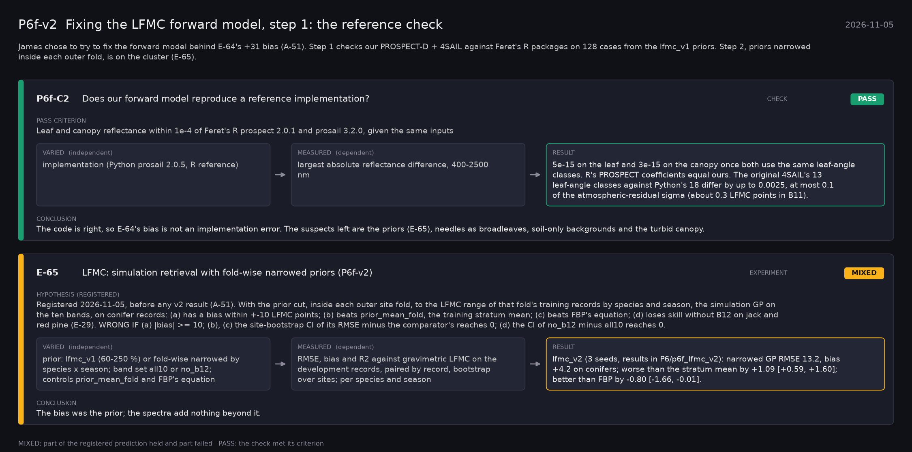

# P6f-v2: Fixing the LFMC forward model, step 1: the reference check (2026-11-05)

What this phase ran and concluded. Generated by `scripts/make_phase_docs.py` from `src/safari_bands/phases.py`; registered hypotheses are quoted from the register, verbatim. Full results: [README.md](README.md).

James chose to try to fix the forward model behind E-64's +31 bias (A-51). Step 1 checks our PROSPECT-D + 4SAIL against Feret's R packages on 128 cases from the lfmc_v1 priors. Step 2, priors narrowed inside each outer fold, is on the cluster (E-65).

## P6f-C2: Does our forward model reproduce a reference implementation? (check): **PASS**

| | |
|---|---|
| Pass criterion | Leaf and canopy reflectance within 1e-4 of Feret's R prospect 2.0.1 and prosail 3.2.0, given the same inputs |
| Varied (independent) | implementation (Python prosail 2.0.5, R reference) |
| Measured (dependent) | largest absolute reflectance difference, 400-2500 nm |
| Result | 5e-15 on the leaf and 3e-15 on the canopy once both use the same leaf-angle classes. R's PROSPECT coefficients equal ours. The original 4SAIL's 13 leaf-angle classes against Python's 18 differ by up to 0.0025, at most 0.1 of the atmospheric-residual sigma (about 0.3 LFMC points in B11). |
| Verdict | **PASS**: the check met its criterion |
| Conclusion | The code is right, so E-64's bias is not an implementation error. The suspects left are the priors (E-65), needles as broadleaves, soil-only backgrounds and the turbid canopy. |

## E-65: LFMC: simulation retrieval with fold-wise narrowed priors (P6f-v2) (experiment): **MIXED**

| | |
|---|---|
| Hypothesis (registered) | Registered 2026-11-05, before any v2 result (A-51). With the prior cut, inside each outer site fold, to the LFMC range of that fold's training records by species and season, the simulation GP on the ten bands, on conifer records: (a) has a bias within +-10 LFMC points; (b) beats prior_mean_fold, the training stratum mean; (c) beats FBP's equation; (d) loses skill without B12 on jack and red pine (E-29). WRONG IF (a) |bias| >= 10; (b), (c) the site-bootstrap CI of its RMSE minus the comparator's reaches 0; (d) the CI of no_b12 minus all10 reaches 0. |
| Varied (independent) | prior: lfmc_v1 (60-250 %) or fold-wise narrowed by species x season; band set all10 or no_b12; controls prior_mean_fold and FBP's equation |
| Measured (dependent) | RMSE, bias and R2 against gravimetric LFMC on the development records, paired by record, bootstrap over sites; per species and season |
| Result | lfmc_v2 (3 seeds, results in P6/p6f_lfmc_v2): narrowed GP RMSE 13.2, bias +4.2 on conifers; worse than the stratum mean by +1.09 [+0.59, +1.60]; better than FBP by -0.80 [-1.66, -0.01]. |
| Verdict | **MIXED**: part of the registered prediction held and part failed |
| Conclusion | The bias was the prior; the spectra add nothing beyond it. |
