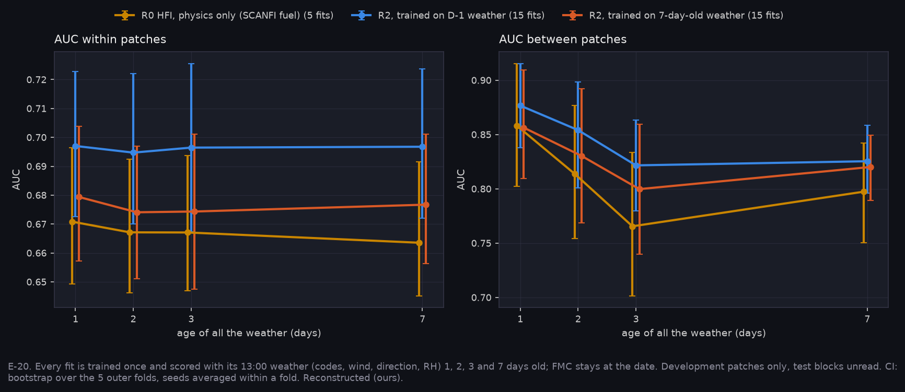

# P7d: weather age, one model scored with stale weather (E-20)

Run on Nibi: `narval_results/lags_v1/20261105-1625`, 35 of 35 fits (r0_scanfi 5, r2 15, r2_age7 15). Pack `stage2_fire_cffdrs_v2_lags`, rebuilt at Model `a5d6f49` (A-50); development patches only, test blocks unread. All values are Reconstructed (ours).

**At a glance:** [experiments.md](experiments.md). Tables: [tables.md](tables.md).

Generated with:

```bash
python scripts/make_results_package.py --phase P7d --run narval_results/lags_v1/20261105-1625
python scripts/make_phase_docs.py --phase P7d
```

## The design

- **Score at lag.** Each fit is trained once on D-1 weather, then scored four times with all of its 13:00 weather 1, 2, 3 and 7 days old: the codes, wind, direction and RH. FMC stays at the date. Differences are taken within a fit, so they are paired exactly.
- **Trained stale.** `r2_age7` is trained and scored on 7-day-old weather. Against `r2` it is paired by fold and seed.
- **R0** is physics only, with no training; its HFI output is the one shown, because R2 starts from it.
- **CI:** bootstrap over the 5 outer folds, with seeds averaged within a fold.



## What it found

| | 2 days | 3 days | 7 days |
|---|---|---|---|
| R2, between patches, minus 1 day | −0.023 [−0.056, +0.012] | **−0.055 [−0.075, −0.034]**, 5/5 folds | **−0.051 [−0.091, −0.011]**, 4/5 |
| R0 HFI, between patches | **−0.044 [−0.075, −0.015]** | **−0.093 [−0.113, −0.075]** | −0.061 [−0.134, +0.016] |
| R2, within patches | −0.002 [−0.006, +0.001] | −0.001 | −0.000 |

- **E-20's testable half holds: decay is not flat.** From 3 days, stale weather costs R2 about 0.05 AUC between patches (0.877 → 0.822). The physics alone (R0) loses more, about 0.09 at 3 days, so R2's learning absorbs part of the staleness but not most of it.
- **Inside a patch, weather age barely matters.** Weather is one value per patch, so the within-patch ranking rests on fuel and terrain. Weather age moves it by at most 0.007.
- **Training on stale weather doesn't help.** `r2_age7` is worse than `r2` at every age: −0.018 to −0.022 within patches (5/5 folds). Even scored at 7 days, where it is matched, it is no better between patches (−0.005 [−0.028, +0.018]).
- **The curve is not monotonic.** Between patches, 7-day-old weather scores slightly better than 3-day-old for all three. With 34 patches per fold this is within the CIs, so it isn't read as a recovery.
- **Not run:** the other half of the hypothesis, that codes decay fastest and the dimensionless history slowest. That needs the per-code weather arms. So the verdict is **PARTIAL**.

## What it means for P12

- **Weather-dependent products belong on the ground with fresh weather (A-41).** A product uplinked 1–2 days old loses −0.023 between patches at 2 days, a CI that still reaches 0. By 3 days it loses 0.055. The architecture options in P12 carry this as the cost of running the fire model onboard.
- **The structure estimators don't depend on weather.** Their value is untouched, which is consistent with A-41's onboard/ground split.

## Limits

- 99 fire patches: 34 per held-out fold, 18 of them fires. Between-patch CIs are wide.
- ERA5-Land weather at 13:00 LDT, not station observations.
- P7's earlier r2_lag7 aged only the codes. It is superseded here, where all weather ages together.

<!-- qual:start -->
## Qualitative view per experiment

- **E-20** Weather staleness (tiles): [qual_E-20_trained_stale.png](qual_E-20_trained_stale.png)
<!-- qual:end -->
