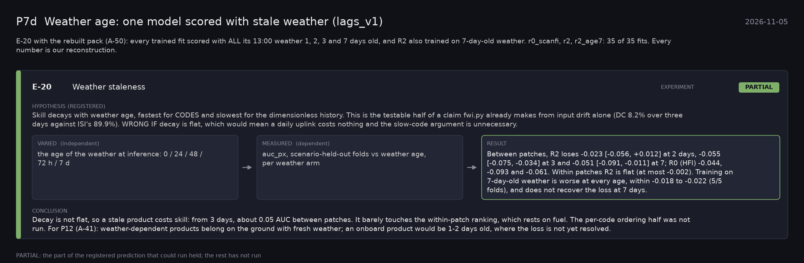

# P7d: Weather age: one model scored with stale weather (lags_v1) (2026-11-05)

What this phase ran and concluded. Generated by `scripts/make_phase_docs.py` from `src/safari_bands/phases.py`; registered hypotheses are quoted from the register, verbatim. Full results: [README.md](README.md).

E-20 with the rebuilt pack (A-50): every trained fit scored with ALL its 13:00 weather 1, 2, 3 and 7 days old, and R2 also trained on 7-day-old weather. r0_scanfi, r2, r2_age7: 35 of 35 fits. Every number is our reconstruction.

## E-20: Weather staleness (experiment): **PARTIAL**

| | |
|---|---|
| Hypothesis (registered) | Skill decays with weather age, fastest for CODES and slowest for the dimensionless history. This is the testable half of a claim fwi.py already makes from input drift alone (DC 8.2% over three days against ISI's 89.9%). WRONG IF decay is flat, which would mean a daily uplink costs nothing and the slow-code argument is unnecessary. |
| Varied (independent) | the age of the weather at inference: 0 / 24 / 48 / 72 h / 7 d |
| Measured (dependent) | auc_px, scenario-held-out folds vs weather age, per weather arm |
| Result | Between patches, R2 loses -0.023 [-0.056, +0.012] at 2 days, -0.055 [-0.075, -0.034] at 3 and -0.051 [-0.091, -0.011] at 7; R0 (HFI) -0.044, -0.093 and -0.061. Within patches R2 is flat (at most -0.002). Training on 7-day-old weather is worse at every age, within -0.018 to -0.022 (5/5 folds), and does not recover the loss at 7 days. |
| Verdict | **PARTIAL**: the part of the registered prediction that could run held; the rest has not run |
| Conclusion | Decay is not flat, so a stale product costs skill: from 3 days, about 0.05 AUC between patches. It barely touches the within-patch ranking, which rests on fuel. The per-code ordering half was not run. For P12 (A-41): weather-dependent products belong on the ground with fresh weather; an onboard product would be 1-2 days old, where the loss is not yet resolved. |
