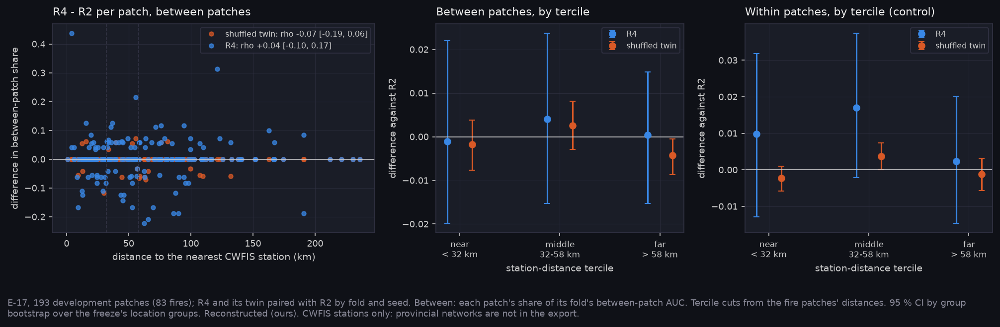

# P7f: does imagery help most where the weather stations are sparse? (E-17, 2026-11-10)

E-17 (gap G3, station density) is read from the slot sweep already held, `narval_results/slots_v2/7289478`. No new training was needed:
- R4 (R2 plus a free imagery branch) and the combined slot arm (percent conifer, FMC and CBH corrected from imagery), each with its shuffled twin;
- all paired with R2 by fold and seed, 15 of 15 fits each.

The distance from each patch to the nearest reporting CWFIS station is the `station_km` column of the development pack (P3, E-52). It covers all 193 development patches, the 2019 fires included. The frozen test is not read. All values are Reconstructed (ours).

**At a glance:** [tables.md](tables.md), [T_station_terciles.csv](T_station_terciles.csv), [summary.json](summary.json).



## Result

| Arm | ρ, between-patch gain against distance [95 % CI] | Gain by tercile (< 32 km / 32–58 / > 58) | Verdict |
|---|---|---|---|
| R4, free imagery branch | +0.04 [−0.10, +0.17] | −0.001 / +0.004 / +0.000 | **REFUTED** |
| PC + FMC + CBH slots from imagery | −0.03 [−0.16, +0.09] | −0.001 / +0.001 / −0.003 | **REFUTED** |

The shuffled twins are within ±0.004 everywhere.

**What it means.**
- The imagery increment does not grow with distance from the nearest station.
  - **Between patches:** the gain is about zero in every tercile.
  - **Within patches:** also flat, and largest in the middle tercile (+0.017, CI reaching 0).
  - The CI on ρ rules out a strong positive link (above +0.17) on this sample.
- **This agrees with E-52.** There, ERA5 and station codes disagreed no more far from stations than near them (ρ about 0), so the premise was already at risk. Here the outcome confirms it: ERA5-Land does not degrade with station distance the way an interpolated station grid would.
- **For the mission case,** the argument "satellite fuel state matters most in the sparsely instrumented north" gets no support from these fires. The imager's value has to rest on its measured slot and band contributions (P7, P12), not on compensating for station gaps.

## How it is measured

- **Between patches (the verdict).** Weather is one value per patch, so it can only change how patches rank against each other, not the ranking inside a patch. Each patch's share of its fold's between-patch AUC is computed:
  - for a fire patch, the share of the fold's non-fire patches scored below it;
  - for a non-fire patch, the share of fire patches scored above it.

  The fold's AUC is the mean of either set, so the shares pair arm against R2 patch by patch. ρ is taken over all patches.
- **Within patches (a control).** Within-patch AUC, arm minus R2, fire patches only.
- **Terciles** are cut on the 83 fire patches' distances: 32 and 58 km. The register's earlier 30 and 54 km came from the station list before packing.
- **CIs:** group bootstrap over the freeze's location groups (2,000 resamples).

**Correction to the verdict rule (stated openly).** The rule (ρ's CI above 0 → SUPPORTED, otherwise REFUTED) was fixed before the first readout. That readout applied it to the within-patch difference: R4 ρ −0.10 [−0.33, +0.14], which would read REFUTED. The rule was then moved to the between-patch share, because weather cannot act within a patch. The move was made after seeing the within-patch number. Both are in the table, and neither shows growth with distance.

## Limits

- **CWFIS stations only.** Provincial agency stations are not in the CWFIS export, so true station density is higher than `station_km` implies. Distances overstate the gap.
- **83 fire patches, 58 of them from 2023.** Distance and year are partly confounded: the 2021 fires sit near stations (median 23 km).
- **R4's imagery is the pre-fire composite, not a moisture retrieval.** A dedicated LFMC slot does not exist yet (E-29, E-16 blocked). A moisture slot could still behave differently.

## Reproduce

```bash
python scripts/make_results_package.py --phase P7f --run narval_results/slots_v2/7289478
python scripts/make_phase_docs.py --phase P7f
```
