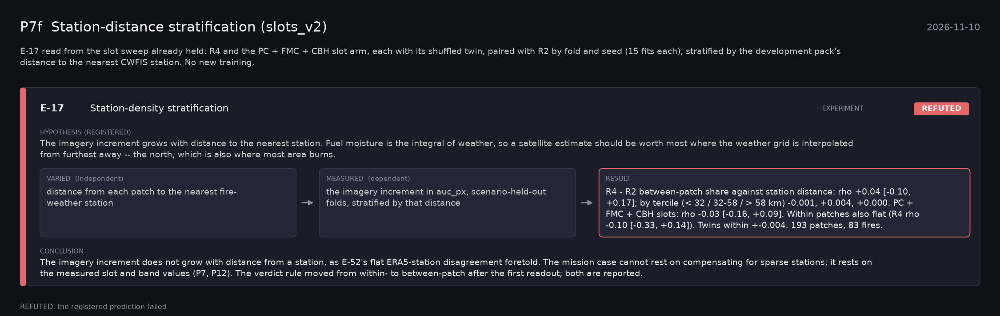

# P7f: Station-distance stratification (slots_v2) (2026-11-10)

What this phase ran and concluded. Generated by `scripts/make_phase_docs.py` from `src/safari_bands/phases.py`; registered hypotheses are quoted from the register, verbatim. Full results: [README.md](README.md).

E-17 read from the slot sweep already held: R4 and the PC + FMC + CBH slot arm, each with its shuffled twin, paired with R2 by fold and seed (15 fits each), stratified by the development pack's distance to the nearest CWFIS station. No new training.

## E-17: Station-density stratification (experiment): **REFUTED**

| | |
|---|---|
| Hypothesis (registered) | The imagery increment grows with distance to the nearest station. Fuel moisture is the integral of weather, so a satellite estimate should be worth most where the weather grid is interpolated from furthest away -- the north, which is also where most area burns. |
| Varied (independent) | distance from each patch to the nearest fire-weather station |
| Measured (dependent) | the imagery increment in auc_px, scenario-held-out folds, stratified by that distance |
| Result | R4 - R2 between-patch share against station distance: rho +0.04 [-0.10, +0.17]; by tercile (< 32 / 32-58 / > 58 km) -0.001, +0.004, +0.000. PC + FMC + CBH slots: rho -0.03 [-0.16, +0.09]. Within patches also flat (R4 rho -0.10 [-0.33, +0.14]). Twins within +-0.004. 193 patches, 83 fires. |
| Verdict | **REFUTED**: the registered prediction failed |
| Conclusion | The imagery increment does not grow with distance from a station, as E-52's flat ERA5-station disagreement foretold. The mission case cannot rest on compensating for sparse stations; it rests on the measured slot and band values (P7, P12). The verdict rule moved from within- to between-patch after the first readout; both are reported. |
