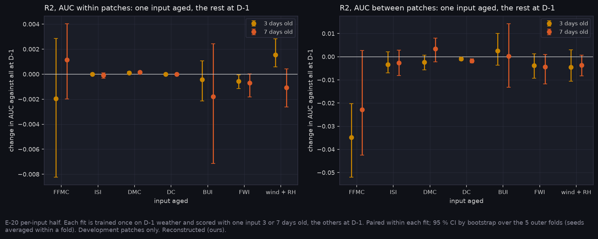

# P7g: which input's staleness costs the skill? (E-20, per-input half, 2026-11-11)

Run on Narval: `narval_results/lags_v2/20261111-0021`, 15/15 R2 fits and 5 R0 evaluations.

Each R2 fit was trained once on D−1 weather, then scored again with **one** input made 2, 3 or 7 days old while every other input stayed at D−1. The inputs aged were:
- each of the six FWI codes;
- the noon wind, wind direction and humidity together ("wind + RH").

The design was registered before the run (A-50, E-20). Deltas pair within a fit; CIs are a bootstrap over the 5 outer folds. All values are Reconstructed (ours).

**At a glance:** [tables.md](tables.md), [T_inputs.csv](T_inputs.csv), [T_fast_slow.csv](T_fast_slow.csv).



## Result

**The registered prediction:** at 3 and 7 days, ageing FFMC or ISI costs more between-patch AUC than ageing DC or BUI.

| Model | Age | Mean(FFMC, ISI aged) − mean(DC, BUI aged), between patches | Folds below 0 |
|---|---|---|---|
| R2 | 3 days | **−0.020** [−0.027, −0.012] | 5/5 |
| R2 | 7 days | **−0.012** [−0.021, −0.001] | 4/5 |
| R0 (HFI) | 3 days | −0.044 [−0.057, −0.033] | |
| R0 (HFI) | 7 days | −0.027 [−0.044, −0.006] | |

**E-20's per-input half: SUPPORTED.** Within patches nothing moves (|change| ≤ 0.002), as weather is one value per patch.

**R2, between patches, each input aged alone:**

| Input aged | 3 days | 7 days |
|---|---|---|
| **FFMC** | **−0.035** [−0.052, −0.020] | −0.023 [−0.043, +0.003] |
| ISI | −0.003 | −0.003 |
| DMC | −0.002 | +0.003 |
| DC | −0.001 [−0.002, −0.000] | −0.002 [−0.003, −0.001] |
| BUI | +0.003 | +0.000 |
| FWI | −0.004 | −0.004 |
| wind + RH | −0.005 | −0.004 |

**What it means:**
- **Staleness is an FFMC problem.**
  - An FFMC 3 days old costs R2 0.035. That is about two-thirds of the 0.055 lost when all the weather is 3 days old (P7d).
  - The slow codes (DC, DMC, BUI) cost almost nothing at a week.
  - This is fwi.py's input-drift argument (DC drifts 8 % in three days, ISI 90 %), now measured on the model's skill.
- **ISI barely matters once FFMC is fresh.** R2 reads fine-fuel moisture through FFMC, and ISI adds wind that the model also sees directly.
- **The loss is not monotone in age for FFMC** (3 days worse than 7). The 7-day CI reaches 0, and fire-weather autocorrelation over a week varies by patch.
- **For P12 (A-41).** An onboard product can carry the slow codes, or anything derived from them, a week old at almost no cost. FFMC is what needs a fresh uplink or a ground-side update. This sharpens P7d's "weather-dependent products on the ground": only the FFMC-dependent part must be.

## Limits

- Development patches only (83 fires, 58 from 2023); the frozen test is read in P10.
- Ageing one code alone pairs it with fresh codes it was computed from (for example an old ISI with a fresh FFMC). Those combinations never occur operationally, but they isolate each input's contribution, as registered.
- R0 is scored at seed 0 only (5 evaluations).

## Reproduce

```bash
python scripts/make_results_package.py --phase P7g --run narval_results/lags_v2/20261111-0021
python scripts/make_phase_docs.py --phase P7g
```
