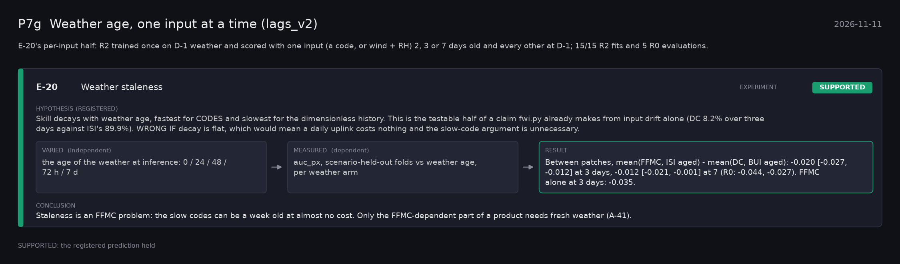

# P7g: Weather age, one input at a time (lags_v2) (2026-11-11)

What this phase ran and concluded. Generated by `scripts/make_phase_docs.py` from `src/safari_bands/phases.py`; registered hypotheses are quoted from the register, verbatim. Full results: [README.md](README.md).

E-20's per-input half: R2 trained once on D-1 weather and scored with one input (a code, or wind + RH) 2, 3 or 7 days old and every other at D-1; 15/15 R2 fits and 5 R0 evaluations.

## E-20: Weather staleness (experiment): **SUPPORTED**

| | |
|---|---|
| Hypothesis (registered) | Skill decays with weather age, fastest for CODES and slowest for the dimensionless history. This is the testable half of a claim fwi.py already makes from input drift alone (DC 8.2% over three days against ISI's 89.9%). WRONG IF decay is flat, which would mean a daily uplink costs nothing and the slow-code argument is unnecessary. |
| Varied (independent) | the age of the weather at inference: 0 / 24 / 48 / 72 h / 7 d |
| Measured (dependent) | auc_px, scenario-held-out folds vs weather age, per weather arm |
| Result | Between patches, mean(FFMC, ISI aged) - mean(DC, BUI aged): -0.020 [-0.027, -0.012] at 3 days, -0.012 [-0.021, -0.001] at 7 (R0: -0.044, -0.027). FFMC alone at 3 days: -0.035. |
| Verdict | **SUPPORTED**: the registered prediction held |
| Conclusion | Staleness is an FFMC problem: the slow codes can be a week old at almost no cost. Only the FFMC-dependent part of a product needs fresh weather (A-41). |
