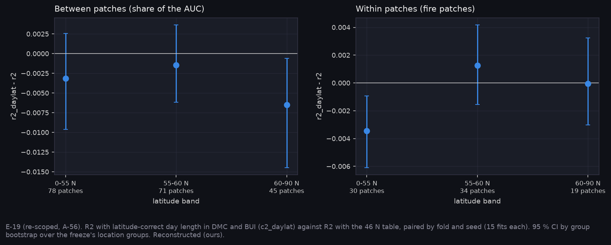

# P7h: latitude-correct day length under R2 (E-19, 2026-11-11)

E-19 as re-scoped on v2 (A-56). The run is `narval_results/slots_e19/20261111-0021`, 15/15 fits each, paired by fold and seed:
- **r2_daylat:** DMC and BUI use latitude-correct day length (the `c2_daylat` variant);
- **r2:** FWI1987's 46° N table.

DC and FWI keep the table in both, because the pack carries `c2_daylat` for DMC and BUI only. All values are Reconstructed (ours).

**At a glance:** [tables.md](tables.md), [T_daylat_bands.csv](T_daylat_bands.csv).



## Result

The registered prediction: the gain concentrates at high latitude, where the 46° N table is furthest from the truth. It is wrong if the gain is uniform. The verdict reads the interaction, (60–90° N) − (0–55° N), on the between-patch share: weather is one value per patch, so only between-patch ranking can respond.

| | Within patches | Between patches |
|---|---|---|
| r2_daylat − r2, all 194 patches | −0.001 [−0.002, +0.001] | −0.003 [−0.012, +0.006] |
| (60–90° N) − (0–55° N) | +0.003 [−0.001, +0.008] | **−0.003 [−0.013, +0.005]** |

Between patches, by band: 0–55° N −0.003, 55–60° N −0.001, 60–90° N −0.007 [−0.015, −0.001].

**E-19: REFUTED.**
- Latitude-correct day length adds nothing to R2 overall.
- It does not help in the north: there it is slightly worse.
- E-50 found the same at R0, where the correction moved DMC but not skill.

**What it means:**
- **The FWI1987 day-length table can stay.** Its error at 60° N does not reach the fire outcome on these patches.
- **The startup and staleness questions matter more for the weather slots** (E-18, E-20).
- **For the CubeSat:** nothing in the weather chain needs latitude-specific treatment from orbit.

## Limits

- 45 patches lie north of 60° N, so the north band is the smallest.
- DC and FWI keep the table, so the correction is partial. A full latitude-correct chain would need a repack.
- Development patches only.

## Reproduce

```bash
python scripts/make_results_package.py --phase P7h --run narval_results/slots_e19/20261111-0021
python scripts/make_phase_docs.py --phase P7h
```
