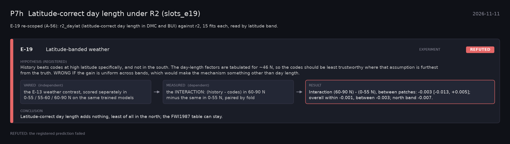

# P7h: Latitude-correct day length under R2 (slots_e19) (2026-11-11)

What this phase ran and concluded. Generated by `scripts/make_phase_docs.py` from `src/safari_bands/phases.py`; registered hypotheses are quoted from the register, verbatim. Full results: [README.md](README.md).

E-19 re-scoped (A-56): r2_daylat (latitude-correct day length in DMC and BUI) against r2, 15 fits each, read by latitude band.

## E-19: Latitude-banded weather (experiment): **REFUTED**

| | |
|---|---|
| Hypothesis (registered) | History beats codes at high latitude specifically, and not in the south. The day-length factors are tabulated for ~46 N, so the codes should be least trustworthy where that assumption is furthest from the truth. WRONG IF the gain is uniform across bands, which would make the mechanism something other than day length. |
| Varied (independent) | the E-13 weather contrast, scored separately in 0-55 / 55-60 / 60-90 N on the same trained models |
| Measured (dependent) | the INTERACTION: (history - codes) in 60-90 N minus the same in 0-55 N, paired by fold |
| Result | Interaction (60-90 N) - (0-55 N), between patches: -0.003 [-0.013, +0.005]; overall within -0.001, between -0.003; north band -0.007. |
| Verdict | **REFUTED**: the registered prediction failed |
| Conclusion | Latitude-correct day length adds nothing, least of all in the north; the FWI1987 table can stay. |
