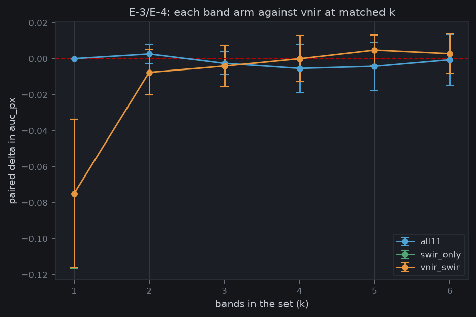

# P7i: the legacy band, axis and index sweeps on the v2 pack (2026-11-11)

These are the legacy fire-outcome sweeps re-run on the CFFDRS v2 pack (A-56): the composite ends the day before each fire, and the label is NBAC burned on or after D. Each arm ran through the same `sweep_bands.py` as in v1:
- tier2-small, 35 epochs (a ranking budget, not an accuracy);
- seed 0, `rasters_only`;
- the slot sweeps' 5 location-group folds.

**Runs:** 16 Narval arrays, `narval_results/sweep_bands_tier2-small_baseline_*_v2/<job>/fold0-4`, all 80 folds complete. Metric: pooled pixel AUC (`auc_px`) on each validation fold. All values are Reconstructed (ours).

**Files:**

| Part | Files |
|---|---|
| Band rankings | [pool_vnir.txt](pool_vnir.txt), [pool_all11.txt](pool_all11.txt), [pool_vnir_swir.txt](pool_vnir_swir.txt), [pool_swir_only.txt](pool_swir_only.txt), figures `pool_*.png` |
| Arm contrasts | [arms_arms.txt](arms_arms.txt), [arms_neg.txt](arms_neg.txt), [arms_gsd.txt](arms_gsd.txt), [arms_cond.txt](arms_cond.txt), [arms_shift.txt](arms_shift.txt), [arms_idx.txt](arms_idx.txt), figures `arms_*.png`, `matched_k.png`, `shift_tolerance.png` |

Every `.txt` has a `.json` beside it. "2 SE" intervals and fold wins are by fold, paired.



## Verdicts

| Exp. | Prediction | v2 result | Verdict |
|---|---|---|---|
| E-1 | The best six VNIR bands include red edge and exclude B1, B9 | Red edge in: B5 and B6 in 4/5 folds at k = 6, B7 in 3/5. But **B1 is in 3/5**: an atmospheric band survives | **REFUTED** |
| E-2 | B11 enters the 11-band greedy search by k = 3 | Entry rungs 3, 5, 7, 7 and never in one fold | **REFUTED** |
| E-3 | Forcing B11 in gains something small and positive (under +0.02) | +0.005 at k = 5, +0.003 at k = 6, every k from 2 to 6 within noise | **MIXED**: small holds, positive not shown |
| E-4 | B11 alone is clearly above chance and clearly below VNIR | +0.099 [+0.081, +0.116] above 0.5; −0.097 [−0.123, −0.072] below VNIR's k = 6 | **SUPPORTED** |
| E-5 | No single removal costs more than about 0.02; B8 and B8A each look worthless | B5 costs 0.029 (all11, 4 folds), B2 0.024, B5 0.023, B3 0.020 (forced-SWIR); B8 −0.001, B8A +0.003 | **REFUTED** (the B8/B8A clause holds) |
| E-6 | The top two or three bands are stable; only the tail swings | The k = 1 band (B7) is chosen in 3/5 folds | **REFUTED** |
| E-7 | 20 → 40 m degrades gracefully, 80 m falls harder | 40 m −0.004 [−0.007, −0.000]; 80 m −0.009 [−0.014, −0.005], 0/5 folds | **SUPPORTED** |
| E-10 | The noise arm sits at 0.5; real bands clearly beat it | Noise 0.5005 (+0.0005, positional prior about 0.3 % of real skill); real +0.193 | **SUPPORTED** (prior negligible) |
| E-11 | `both` beats `greenness` by a small, consistent margin; `moisture` draws with `greenness` | `both` +0.016 [+0.001, +0.032], 4/5 folds; `moisture` −0.020 [−0.032, −0.007] | **MIXED** |
| E-12 | Raw bands beat every index family | Raw beats greenness by +0.034 and moisture by +0.054; beats `both` by +0.018 in 5/5 folds, interval reaching 0 [−0.000, +0.036] | **SUPPORTED**, narrowly against `both` |
| E-26 | Within-fire skill is at least as good as overall skill | Within-fire +0.040 [+0.028, +0.051], 5/5 folds | **SUPPORTED** |
| E-28 | Negligible below ¼ pixel, material by 1 pixel | ¼ px −0.0001, ½ px −0.0002, 1 px −0.0007, 2 px −0.0024. Two pixels cost little | **REFUTED**: the rigid-shift registration risk is retired at this label |

## What it means

- **Band ranking on the fire outcome is weak and unstable.**
  - Scores rise from k = 1 (0.674) to k = 3 (0.694), then stay flat (0.696 at k = 6).
  - The fold SD (about 0.04) is ten times the greedy margins (0.002–0.010).
  - Fire outcome is a poor target for choosing bands, which is why P6 and P12 choose bands on the ecology targets. These runs confirm that design rather than compete with it.
- **SWIR on the fire outcome:**
  - B11 alone carries real signal (E-4), but adds nothing measurable to VNIR at matched k (E-3).
  - In the forced arm, B11 is the most consistently useful band (0.015 drop, 5/5 folds).
  - P12's SWIR case rests on the ecology targets (E-67), where SWIR adds +0.025–0.033.
- **Indices lose to raw bands.** The learned model on raw bands is the best front end (E-12), and moisture indices alone are the weakest. An onboard index layer would cost skill.
- **Hardware tolerances are loose:**
  - 40 m costs 0.004 (E-7). The Mantis MS mode's 32 m GSD sits between 20 and 40 m.
  - Even 2 px of rigid SWIR shift costs only 0.0024 (E-28).
- **Burn pattern inside a fire is easier than burn anywhere** (E-26). Fuel and terrain carry real within-fire signal.

## E-54: what the v1 results were worth

The same arms on v1's 30-June composite (`docs/results/band_search_nbac`) scored 0.755–0.790 pooled AUC. On v2 they score 0.674–0.704, about 0.07–0.09 lower.

This comparison is not paired: v1 used 6 folds, v2 the slot sweeps' 5, and the label dating differs. It is consistent with E-54's finding that the v1 composite could contain the burn. The v1 rankings (B5 6/6, B7 5/6 at k = 6) also differ from v2's (B3, B4, B5, B6 4/5), so **the v1 band results should not be cited**; these supersede them.

## Limits

- One seed per fold, a 35-epoch ranking budget, and pooled pixel AUC. These rank band sets; they are not accuracies.
- 83 fire patches, 58 from 2023. The test blocks are untouched (P10).
- Rigid translation only (E-28), at the pack's 20 m grid, so the tolerance is necessary, not sufficient.

## Reproduce

```bash
# Fire_Risk_FW, for each arm
python scripts/pool_bands.py narval_results/sweep_bands_tier2-small_baseline_vnir_v2 --figure <dir> --json-out pool_vnir.json
python scripts/report_arms.py <the group's run dirs> --figure <dir> --json-out arms_<group>.json
```

Groups: arms (vnir, all11, vnir_swir, swir_only); neg (neg_real, neg_noise); gsd (gsd_20, gsd_40, gsd_80); cond (cond_all, cond_fire); shift (shift_raw); idx (idx_raw, idx_greenness, idx_moisture, idx_both).
