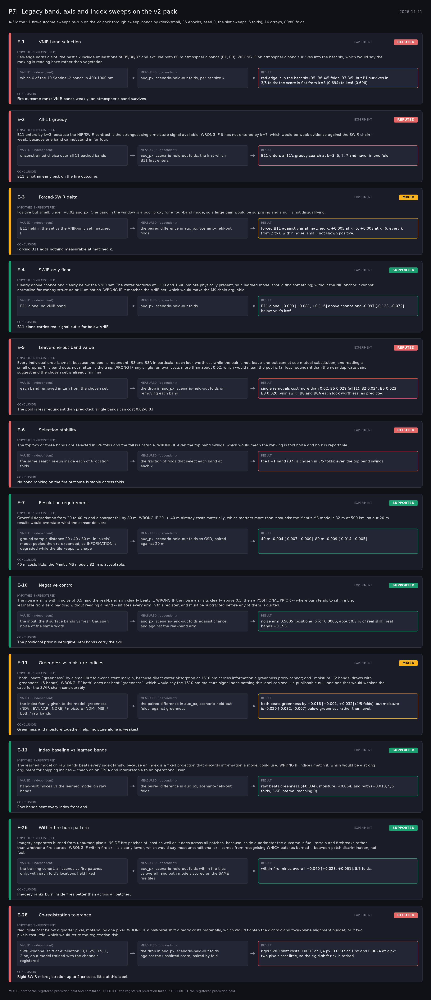

# P7i: Legacy band, axis and index sweeps on the v2 pack (2026-11-11)

What this phase ran and concluded. Generated by `scripts/make_phase_docs.py` from `src/safari_bands/phases.py`; registered hypotheses are quoted from the register, verbatim. Full results: [README.md](README.md).

A-56: the v1 fire-outcome sweeps re-run on the v2 pack through sweep_bands.py (tier2-small, 35 epochs, seed 0, the slot sweeps' 5 folds); 16 arrays, 80/80 folds.

## E-1: VNIR band selection (experiment): **REFUTED**

| | |
|---|---|
| Hypothesis (registered) | Red-edge earns a slot: the best six include at least one of B5/B6/B7 and exclude both 60 m atmospheric bands (B1, B9). WRONG IF an atmospheric band survives into the best six, which would say the ranking is reading haze rather than vegetation. |
| Varied (independent) | which 6 of the 10 Sentinel-2 bands in 400-1000 nm |
| Measured (dependent) | auc_px, scenario-held-out folds, per set size k |
| Result | red edge is in the best six (B5, B6 4/5 folds; B7 3/5) but B1 survives in 3/5 folds; the score is flat from k=3 (0.694) to k=6 (0.696). |
| Verdict | **REFUTED**: the registered prediction failed |
| Conclusion | Fire outcome ranks VNIR bands weakly; an atmospheric band survives. |

## E-2: All-11 greedy (experiment): **REFUTED**

| | |
|---|---|
| Hypothesis (registered) | B11 enters by k=3, because the NIR/SWIR contrast is the strongest single moisture signal available. WRONG IF it has not entered by k=7, which would be weak evidence against the SWIR chain -- weak, because one band cannot stand in for four. |
| Varied (independent) | unconstrained choice over all 11 packed bands |
| Measured (dependent) | auc_px, scenario-held-out folds; the k at which B11 first enters |
| Result | B11 enters all11's greedy search at k=3, 5, 7, 7 and never in one fold. |
| Verdict | **REFUTED**: the registered prediction failed |
| Conclusion | B11 is not an early pick on the fire outcome. |

## E-3: Forced-SWIR delta (experiment): **MIXED**

| | |
|---|---|
| Hypothesis (registered) | Positive but small: under +0.02 auc_px. One band in the window is a poor proxy for a four-band mode, so a large gain would be surprising and a null is not disqualifying. |
| Varied (independent) | B11 held in the set vs the VNIR-only set, matched k |
| Measured (dependent) | the paired difference in auc_px, scenario-held-out folds |
| Result | forced B11 against vnir at matched k: +0.005 at k=5, +0.003 at k=6, every k from 2 to 6 within noise: small, not shown positive. |
| Verdict | **MIXED**: part of the registered prediction held and part failed |
| Conclusion | Forcing B11 adds nothing measurable at matched k. |

## E-4: SWIR-only floor (experiment): **SUPPORTED**

| | |
|---|---|
| Hypothesis (registered) | Clearly above chance and clearly below the VNIR set. The water features at 1200 and 1600 nm are physically present, so a learned model should find something; without the NIR anchor it cannot normalise for canopy structure or illumination. WRONG IF it matches the VNIR set, which would make the MS chain arguable. |
| Varied (independent) | B11 alone, no VNIR band |
| Measured (dependent) | auc_px, scenario-held-out folds |
| Result | B11 alone +0.099 [+0.081, +0.116] above chance and -0.097 [-0.123, -0.072] below vnir's k=6. |
| Verdict | **SUPPORTED**: the registered prediction held |
| Conclusion | B11 alone carries real signal but is far below VNIR. |

## E-5: Leave-one-out band value (experiment): **REFUTED**

| | |
|---|---|
| Hypothesis (registered) | Every individual drop is small, because the pool is redundant. B8 and B8A in particular each look worthless while the pair is not: leave-one-out cannot see mutual substitution, and reading a small drop as 'this band does not matter' is the trap. WRONG IF any single removal costs more than about 0.02, which would mean the pool is far less redundant than the near-duplicate pairs suggest and the chosen set is already minimal. |
| Varied (independent) | each band removed in turn from the chosen set |
| Measured (dependent) | the drop in auc_px, scenario-held-out folds on removing each band |
| Result | single removals cost more than 0.02: B5 0.029 (all11), B2 0.024, B5 0.023, B3 0.020 (vnir_swir); B8 and B8A each look worthless, as predicted. |
| Verdict | **REFUTED**: the registered prediction failed |
| Conclusion | The pool is less redundant than predicted: single bands can cost 0.02-0.03. |

## E-6: Selection stability (experiment): **REFUTED**

| | |
|---|---|
| Hypothesis (registered) | The top two or three bands are selected in 6/6 folds and the tail is unstable. WRONG IF even the top band swings, which would mean the ranking is fold noise and no k is reportable. |
| Varied (independent) | the same search re-run inside each of 6 location folds |
| Measured (dependent) | the fraction of folds that select each band at each k |
| Result | the k=1 band (B7) is chosen in 3/5 folds: even the top band swings. |
| Verdict | **REFUTED**: the registered prediction failed |
| Conclusion | No band ranking on the fire outcome is stable across folds. |

## E-7: Resolution requirement (experiment): **SUPPORTED**

| | |
|---|---|
| Hypothesis (registered) | Graceful degradation from 20 to 40 m and a sharper fall by 80 m. WRONG IF 20 -> 40 m already costs materially, which matters more than it sounds: the Mantis MS mode is 32 m at 500 km, so our 20 m results would overstate what the sensor delivers. |
| Varied (independent) | ground sample distance 20 / 40 / 80 m, in 'pixels' mode: pooled then re-expanded, so INFORMATION is degraded while the tile keeps its shape |
| Measured (dependent) | auc_px, scenario-held-out folds vs GSD, paired against 20 m |
| Result | 40 m -0.004 [-0.007, -0.000], 80 m -0.009 [-0.014, -0.005]. |
| Verdict | **SUPPORTED**: the registered prediction held |
| Conclusion | 40 m costs little; the Mantis MS mode's 32 m is acceptable. |

## E-10: Negative control (experiment): **SUPPORTED**

| | |
|---|---|
| Hypothesis (registered) | The noise arm is within noise of 0.5, and the real-band arm clearly beats it. WRONG IF the noise arm sits clearly above 0.5: then a POSITIONAL PRIOR -- where burn tends to sit in a tile, learnable from zero padding without reading a band -- inflates every arm in this register, and must be subtracted before any of them is quoted. |
| Varied (independent) | the input: the 9 surface bands vs fresh Gaussian noise of the same width |
| Measured (dependent) | auc_px, scenario-held-out folds against chance, and against the real-band arm |
| Result | noise arm 0.5005 (positional prior 0.0005, about 0.3 % of real skill); real bands +0.193. |
| Verdict | **SUPPORTED**: the registered prediction held |
| Conclusion | The positional prior is negligible; real bands carry the skill. |

## E-11: Greenness vs moisture indices (experiment): **MIXED**

| | |
|---|---|
| Hypothesis (registered) | `both` beats `greenness` by a small but fold-consistent margin, because direct water absorption at 1610 nm carries information a greenness proxy cannot; and `moisture` (2 bands) draws with `greenness` (5 bands). WRONG IF `both` does not beat `greenness`, which would say the 1610 nm moisture signal adds nothing this label can see -- a publishable null, and one that would weaken the case for the SWIR chain considerably. |
| Varied (independent) | the index family given to the model: greenness (NDVI, EVI, VARI, NDRE) / moisture (NDMI, MSI) / both / raw bands |
| Measured (dependent) | the paired difference in auc_px, scenario-held-out folds, against greenness |
| Result | both beats greenness by +0.016 [+0.001, +0.032] (4/5 folds), but moisture is -0.020 [-0.032, -0.007] below greenness rather than level. |
| Verdict | **MIXED**: part of the registered prediction held and part failed |
| Conclusion | Greenness and moisture together help; moisture alone is weakest. |

## E-12: Index baseline vs learned bands (experiment): **SUPPORTED**

| | |
|---|---|
| Hypothesis (registered) | The learned model on raw bands beats every index family, because an index is a fixed projection that discards information a model could use. WRONG IF indices match it, which would be a strong argument for shipping indices -- cheap on an FPGA and interpretable to an operational user. |
| Varied (independent) | hand-built indices vs the learned model on raw bands |
| Measured (dependent) | the paired difference in auc_px, scenario-held-out folds |
| Result | raw beats greenness (+0.034), moisture (+0.054) and both (+0.018, 5/5 folds, 2-SE interval reaching 0). |
| Verdict | **SUPPORTED**: the registered prediction held |
| Conclusion | Raw bands beat every index front end. |

## E-26: Within-fire burn pattern (experiment): **SUPPORTED**

| | |
|---|---|
| Hypothesis (registered) | Imagery separates burned from unburned pixels INSIDE fire patches at least as well as it does across all patches, because inside a perimeter the outcome is fuel, terrain and firebreaks rather than whether a fire started. WRONG IF within-fire skill is clearly lower, which would say most unconditional skill comes from recognising WHICH patches burned -- between-patch discrimination, not fuel. |
| Varied (independent) | the training cohort: all scenes vs fire patches only, with each fold's locations held fixed |
| Measured (dependent) | auc_px, scenario-held-out folds within fire tiles vs overall; and both models scored on the SAME fire tiles |
| Result | within-fire minus overall +0.040 [+0.028, +0.051], 5/5 folds. |
| Verdict | **SUPPORTED**: the registered prediction held |
| Conclusion | Imagery ranks burn inside fires better than across all patches. |

## E-28: Co-registration tolerance (experiment): **REFUTED**

| | |
|---|---|
| Hypothesis (registered) | Negligible cost below a quarter pixel, material by one pixel. WRONG IF a half-pixel shift already costs materially, which would tighten the dichroic and focal-plane alignment budget; or if two pixels cost little, which would retire the registration risk. |
| Varied (independent) | SWIR-channel shift at evaluation: 0, 0.25, 0.5, 1, 2 px, on a model trained with the channels registered |
| Measured (dependent) | the drop in auc_px, scenario-held-out folds against the unshifted score, paired by fold |
| Result | rigid SWIR shift costs 0.0001 at 1/4 px, 0.0007 at 1 px and 0.0024 at 2 px: two pixels cost little, so the rigid-shift risk is retired. |
| Verdict | **REFUTED**: the registered prediction failed |
| Conclusion | Rigid SWIR misregistration up to 2 px costs little at this label. |
