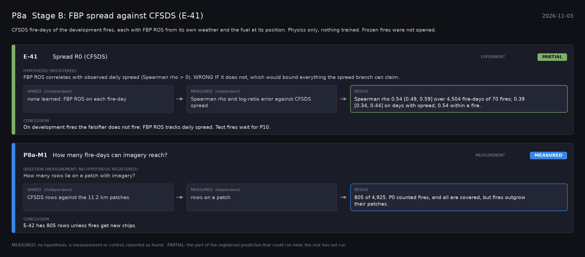

# P8a: Stage B: FBP spread against CFSDS (E-41) (2026-11-03)

What this phase ran and concluded. Generated by `scripts/make_phase_docs.py` from `src/safari_bands/phases.py`; registered hypotheses are quoted from the register, verbatim. Full results: [README.md](README.md).

CFSDS fire-days of the development fires, each with FBP ROS from its own weather and the fuel at its position. Physics only, nothing trained. Frozen fires were not opened.

## E-41: Spread R0 (CFSDS) (experiment): **PARTIAL**

| | |
|---|---|
| Hypothesis (registered) | FBP ROS correlates with observed daily spread (Spearman rho > 0). WRONG IF it does not, which would bound everything the spread branch can claim. |
| Varied (independent) | none learned: FBP ROS on each fire-day |
| Measured (dependent) | Spearman rho and log-ratio error against CFSDS spread |
| Result | Spearman rho 0.54 [0.49, 0.59] over 4,504 fire-days of 70 fires; 0.39 [0.34, 0.44] on days with spread; 0.54 within a fire. |
| Verdict | **PARTIAL**: the part of the registered prediction that could run held; the rest has not run |
| Conclusion | On development fires the falsifier does not fire: FBP ROS tracks daily spread. Test fires wait for P10. |

## P8a-M1: How many fire-days can imagery reach? (measurement): **MEASURED**

| | |
|---|---|
| Question (measurement; no hypothesis registered) | How many rows lie on a patch with imagery? |
| Varied (independent) | CFSDS rows against the 11.2 km patches |
| Measured (dependent) | rows on a patch |
| Result | 805 of 4,925. P0 counted fires, and all are covered, but fires outgrow their patches. |
| Verdict | **MEASURED**: no hypothesis: a measurement or control, reported as found |
| Conclusion | E-42 has 805 rows unless fires get new chips. |
