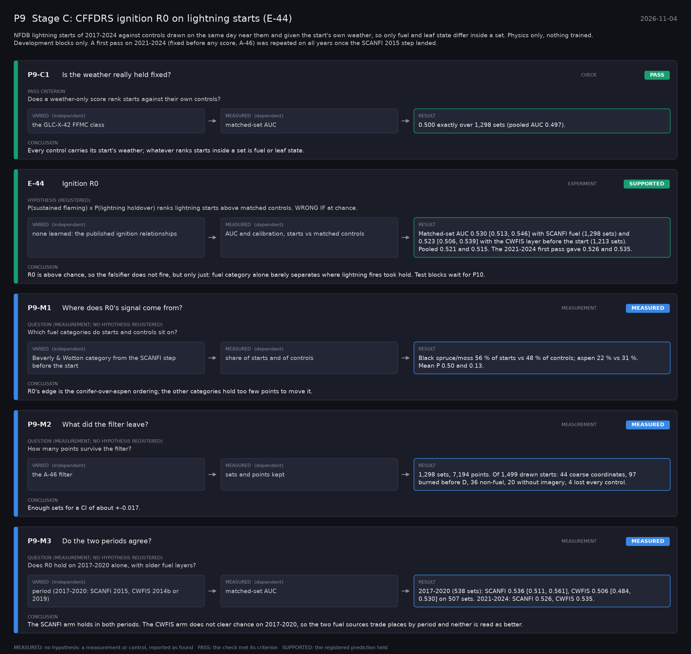

# P9: Stage C: CFFDRS ignition R0 on lightning starts (E-44) (2026-11-04)

What this phase ran and concluded. Generated by `scripts/make_phase_docs.py` from `src/safari_bands/phases.py`; registered hypotheses are quoted from the register, verbatim. Full results: [README.md](README.md).

NFDB lightning starts of 2017-2024 against controls drawn on the same day near them and given the start's own weather, so only fuel and leaf state differ inside a set. Physics only, nothing trained. Development blocks only. A first pass on 2021-2024 (fixed before any score, A-46) was repeated on all years once the SCANFI 2015 step landed.

## P9-C1: Is the weather really held fixed? (check): **PASS**

| | |
|---|---|
| Pass criterion | Does a weather-only score rank starts against their own controls? |
| Varied (independent) | the GLC-X-42 FFMC class |
| Measured (dependent) | matched-set AUC |
| Result | 0.500 exactly over 1,298 sets (pooled AUC 0.497). |
| Verdict | **PASS**: the check met its criterion |
| Conclusion | Every control carries its start's weather; whatever ranks starts inside a set is fuel or leaf state. |

## E-44: Ignition R0 (experiment): **SUPPORTED**

| | |
|---|---|
| Hypothesis (registered) | P(sustained flaming) x P(lightning holdover) ranks lightning starts above matched controls. WRONG IF at chance. |
| Varied (independent) | none learned: the published ignition relationships |
| Measured (dependent) | AUC and calibration, starts vs matched controls |
| Result | Matched-set AUC 0.530 [0.513, 0.546] with SCANFI fuel (1,298 sets) and 0.523 [0.506, 0.539] with the CWFIS layer before the start (1,213 sets). Pooled 0.521 and 0.515. The 2021-2024 first pass gave 0.526 and 0.535. |
| Verdict | **SUPPORTED**: the registered prediction held |
| Conclusion | R0 is above chance, so the falsifier does not fire, but only just: fuel category alone barely separates where lightning fires took hold. Test blocks wait for P10. |

## P9-M1: Where does R0's signal come from? (measurement): **MEASURED**

| | |
|---|---|
| Question (measurement; no hypothesis registered) | Which fuel categories do starts and controls sit on? |
| Varied (independent) | Beverly & Wotton category from the SCANFI step before the start |
| Measured (dependent) | share of starts and of controls |
| Result | Black spruce/moss 56 % of starts vs 48 % of controls; aspen 22 % vs 31 %. Mean P 0.50 and 0.13. |
| Verdict | **MEASURED**: no hypothesis: a measurement or control, reported as found |
| Conclusion | R0's edge is the conifer-over-aspen ordering; the other categories hold too few points to move it. |

## P9-M2: What did the filter leave? (measurement): **MEASURED**

| | |
|---|---|
| Question (measurement; no hypothesis registered) | How many points survive the filter? |
| Varied (independent) | the A-46 filter |
| Measured (dependent) | sets and points kept |
| Result | 1,298 sets, 7,194 points. Of 1,499 drawn starts: 44 coarse coordinates, 97 burned before D, 36 non-fuel, 20 without imagery, 4 lost every control. |
| Verdict | **MEASURED**: no hypothesis: a measurement or control, reported as found |
| Conclusion | Enough sets for a CI of about +-0.017. |

## P9-M3: Do the two periods agree? (measurement): **MEASURED**

| | |
|---|---|
| Question (measurement; no hypothesis registered) | Does R0 hold on 2017-2020 alone, with older fuel layers? |
| Varied (independent) | period (2017-2020: SCANFI 2015, CWFIS 2014b or 2019) |
| Measured (dependent) | matched-set AUC |
| Result | 2017-2020 (538 sets): SCANFI 0.536 [0.511, 0.561], CWFIS 0.506 [0.484, 0.530] on 507 sets. 2021-2024: SCANFI 0.526, CWFIS 0.535. |
| Verdict | **MEASURED**: no hypothesis: a measurement or control, reported as found |
| Conclusion | The SCANFI arm holds in both periods. The CWFIS arm does not clear chance on 2017-2020, so the two fuel sources trade places by period and neither is read as better. |
