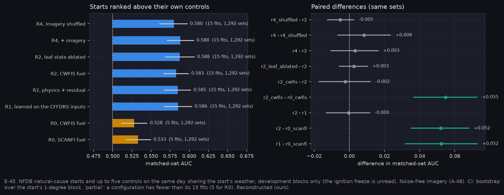

# P9b: ignition learned rungs (E-45)

Run on Nibi: `narval_results/ignition_v1/20261105-1625`, **100 of 100 fits**. Pack `ignition_v1_pack` (Model `a5d6f49`): 7,194 points in 1,298 matched sets, development blocks only. The ignition freeze (test blocks and 2025) is unread. Imagery is noise-free (A-48). All values are Reconstructed (ours).

**At a glance:** [experiments.md](experiments.md). Tables: [tables.md](tables.md).

Generated with:

```bash
python scripts/make_results_package.py --phase P9b --run narval_results/ignition_v1/20261105-1625
python scripts/make_phase_docs.py --phase P9b
```

All eight configurations are complete: R0 at seed 0 on 5 folds, every learned rung on 5 folds × 3 seeds, 1,292 matched sets.



## What it shows

| Contrast (paired, same sets) | Difference [95 % CI] |
|---|---|
| R1 (learned on the CFFDRS inputs) − R0 | **+0.052 [+0.032, +0.073]** |
| R2 (physics + residual) − R0 | **+0.052 [+0.035, +0.068]** |
| R2 − R1 | −0.001 [−0.013, +0.012] |
| R4 (+ imagery) − R4 with imagery shuffled | +0.008 [−0.006, +0.023] |
| R4 − R2 | +0.003 [−0.010, +0.016] |
| R2 with leaf state ablated − R2 | +0.003 [−0.006, +0.010] |
| R2 with CWFIS fuel − R2 with SCANFI fuel | −0.002 [−0.017, +0.012] |

**Registered predictions (2026-11-05):**

| Prediction | Verdict |
|---|---|
| 1. r4 beats r4_shuffled, paired CI above 0 | **failed**: +0.008, the CI spans 0 |
| 2. r2 within ±0.01 of r0 | **refuted**: +0.052 |
| 3. r2_leaf_ablated within ±0.005 of r2 | **inconclusive**: +0.003, but the CI reaches ±0.010 |

**E-45: REFUTED on what ran.**
- **Imagery adds no measurable ignition skill.** Adding the bands to R2 gains +0.003. The real imagery beats shuffled imagery by only +0.008, with a CI spanning 0.
- **Leaf state carries nothing.** Removing it changes nothing measurable.
- **The fuel inventory doesn't matter here.** CWFIS and SCANFI fuel give the same R2.
- **What does lift ignition ranking is learning on the CFFDRS inputs:** fuel and the SCANFI structure slots, from 0.533 to 0.586. Within a matched set the weather is shared, so the gain comes from what differs between the start and its controls.
- **For the CubeSat:** ignition gives no band requirement. Imagery's value to the fire-danger chain has to come through the fuel-structure slots (fuel type, conifer, closure, height), which SAFARI maps (E-35, P6a), not through ignition directly.

## Not yet tested

- The fuel slot's replace form: imagery-estimated fuel type in place of the inventory. It needs eco sidecars for the points, which is E-35's `eco_fire` step.
- The canopy-closure slot, which waits for Q26.

## Limits

- Controls hold the weather and the ERA5 cell fixed but not lightning strike density (A-46).
- Imagery is noise-free (A-48), so the null result for imagery is not a noise artefact.
- 1-degree block bootstrap over 394 blocks.

<!-- qual:start -->
## Qualitative view per experiment

- **E-45** Ignition slot value (set map): [qual_E-45_sets_map.png](qual_E-45_sets_map.png)
<!-- qual:end -->
