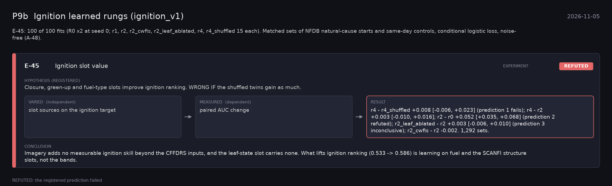

# P9b: Ignition learned rungs (ignition_v1) (2026-11-05)

What this phase ran and concluded. Generated by `scripts/make_phase_docs.py` from `src/safari_bands/phases.py`; registered hypotheses are quoted from the register, verbatim. Full results: [README.md](README.md).

E-45: 100 of 100 fits (R0 x2 at seed 0; r1, r2, r2_cwfis, r2_leaf_ablated, r4, r4_shuffled 15 each). Matched sets of NFDB natural-cause starts and same-day controls, conditional logistic loss, noise-free (A-48).

## E-45: Ignition slot value (experiment): **REFUTED**

| | |
|---|---|
| Hypothesis (registered) | Closure, green-up and fuel-type slots improve ignition ranking. WRONG IF the shuffled twins gain as much. |
| Varied (independent) | slot sources on the ignition target |
| Measured (dependent) | paired AUC change |
| Result | r4 - r4_shuffled +0.008 [-0.006, +0.023] (prediction 1 fails); r4 - r2 +0.003 [-0.010, +0.016]; r2 - r0 +0.052 [+0.035, +0.068] (prediction 2 refuted); r2_leaf_ablated - r2 +0.003 [-0.006, +0.010] (prediction 3 inconclusive); r2_cwfis - r2 -0.002. 1,292 sets. |
| Verdict | **REFUTED**: the registered prediction failed |
| Conclusion | Imagery adds no measurable ignition skill beyond the CFFDRS inputs, and the leaf-state slot carries none. What lifts ignition ranking (0.533 -> 0.586) is learning on fuel and the SCANFI structure slots, not the bands. |
