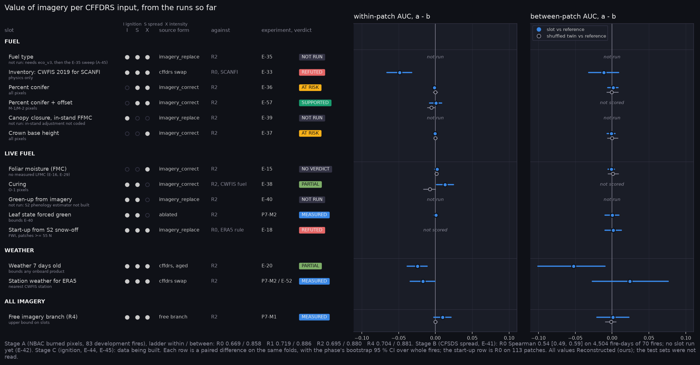

# Results index

Generated by `scripts/make_results_index.py`; do not edit. Each phase folder holds its figures, tables (`tables.md`, `T_*.csv`), the phase sheet (`experiments.md`, `experiments.png`) and a README with the reading. Qualitative views per experiment are listed in [QUALITATIVE_INDEX.md](QUALITATIVE_INDEX.md).

## Value map

What substituting each CFFDRS input changed, across the phases so far. Table: [value_map.md](value_map.md).

## Phases

| phase | date | title | verdicts |
|---|---|---|---|
| [P0](P0/p0_verify/../../phase0_cffdrs_mirror.md) | 2026-10-23 | Verify and freeze | 1 FIXED, 4 MEASURED, 1 PASS |
| [P1](P1/p1_physics/README.md) | 2026-10-23 | Physics port | 1 FIXED, 1 MEASURED, 1 PASS |
| [P2](P2/p2_r0/README.md) | 2026-10-24 | R0: CFFDRS as is, every fuel inventory | 1 AT RISK, 4 MEASURED, 1 PASS, 1 REFUTED, 1 SUPPORTED |
| [P3](P3/p3_dated/README.md) | 2026-10-24 | Dated design: dates, 13:00 LDT weather, start-up | 1 AT RISK, 2 MEASURED, 1 MIXED, 1 PASS, 2 REFUTED, 4 SUPPORTED |
| [P4](P4/p4_prefire/README.md) | 2026-10-25 | Pre-fire imagery, dated labels, the v2 pack | 3 MEASURED, 1 MIXED, 1 PASS |
| [P5](P5/p5_slotnet/README.md) | 2026-10-25 | The CFFDRS-structured network | 1 FIXED, 2 MEASURED, 3 PASS, 4 PENDING |
| [P7](P7/p7_slots/README.md) | 2026-10-26 | Stage A slot experiments, first sweep (slots_v2) | 2 AT RISK, 4 MEASURED, 1 MIXED, 1 PARTIAL, 1 PENDING |
| [P7b](P7/p7b_operational/README.md) | 2026-10-26 | Against what CWFIS actually issued (E-55) | 1 FIXED, 2 MEASURED, 1 MIXED |
| [P7c](P7/p7c_slots_v3/README.md) | 2026-10-27 | Second slot sweep: the Q29 arms (slots_v3) | 1 MEASURED, 1 PARTIAL, 1 PASS, 1 REFUTED, 1 SUPPORTED |
| [P6a](P6/p6a_ecology/README.md) | 2026-10-29 | Ecology estimator band searches on Sentinel-2 | 1 AT RISK, 2 MEASURED, 1 MIXED, 1 SUPPORTED |
| [P6c](P6/p6c_snow/README.md) | 2026-10-29 | Snow-off without SWIR (E-60) | 3 MEASURED, 1 REFUTED |
| [P6a-HS-prov](P6/p6a_hs_provisional/README.md) | 2026-10-30 | AVIRIS-NG band searches, provisional run (void) | 1 FIXED, 1 MEASURED, 2 PENDING |
| [P6b](P6/p6b_cohort/README.md) | 2026-10-30 | The 2024-2025 cohort and what CWFIS issued | 1 PARTIAL, 1 PASS, 1 PENDING |
| [P6d](P6/p6d_startup/README.md) | 2026-10-30 | The FWI start-up from Sentinel-2 snow-off (E-18) | 1 MEASURED, 1 REFUTED |
| [P6a-HS-v2](P6/p6a_hs_v2_provisional/README.md) | 2026-11-01 | AVIRIS-NG band searches, corrected pack, partial sweep | 2 MEASURED, 2 PENDING |
| [P6a-HS-v3](P6/p6a_hs_v3/README.md) | 2026-11-02 | AVIRIS-NG band searches, all lines and folds | 1 MEASURED, 2 PARTIAL |
| [P6a-ext](P6/p6a_external_labels/README.md) | 2026-11-02 | Band rankings on labels that owe nothing to Landsat | 2 MEASURED, 1 PASS |
| [P6e](P6/p6e_out_of_time/README.md) | 2026-11-02 | Out-of-time generalisation on 2024 (E-63) | 1 AT RISK, 3 MEASURED, 2 PASS |
| [P6a-HS-v4](P6/p6a_hs_v4/README.md) | 2026-11-03 | AVIRIS-NG band searches on the final labels | 1 MEASURED, 2 REFUTED |
| [P6a-ext-v2](P6/p6a_external_labels_v2/README.md) | 2026-11-03 | Labels that owe nothing to Landsat, full lidar | 1 MEASURED, 1 PASS |
| [P8a](P8/p8a_spread/README.md) | 2026-11-03 | Stage B: FBP spread against CFSDS (E-41) | 1 MEASURED, 1 PARTIAL |
| [P6a-v3](P6/p6a_ecology_v3/README.md) | 2026-11-04 | Ecology band searches on the corrected family labels (eco_v3) | 1 MEASURED, 1 MIXED, 1 REFUTED, 1 SUPPORTED |
| [P6f](P6/p6f_lfmc/README.md) | 2026-11-04 | LFMC from Sentinel-2 against FBP's equation (E-64, E-29) | 2 MEASURED, 1 PASS, 1 REFUTED, 1 SUPPORTED |
| [P9](P9/p9_ignition/README.md) | 2026-11-04 | Stage C: CFFDRS ignition R0 on lightning starts (E-44) | 3 MEASURED, 1 PASS, 1 SUPPORTED |
| [P12a](P12/p12_bands/README.md) | 2026-11-05 | Band options: the consensus sets (E-46, Q38) | 1 SUPPORTED |
| [P6f-v2](P6/p6f_reference/README.md) | 2026-11-05 | Fixing the LFMC forward model, step 1: the reference check | 1 MIXED, 1 PASS |
| [P7d](P7/p7d_weather_age/README.md) | 2026-11-05 | Weather age: one model scored with stale weather (lags_v1) | 1 PARTIAL |
| [P9b](P9/p9b_ignition_rungs/README.md) | 2026-11-05 | Ignition learned rungs, partial (ignition_v1) | 1 PENDING |
| [P12b](P12/p12_sensors/README.md) | 2026-11-06 | What each Dragonfly Mantis mode would offer (sensors_v1) | 1 MIXED |
| [P6f2](P6/p6f_lfmc_v2/README.md) | 2026-11-06 | LFMC with priors narrowed inside each fold (lfmc_v2) | 1 MIXED |
| [P12c](P12/p12_arch/README.md) | 2026-11-09 | The onboard model's size (E-47, arch_mantis_std) | 1 REFUTED |

## Experiments

40 of 66 experiments have a result. The register state says whether it can run again; the verdicts are what the phases found, oldest first. Full definitions: [EXPERIMENTS.md](../EXPERIMENTS.md).

| experiment | register state | verdicts | results | own views |
|---|---|---|---|---|
| E-1 VNIR band selection | Partial result | - | [band_search_nbac](band_search_nbac/) | - |
| E-2 All-11 greedy | Partial result | - | [band_search_nbac](band_search_nbac/) | - |
| E-3 Forced-SWIR delta | Partial result | - | [band_search_nbac](band_search_nbac/) | - |
| E-4 SWIR-only floor | Runnable now | - | - | - |
| E-5 Leave-one-out band value | Partial result | - | [band_search_nbac](band_search_nbac/) | - |
| E-6 Selection stability | Partial result | - | [band_search_nbac](band_search_nbac/) | - |
| E-7 Resolution requirement | Runnable now | - | - | - |
| E-8 Label independence control | Needs a pack | - | - | - |
| E-9 Lightning cohort | Needs new data | - | - | - |
| E-10 Negative control | Partial result | - | [band_search_nbac](band_search_nbac/) | - |
| E-11 Greenness vs moisture indices | Runnable now | - | - | - |
| E-12 Index baseline vs learned bands | Runnable now | - | - | - |
| E-13 Weather representation | Runnable now | - | - | - |
| E-14 Fusion architecture | Runnable now | - | - | - |
| E-15 Imagery vs the FBP formula | Runnable now | - | - | - |
| E-16 FMC arms | No label exists | - | - | - |
| E-17 Station-density stratification | Needs code | - | - | - |
| E-18 Snow-off startup | Runnable now | P6d REFUTED | [P6/p6d_startup](P6/p6d_startup/) | [patch_map](P6/p6d_startup/qual_E-18_patch_map.png) |
| E-19 Latitude-banded weather | Runnable now | - | - | - |
| E-20 Weather staleness | Partial result | P7 PARTIAL, P7d PARTIAL | [P7/p7_slots](P7/p7_slots/), [P7/p7d_weather_age](P7/p7d_weather_age/) | [staleness](P7/p7_slots/qual_E-20_staleness.png), [trained_stale](P7/p7d_weather_age/qual_E-20_trained_stale.png) |
| E-21 Fuel-layer refresh | Partial result | P2 AT RISK, P3 AT RISK | [P2/p2_r0](P2/p2_r0/), [P3/p3_dated](P3/p3_dated/) | [inventory_age](P3/p3_dated/qual_E-21_inventory_age.png) |
| E-22 Ecology arm | Runnable now | P6a SUPPORTED, P6a-v3 SUPPORTED | [P6/p6a_ecology](P6/p6a_ecology/), [P6/p6a_ecology_v3](P6/p6a_ecology_v3/) | - |
| E-23 SWIR band placement | Needs new data | - | - | - |
| E-24 1209 vs 1240 nm | Needs new data | - | - | - |
| E-25 Spectral resolution: HS vs MS | Needs new data | - | - | - |
| E-26 Within-fire burn pattern | Runnable now | - | - | - |
| E-27 Cost per input channel | Runnable now | - | - | - |
| E-28 Co-registration tolerance | Runnable now | - | - | - |
| E-29 T1 live foliar moisture | Runnable now | P6f SUPPORTED | [P6/p6f_lfmc](P6/p6f_lfmc/) | - |
| E-30 T2 curing / NPV fraction | No label exists | - | - | - |
| E-31 Fire occurrence prediction | No label exists | - | - | - |
| E-32 CFFDRS as is (R0) | Partial result | P2 SUPPORTED, P3 SUPPORTED | [P2/p2_r0](P2/p2_r0/), [P3/p3_dated](P3/p3_dated/) | [r0](P2/p2_r0/qual_E-32_r0.png) |
| E-33 Fuel inventory comparison | Partial result | P2 REFUTED | [P2/p2_r0](P2/p2_r0/) | [inventories](P2/p2_r0/qual_E-33_inventories.png) |
| E-34 Learned CFFDRS (R1/R2) | Runnable now | P5 PENDING, P7 MIXED | [P5/p5_slotnet](P5/p5_slotnet/), [P7/p7_slots](P7/p7_slots/) | - |
| E-35 Fuel-type slot | Runnable now | - | - | - |
| E-36 Percent-conifer slot | Runnable now | P5 PENDING, P7 AT RISK | [P5/p5_slotnet](P5/p5_slotnet/), [P7/p7_slots](P7/p7_slots/) | [pc](P7/p7_slots/qual_E-36_pc.png) |
| E-37 Crown-base-height slot | Runnable now | P5 PENDING, P7 AT RISK | [P5/p5_slotnet](P5/p5_slotnet/), [P7/p7_slots](P7/p7_slots/) | [cbh](P7/p7_slots/qual_E-37_cbh.png) |
| E-38 Curing slot | Runnable now | P5 PENDING, P7 PENDING, P7c PARTIAL | [P5/p5_slotnet](P5/p5_slotnet/), [P7/p7_slots](P7/p7_slots/), [P7/p7c_slots_v3](P7/p7c_slots_v3/) | [curing](P7/p7c_slots_v3/qual_E-38_curing.png) |
| E-39 Canopy closure to in-stand moisture | Needs code | - | - | - |
| E-40 Green-up slot | Needs code | - | - | - |
| E-41 Spread R0 (CFSDS) | Partial result | P8a PARTIAL | [P8/p8a_spread](P8/p8a_spread/) | [progression](P8/p8a_spread/qual_E-41_progression.png) |
| E-42 Spread slot value | Needs a pack | - | - | - |
| E-43 Date-only control | Partial result | P3 SUPPORTED | [P3/p3_dated](P3/p3_dated/) | - |
| E-44 Ignition R0 | Partial result | P9 SUPPORTED | [P9/p9_ignition](P9/p9_ignition/) | [sets](P9/p9_ignition/qual_E-44_sets.png) |
| E-45 Ignition slot value | Runnable now | P9b PENDING | [P9/p9b_ignition_rungs](P9/p9b_ignition_rungs/) | [sets_map](P9/p9b_ignition_rungs/qual_E-45_sets_map.png) |
| E-46 Band and index decision | Partial result | P12a SUPPORTED | [P12/p12_bands](P12/p12_bands/), [P12/p12_weights](P12/p12_weights/) | [band_placement](P12/p12_bands/qual_E-46_band_placement.png) |
| E-47 Architecture decision | Partial result | P12c REFUTED | [P12/p12_arch](P12/p12_arch/) | [family_confusion](P12/p12_arch/qual_E-47_family_confusion.png) |
| E-48 Hardware decision | Needs a pack | - | [P12/p12_convert](P12/p12_convert/) | - |
| E-49 Dating the weather (R0) | Partial result | P3 REFUTED | [P3/p3_dated](P3/p3_dated/) | [weather_date](P3/p3_dated/qual_E-49_weather_date.png) |
| E-50 Latitude-correct day length (R0) | Partial result | P3 SUPPORTED | [P3/p3_dated](P3/p3_dated/) | [patch_map](P3/p3_dated/qual_E-50_patch_map.png) |
| E-51 Operational start-up (R0) | Partial result | P3 MIXED | [P3/p3_dated](P3/p3_dated/) | [patch_map](P3/p3_dated/qual_E-51_patch_map.png) |
| E-52 Weather source: station vs ERA5 (R0) | Partial result | P3 REFUTED | [P3/p3_dated](P3/p3_dated/) | [patch_map](P3/p3_dated/qual_E-52_patch_map.png) |
| E-53 Weather staleness under R0 | Partial result | P3 SUPPORTED | [P3/p3_dated](P3/p3_dated/) | [patch_map](P3/p3_dated/qual_E-53_patch_map.png) |
| E-54 Legacy composite leakage | Partial result | P4 MIXED | [P4/p4_prefire](P4/p4_prefire/) | - |
| E-55 Operational FWI grid vs the reconstruction | Runnable now | P7b MIXED | [P7/p7b_operational](P7/p7b_operational/) | [patch_map](P7/p7b_operational/qual_E-55_patch_map.png) |
| E-56 Operational FBP outputs on a 2024-2025 cohort | Partial result | P6b PARTIAL | [P6/p6b_cohort](P6/p6b_cohort/) | [cohort_tiles](P6/p6b_cohort/qual_E-56_cohort_tiles.png), [patch_map](P6/p6b_cohort/qual_E-56_patch_map.png) |
| E-57 Percent-conifer correction with an imagery-free offset | Runnable now | P7c SUPPORTED | [P7/p7c_slots_v3](P7/p7c_slots_v3/) | [pc_offset](P7/p7c_slots_v3/qual_E-57_pc_offset.png) |
| E-58 Closing R2's within-patch gap to R1 | Runnable now | P7c REFUTED | [P7/p7c_slots_v3](P7/p7c_slots_v3/) | [r2_gap](P7/p7c_slots_v3/qual_E-58_r2_gap.png) |
| E-59 Indices as model inputs | Runnable now | P6a MIXED, P6a-v3 MIXED | [P6/p6a_ecology](P6/p6a_ecology/), [P6/p6a_ecology_v3](P6/p6a_ecology_v3/) | - |
| E-60 Snow-off without SWIR | Runnable now | P6c REFUTED | [P6/p6c_snow](P6/p6c_snow/) | - |
| E-61 Best SWIR bands, searched broadly | Partial result | P6a-HS-prov PENDING, P6a-HS-v2 PENDING, P6a-HS-v3 PARTIAL, P6a-HS-v4 REFUTED | [P6/p6a_hs_provisional](P6/p6a_hs_provisional/), [P6/p6a_hs_v2_provisional](P6/p6a_hs_v2_provisional/), [P6/p6a_hs_v3](P6/p6a_hs_v3/), [P6/p6a_hs_v4](P6/p6a_hs_v4/), [P6/p6a_external_labels_v2](P6/p6a_external_labels_v2/) | [closure](P6/p6a_hs_v2_provisional/qual_E-61_closure.png), [family](P6/p6a_hs_v2_provisional/qual_E-61_family.png), [height](P6/p6a_hs_v2_provisional/qual_E-61_height.png), [pc](P6/p6a_hs_v2_provisional/qual_E-61_pc.png), [closure](P6/p6a_hs_v3/qual_E-61_closure.png), [family](P6/p6a_hs_v3/qual_E-61_family.png), [height](P6/p6a_hs_v3/qual_E-61_height.png), [pc](P6/p6a_hs_v3/qual_E-61_pc.png), [closure](P6/p6a_hs_v4/qual_E-61_closure.png), [family](P6/p6a_hs_v4/qual_E-61_family.png), [height](P6/p6a_hs_v4/qual_E-61_height.png), [pc](P6/p6a_hs_v4/qual_E-61_pc.png) |
| E-62 Best VNIR bands, searched broadly | Partial result | P6a AT RISK, P6a-HS-prov PENDING, P6a-HS-v2 PENDING, P6a-HS-v3 PARTIAL, P6a-HS-v4 REFUTED, P6a-v3 REFUTED | [P6/p6a_ecology](P6/p6a_ecology/), [P6/p6a_hs_provisional](P6/p6a_hs_provisional/), [P6/p6a_hs_v2_provisional](P6/p6a_hs_v2_provisional/), [P6/p6a_hs_v3](P6/p6a_hs_v3/), [P6/p6a_hs_v4](P6/p6a_hs_v4/), [P6/p6a_ecology_v3](P6/p6a_ecology_v3/) | [closure](P6/p6a_hs_v2_provisional/qual_E-62_closure.png), [family](P6/p6a_hs_v2_provisional/qual_E-62_family.png), [height](P6/p6a_hs_v2_provisional/qual_E-62_height.png), [pc](P6/p6a_hs_v2_provisional/qual_E-62_pc.png), [closure](P6/p6a_hs_v3/qual_E-62_closure.png), [family](P6/p6a_hs_v3/qual_E-62_family.png), [height](P6/p6a_hs_v3/qual_E-62_height.png), [pc](P6/p6a_hs_v3/qual_E-62_pc.png), [closure](P6/p6a_hs_v4/qual_E-62_closure.png), [family](P6/p6a_hs_v4/qual_E-62_family.png), [height](P6/p6a_hs_v4/qual_E-62_height.png), [pc](P6/p6a_hs_v4/qual_E-62_pc.png) |
| E-63 Out-of-time generalisation, two training regimes | Partial result | P6b PENDING, P6e AT RISK | [P6/p6b_cohort](P6/p6b_cohort/), [P6/p6e_out_of_time](P6/p6e_out_of_time/) | [patch_map](P6/p6e_out_of_time/qual_E-63_patch_map.png) |
| E-64 LFMC: simulation-trained, Sentinel-2 empirical, FBP equation | Runnable now | P6f REFUTED | [P6/p6f_lfmc](P6/p6f_lfmc/) | [series](P6/p6f_lfmc/qual_E-64_series.png) |
| E-65 LFMC: simulation retrieval with fold-wise narrowed priors (P6f-v2) | Runnable now | P6f-v2 MIXED, P6f2 MIXED | [P6/p6f_reference](P6/p6f_reference/), [P6/p6f_lfmc_v2](P6/p6f_lfmc_v2/) | - |
| E-66 What each Dragonfly Mantis mode would offer | Runnable now | P12b MIXED | [P12/p12_sensors](P12/p12_sensors/) | [sensor_bands](P12/p12_sensors/qual_E-66_sensor_bands.png) |
