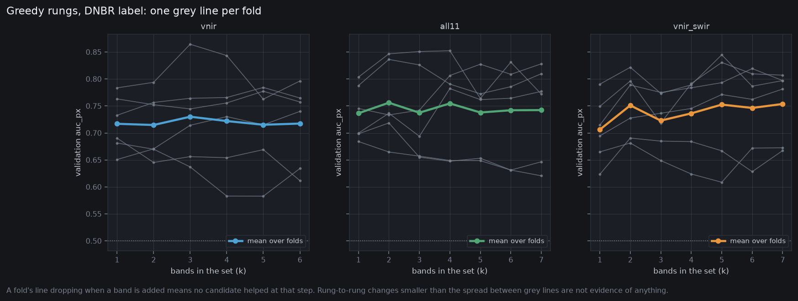
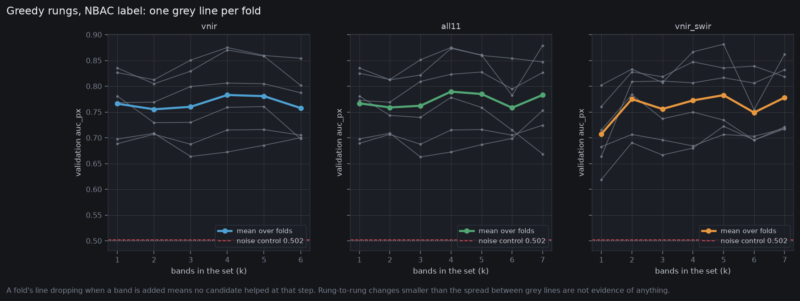
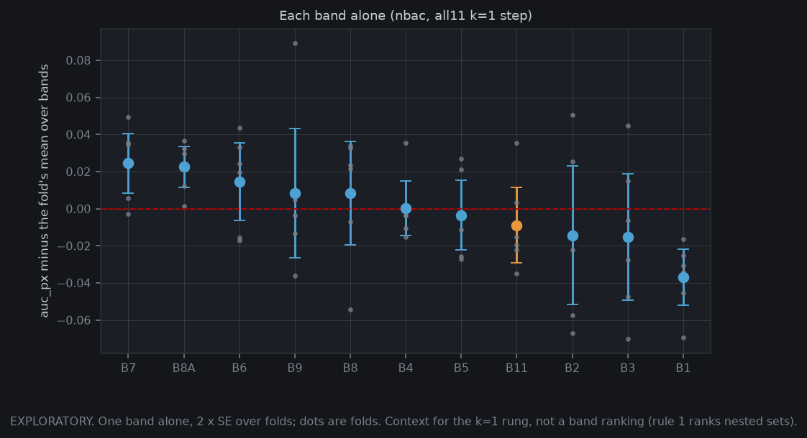
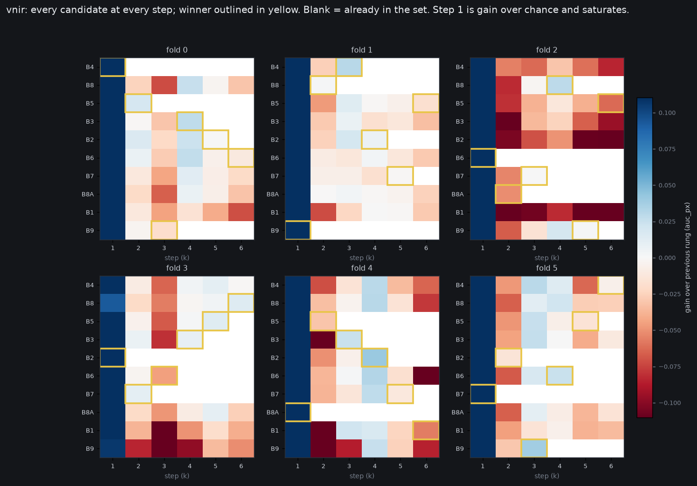
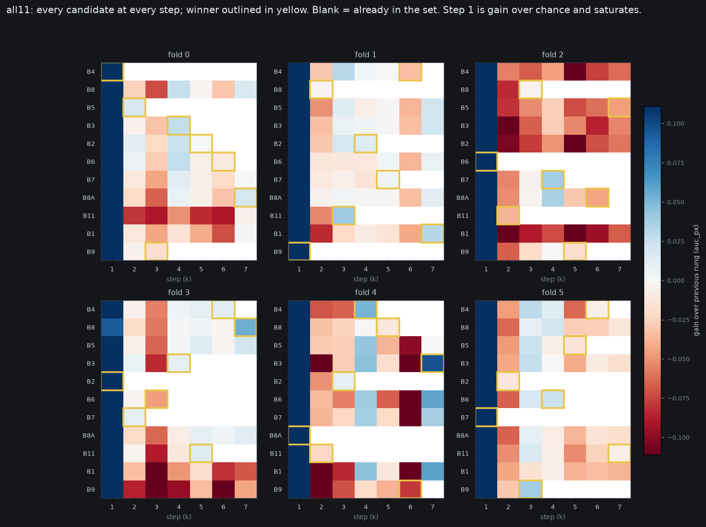
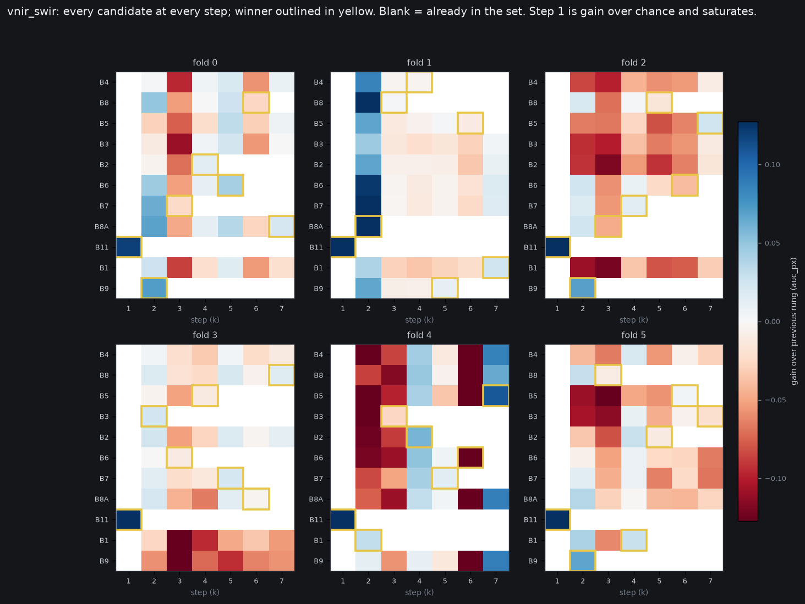
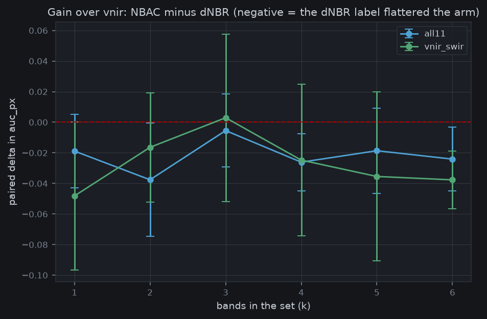

# Band searches

## Runs

| arm | label | job | folds | fits/fold | sec/fit |
|---|---|---|---|---|---|
| all11 | dnbr | 6816763 | 6 | -- | -- |
| all11 | nbac | 6844530 | 6 | 60 | 92 |
| neg_noise | nbac | 6844515 | 6 | 1 | 93 |
| vnir | dnbr | 6797479 | 6 | -- | -- |
| vnir | nbac | 6844532 | 6 | 49 | 90 |
| vnir_swir | dnbr | 6816765 | 6 | -- | -- |
| vnir_swir | nbac | 6844531 | 6 | 51 | 91 |

Runs under **dnbr** trained on the circular label and were unseeded. They appear only in the label comparison below.

## Score by rung (nbac), fold mean +/- SD

| arm | k=1 | k=2 | k=3 | k=4 | k=5 | k=6 | k=7 |
|---|---|---|---|---|---|---|---|
| vnir | 0.766 +/- 0.062 | 0.755 +/- 0.047 | 0.760 +/- 0.078 | 0.783 +/- 0.083 | 0.781 +/- 0.073 | 0.758 +/- 0.066 | -- |
| all11 | 0.767 +/- 0.062 | 0.759 +/- 0.048 | 0.762 +/- 0.077 | 0.790 +/- 0.084 | 0.785 +/- 0.075 | 0.758 +/- 0.062 | 0.783 +/- 0.081 |
| vnir_swir | 0.707 +/- 0.067 | 0.775 +/- 0.062 | 0.756 +/- 0.065 | 0.773 +/- 0.081 | 0.783 +/- 0.071 | 0.749 +/- 0.062 | 0.778 +/- 0.067 |

Noise control (same width, bands replaced by noise): 0.5022. Every arm's skill is measured above that, not above 0.5.

### Against vnir at matched k (nbac)

| arm | k | delta | 2-SE interval | wins | verdict |
|---|---|---|---|---|---|
| all11 | 1 | +0.0006 | [-0.0009, +0.0022] | 4/6 | within noise |
| all11 | 2 | +0.0037 | [-0.0011, +0.0085] | 4/6 | within noise |
| all11 | 3 | +0.0019 | [-0.0036, +0.0074] | 4/6 | within noise |
| all11 | 4 | +0.0066 | [-0.0009, +0.0140] | 3/6 | within noise |
| all11 | 5 | +0.0041 | [-0.0034, +0.0116] | 3/6 | within noise |
| all11 | 6 | +0.0006 | [-0.0092, +0.0103] | 2/6 | within noise |
| vnir_swir | 1 | -0.0590 | [-0.0845, -0.0335] | 0/6 | WORSE than baseline |
| vnir_swir | 2 | +0.0199 | [-0.0016, +0.0415] | 4/6 | within noise |
| vnir_swir | 3 | -0.0043 | [-0.0244, +0.0159] | 3/6 | within noise |
| vnir_swir | 4 | -0.0105 | [-0.0250, +0.0039] | 2/6 | within noise |
| vnir_swir | 5 | +0.0019 | [-0.0160, +0.0198] | 4/6 | within noise |
| vnir_swir | 6 | -0.0087 | [-0.0268, +0.0093] | 2/6 | within noise |

Caveat: the k=1 cell for a forced arm compares one pinned band against the BEST of the baseline's candidates, chosen on the same validation fold. That comparison favours the baseline by construction.

### How decisive was each step (nbac)

| arm | steps | median margin | steps with margin < 0.005 | fold SD of the score (median over k) |
|---|---|---|---|---|
| vnir | 36 | 0.0047 | 19/36 | 0.0694 |
| all11 | 42 | 0.0070 | 16/42 | 0.0752 |
| vnir_swir | 36 | 0.0078 | 14/36 | 0.0666 |

A margin is the winner minus the runner-up at one step. Fits within a fold share a seed, so the margin is not seed noise -- but it is one draw of the training and of the validation crop, and a winner by less than ~0.005 would not survive a second seed. Re-run with --seed 1 to measure it.

### Each band alone (nbac, from all11's k=1 step)

EXPLORATORY (rule 1). Fold-centred: each fold's mean over bands is removed.

| band | mean | 2-SE | folds above the fold mean |
|---|---|---|---|
| B7 | +0.0246 | 0.0161 | 5/6 |
| B8A | +0.0225 | 0.0109 | 6/6 |
| B6 | +0.0146 | 0.0208 | 4/6 |
| B9 | +0.0085 | 0.0349 | 3/6 |
| B8 | +0.0084 | 0.0279 | 4/6 |
| B4 | +0.0002 | 0.0147 | 1/6 |
| B5 | -0.0036 | 0.0188 | 2/6 |
| B11 | -0.0088 | 0.0205 | 2/6 |
| B2 | -0.0143 | 0.0374 | 2/6 |
| B3 | -0.0152 | 0.0342 | 2/6 |
| B1 | -0.0369 | 0.0152 | 0/6 |

B11 entry rung in all11 (nbac), per fold: never, 3, 2, 5, 2, 7

## Label: does SWIR's advantage survive the relabel?

Gain = arm minus vnir at the same k and fold. Absolute scores are not compared across labels: NBAC is a different task (43 % more burned pixels, perimeter-filled), so a level shift says nothing about leakage.

| arm | k | gain under dNBR | gain under NBAC | NBAC minus dNBR | 2-SE interval | verdict |
|---|---|---|---|---|---|---|
| all11 | 1 | 0.0195 | 0.0006 | -0.0189 | [-0.0428, +0.0051] | within noise |
| all11 | 2 | 0.0413 | 0.0037 | -0.0376 | [-0.0746, -0.0006] | leans, folds disagree |
| all11 | 3 | 0.0074 | 0.0019 | -0.0055 | [-0.0293, +0.0184] | within noise |
| all11 | 4 | 0.0327 | 0.0066 | -0.0261 | [-0.0448, -0.0075] | leans, folds disagree |
| all11 | 5 | 0.0227 | 0.0041 | -0.0186 | [-0.0466, +0.0093] | within noise |
| all11 | 6 | 0.0247 | 0.0006 | -0.0241 | [-0.0450, -0.0033] | leans, folds disagree |
| vnir_swir | 1 | -0.0108 | -0.0590 | -0.0482 | [-0.0965, +0.0001] | within noise |
| vnir_swir | 2 | 0.0363 | 0.0199 | -0.0164 | [-0.0521, +0.0193] | within noise |
| vnir_swir | 3 | -0.0072 | -0.0043 | +0.0029 | [-0.0518, +0.0577] | within noise |
| vnir_swir | 4 | 0.0142 | -0.0105 | -0.0248 | [-0.0743, +0.0247] | within noise |
| vnir_swir | 5 | 0.0374 | 0.0019 | -0.0355 | [-0.0908, +0.0199] | within noise |
| vnir_swir | 6 | 0.0290 | -0.0087 | -0.0377 | [-0.0565, -0.0189] | leans, folds disagree |

B11 entry rung in all11 -- dNBR: 1, 4, 2, 2, 6, 1; NBAC: never, 3, 2, 5, 2, 7

The dNBR runs were unseeded, so this contrast carries their seed noise as well as the label difference. A consistent sign across folds is the signal; one fold is not.

## Figures

