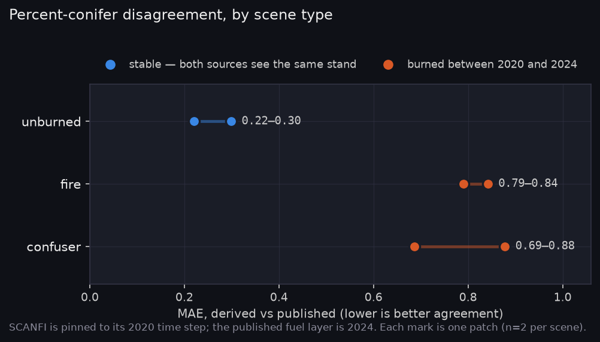
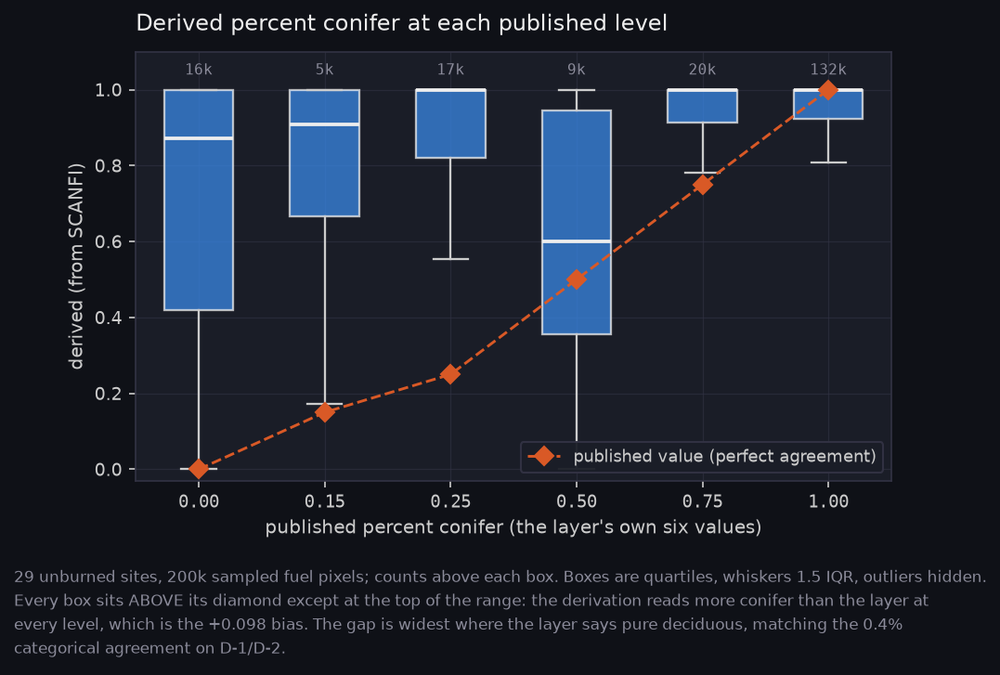
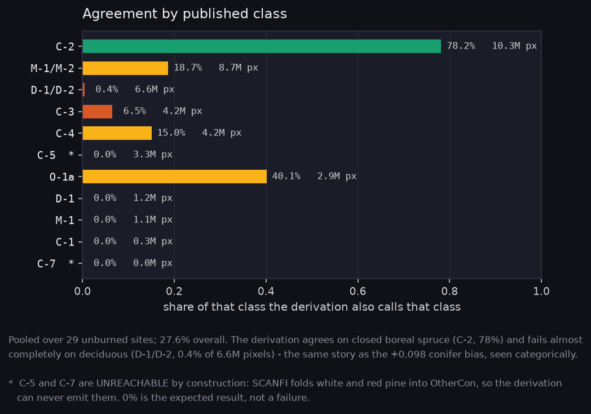
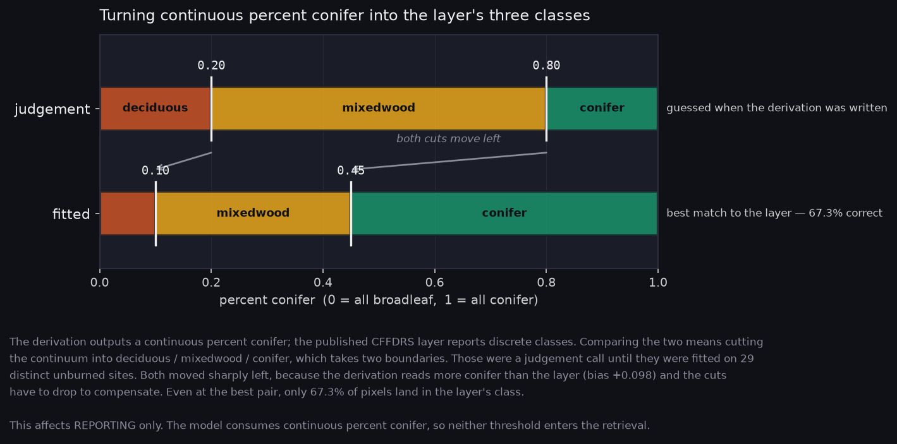
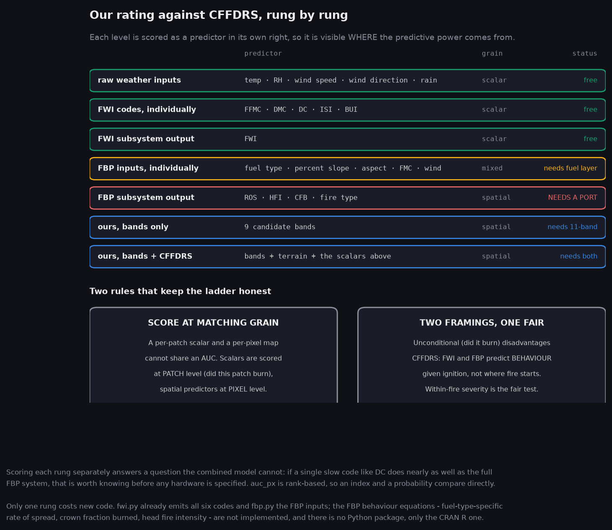

# Derived fuel type against the published CFFDRS layer

**Date:** 2026-10-07
**Scope:** does the SCANFI-derived FBP fuel type agree with the published
CFFDRS FBP Fuel Types 2024 layer, and can it be calibrated against it?
**Status:** first measurement. Small n — read the caveats before quoting any
number here.

## Why this was measured before the derived arm is used anywhere

`Fire_Risk_Model/src/data/fuel_type.py` derives FBP fuel types from SCANFI
species, crown closure, height and non-treed cover. The derivation embeds
judgement the FBP System does not specify: percent-conifer cut points at
0.20/0.80, crown closure 0.40 for C-1 against C-2, height 10 m for C-3 against
C-4. An unvalidated derivation fed into a band-selection study puts an
unmeasured amount of its own error into everything downstream.

## The machinery works

Confirmed end to end on real patches:

- The published layer is fetched **per patch over WCS** (226 KB for a 10 km
  window) rather than as the 3.17 GB national BigTIFF, whose server ignores
  HTTP Range requests. Verified aligned to the patch grid.
- Alignment was checked independently with water as a landmark present in both
  sources: **IoU 0.789** between SCANFI water and the layer's water class. The
  georeferencing is sound, so any disagreement that follows is real.
- Self-comparison of the scoring code returns R² 1.0 and 100% agreement.

## The result splits hard by scene type

Two patches each, pooled over fuel pixels only:

| scene | PC MAE | bias | label agreement |
|---|---|---|---|
| **unburned** | 0.220 / 0.299 | +0.07 / +0.24 | 42% / 14% |
| **fire** | 0.790 / 0.842 | +0.76 / +0.83 | 4.2% / 3.5% |
| **confuser** | 0.878 / 0.686 | +0.88 / +0.63 | 0.5% / 8.9% |

Bias is derived minus published, so a positive value means the derivation says
**more conifer** than the layer.

## The explanation: the two sources have different vintages

`scanfi._select_time_step` returns **2020 for every patch year** — SCANFI is
pinned to one time step. The published fuel layer is **2024**. So every
comparison is SCANFI-2020 against layer-2024, and the question that sorts the
table is simply *did this ground burn between 2020 and 2024?*

- **unburned** — never burned. Both sources describe the same stand. Moderate
  agreement.
- **fire** — burned 2021–2022, i.e. between the vintages. SCANFI sees pre-fire
  conifer; the layer sees post-fire ground.
- **confuser** — imaged 2018–2019 but, by construction, these are CWFIS sites
  that burned a few years later, also before 2024. Same situation as `fire`,
  which is why they behave like it rather than like `unburned`.

The direction of the bias fits: SCANFI-2020 says conifer, the 2024 layer says
D-1/D-2 aspen, and post-fire boreal regeneration *is* deciduous — aspen and
birch resprout first. A +0.76 bias is what comparing pre-fire conifer against
post-fire aspen regeneration should look like.

## The pooled run, corrected

The first pooled figure reported **100% label agreement on every class**. That
was a self-comparison: the published labelling was passed as the derived
argument, so the layer was scored against itself. The tell was that per-patch
agreement ran 14-42% while the pooled figure was 100%, and pooling cannot lift
agreement above its parts. Fixed, and re-run over 29 distinct unburned
locations (107 files deduplicate to 29 sites; SCANFI is pinned to 2020 and the
layer is static, so repeated years of one site return identical rows).

| | |
|---|---|
| sites | 29 distinct unburned locations |
| pixels | 51.3M, of which 42.7M (83%) carry fuel |
| percent-conifer MAE | **0.212** |
| bias | **+0.098** (derivation reads more conifer) |
| R² | **−0.071** |
| label agreement | **27.6%** |
| per-site MAE | 0.018 min, 0.220 median, 0.571 max |

The published percent conifer is discrete — the layer encodes it in its class
codes, so it only takes six values. Plotted that way the result is stark: where
the layer says **pure deciduous**, the derivation's median is **0.87**. The
boxes barely track the diamonds anywhere except the conifer end, which is what
a negative R² means in practice.

Categorically the same story. The derivation agrees on closed boreal spruce
(C-2, 78% of 10.3M pixels) and fails almost completely on deciduous (D-1/D-2,
0.4% of 6.6M). C-5 and C-7 at 0% are expected rather than failures: SCANFI
folds white and red pine into OtherCon, so the derivation can never emit them.

## Three consequences

**1. Only unburned patches can calibrate the derivation.** On fire and
confuser patches the two sources describe different ground, so calibrating
there would tune the thresholds against disturbance rather than against the
derivation's own error. A calibration run restricted to unburned patches is in
progress.

**2. This is measured support for the mission argument, not asserted.** The
static fuel layer is most wrong exactly where the mission matters — MAE
0.79–0.88 on ground that burned, against 0.22–0.30 on stable ground. "A 2024
layer cannot describe a stand that burned in 2025" was a reasonable claim
before; it is now a number. Note the caveat in the next section before leaning
on it.

**3. The derivation is weak on stable ground, and calibration does not rescue
it.** Pooled MAE 0.212 with R² −0.071 means it is slightly worse than
predicting the mean percent conifer. Fitting the cut points moves them a long
way (0.20/0.80 → 0.10/0.45) and still only reaches 67.3% three-class accuracy.
This is a negative result about the derived fuel arm, not a tuning problem:
the derivation systematically reads conifer where the layer reads deciduous.

## Caveats, which are substantial

- **n = 2 per scene type.** This is a pattern, not an established effect. The
  separation between scene types is large enough (3–4× in MAE) that it is
  unlikely to be noise, but no significance test has been run and none should
  be quoted.
- **The vintage explanation is inferred, not isolated.** It fits all three
  scene types and the direction of the bias, but the decisive test — re-running
  SCANFI at the layer's own vintage — is impossible, because the time-step
  selector returns 2020 for every year. Confirming it properly needs either a
  later SCANFI step wired in or an independent disturbance mask.
- **Label agreement understates the derivation.** Season pairs are scored as
  agreement where the layer declines to choose, but the layer's single grass
  class and its coarse deciduous call still make categorical scoring harsher
  than the continuous one. The percent-conifer regression is the statistic to
  read.
- **Leaf-on was assumed.** Day of year 180 for every patch; the patch names
  carry a year, not a date.

## What this does not say

It does not say the derivation is unusable, and it does not say the published
layer is wrong. On stable ground they are comparable; on disturbed ground they
are answering different questions. The useful conclusion is narrower: **the
agreement statistic is only interpretable on unburned patches**, and that is
where the thresholds must be calibrated.

## Planned experiments

Diagrams of what Stage 1 intends to run, regenerated with
`python scripts/make_experiment_diagrams.py`.

| Diagram | What it shows |
|---|---|
| [exp_axes.png](figures/exp_axes.png) | the five axes, and which two are the question |
| [exp_protocol.png](figures/exp_protocol.png) | two-tier greedy selection, re-run inside every fold |
| [exp_cffdrs.png](figures/exp_cffdrs.png) | CFFDRS inputs as the baseline, and what replaces each slot |
| [exp_vs_cffdrs.png](figures/exp_vs_cffdrs.png) | **our rating against CFFDRS, rung by rung** |
| [exp_critical_path.png](figures/exp_critical_path.png) | what is built, and what blocks the rest |

The ladder scores each level as a predictor in its own right — raw weather
inputs, each FWI code, the FWI output, each FBP input, the FBP output, then our
model with and without them. If a single slow code like DC does nearly as well
as the full FBP system, that is worth knowing before any hardware is specified.

Two rules keep it honest. A per-patch scalar and a per-pixel map cannot share
an AUC, so scalars are scored at patch level and spatial predictors at pixel
level. And scored unconditionally, CFFDRS is at a structural disadvantage: FWI
and FBP predict fire *behaviour given ignition*, not where fire starts. The
within-fire framing is the fair one (Q19).

## Figures

Regenerate with `python scripts/make_result_figures.py`.

| Figure | What it shows |
|---|---|
| [scene_split.png](figures/scene_split.png) | the finding above |
| [band_pool.png](figures/band_pool.png) | the 11-band pool against the atmospheric regions |
| [index_feasibility.png](figures/index_feasibility.png) | which index each band set can form |
| [cut_points.png](figures/cut_points.png) | judgement vs fitted percent-conifer thresholds |

## Next

1. Finish the unburned-only calibration and adopt the fitted cut points (A-11).
2. Decide whether a later SCANFI time step can be wired in; if so the vintage
   explanation becomes testable rather than inferred.
3. Record the SCANFI vintage pinning as an assumption — it affects every use of
   SCANFI in this project, not only this comparison.
