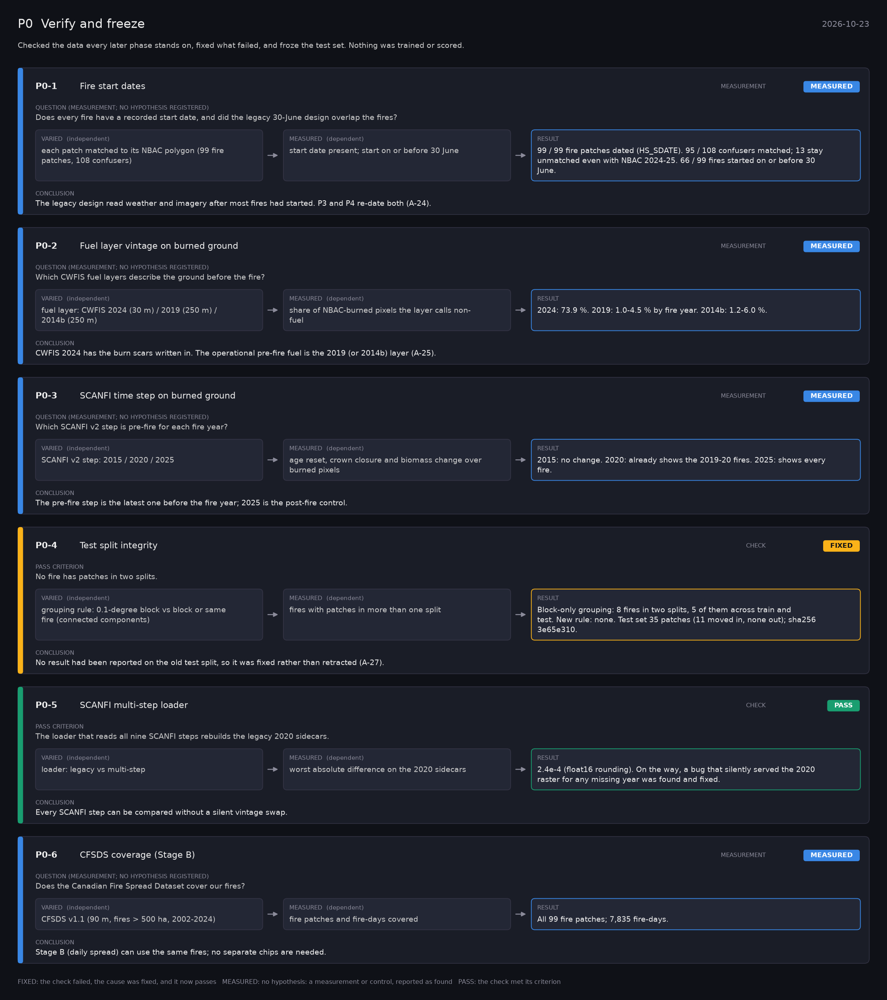

# P0: Verify and freeze (2026-10-23)

What this phase ran and concluded. Generated by `scripts/make_phase_docs.py` from `src/safari_bands/phases.py`; registered hypotheses are quoted from the register, verbatim. Full results: [../phase0_cffdrs_mirror.md](../phase0_cffdrs_mirror.md).

Checked the data every later phase stands on, fixed what failed, and froze the test set. Nothing was trained or scored.

## P0-1: Fire start dates (measurement): **MEASURED**

| | |
|---|---|
| Question (measurement; no hypothesis registered) | Does every fire have a recorded start date, and did the legacy 30-June design overlap the fires? |
| Varied (independent) | each patch matched to its NBAC polygon (99 fire patches, 108 confusers) |
| Measured (dependent) | start date present; start on or before 30 June |
| Result | 99 / 99 fire patches dated (HS_SDATE). 95 / 108 confusers matched; 13 stay unmatched even with NBAC 2024-25. 66 / 99 fires started on or before 30 June. |
| Verdict | **MEASURED**: no hypothesis: a measurement or control, reported as found |
| Conclusion | The legacy design read weather and imagery after most fires had started. P3 and P4 re-date both (A-24). |

## P0-2: Fuel layer vintage on burned ground (measurement): **MEASURED**

| | |
|---|---|
| Question (measurement; no hypothesis registered) | Which CWFIS fuel layers describe the ground before the fire? |
| Varied (independent) | fuel layer: CWFIS 2024 (30 m) / 2019 (250 m) / 2014b (250 m) |
| Measured (dependent) | share of NBAC-burned pixels the layer calls non-fuel |
| Result | 2024: 73.9 %. 2019: 1.0-4.5 % by fire year. 2014b: 1.2-6.0 %. |
| Verdict | **MEASURED**: no hypothesis: a measurement or control, reported as found |
| Conclusion | CWFIS 2024 has the burn scars written in. The operational pre-fire fuel is the 2019 (or 2014b) layer (A-25). |

## P0-3: SCANFI time step on burned ground (measurement): **MEASURED**

| | |
|---|---|
| Question (measurement; no hypothesis registered) | Which SCANFI v2 step is pre-fire for each fire year? |
| Varied (independent) | SCANFI v2 step: 2015 / 2020 / 2025 |
| Measured (dependent) | age reset, crown closure and biomass change over burned pixels |
| Result | 2015: no change. 2020: already shows the 2019-20 fires. 2025: shows every fire. |
| Verdict | **MEASURED**: no hypothesis: a measurement or control, reported as found |
| Conclusion | The pre-fire step is the latest one before the fire year; 2025 is the post-fire control. |

## P0-4: Test split integrity (check): **FIXED**

| | |
|---|---|
| Pass criterion | No fire has patches in two splits. |
| Varied (independent) | grouping rule: 0.1-degree block vs block or same fire (connected components) |
| Measured (dependent) | fires with patches in more than one split |
| Result | Block-only grouping: 8 fires in two splits, 5 of them across train and test. New rule: none. Test set 35 patches (11 moved in, none out); sha256 3e65e310. |
| Verdict | **FIXED**: the check failed, the cause was fixed, and it now passes |
| Conclusion | No result had been reported on the old test split, so it was fixed rather than retracted (A-27). |

## P0-5: SCANFI multi-step loader (check): **PASS**

| | |
|---|---|
| Pass criterion | The loader that reads all nine SCANFI steps rebuilds the legacy 2020 sidecars. |
| Varied (independent) | loader: legacy vs multi-step |
| Measured (dependent) | worst absolute difference on the 2020 sidecars |
| Result | 2.4e-4 (float16 rounding). On the way, a bug that silently served the 2020 raster for any missing year was found and fixed. |
| Verdict | **PASS**: the check met its criterion |
| Conclusion | Every SCANFI step can be compared without a silent vintage swap. |

## P0-6: CFSDS coverage (Stage B) (measurement): **MEASURED**

| | |
|---|---|
| Question (measurement; no hypothesis registered) | Does the Canadian Fire Spread Dataset cover our fires? |
| Varied (independent) | CFSDS v1.1 (90 m, fires > 500 ha, 2002-2024) |
| Measured (dependent) | fire patches and fire-days covered |
| Result | All 99 fire patches; 7,835 fire-days. |
| Verdict | **MEASURED**: no hypothesis: a measurement or control, reported as found |
| Conclusion | Stage B (daily spread) can use the same fires; no separate chips are needed. |
