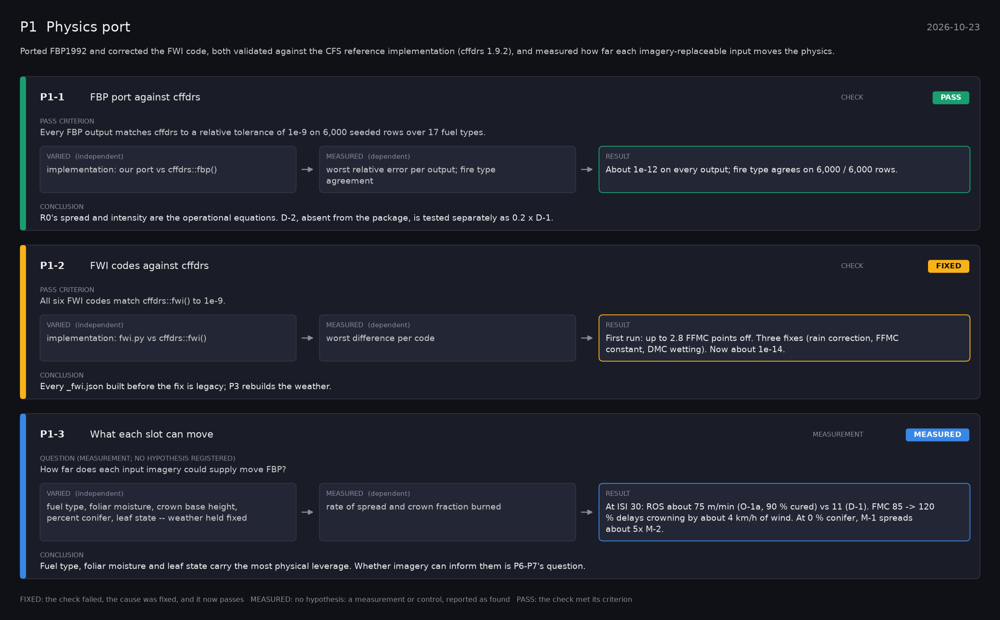

# P1: Physics port (2026-10-23)

What this phase ran and concluded. Generated by `scripts/make_phase_docs.py` from `src/safari_bands/phases.py`; registered hypotheses are quoted from the register, verbatim. Full results: [README.md](README.md).

Ported FBP1992 and corrected the FWI code, both validated against the CFS reference implementation (cffdrs 1.9.2), and measured how far each imagery-replaceable input moves the physics.

## P1-1: FBP port against cffdrs (check): **PASS**

| | |
|---|---|
| Pass criterion | Every FBP output matches cffdrs to a relative tolerance of 1e-9 on 6,000 seeded rows over 17 fuel types. |
| Varied (independent) | implementation: our port vs cffdrs::fbp() |
| Measured (dependent) | worst relative error per output; fire type agreement |
| Result | About 1e-12 on every output; fire type agrees on 6,000 / 6,000 rows. |
| Verdict | **PASS**: the check met its criterion |
| Conclusion | R0's spread and intensity are the operational equations. D-2, absent from the package, is tested separately as 0.2 x D-1. |

## P1-2: FWI codes against cffdrs (check): **FIXED**

| | |
|---|---|
| Pass criterion | All six FWI codes match cffdrs::fwi() to 1e-9. |
| Varied (independent) | implementation: fwi.py vs cffdrs::fwi() |
| Measured (dependent) | worst difference per code |
| Result | First run: up to 2.8 FFMC points off. Three fixes (rain correction, FFMC constant, DMC wetting). Now about 1e-14. |
| Verdict | **FIXED**: the check failed, the cause was fixed, and it now passes |
| Conclusion | Every _fwi.json built before the fix is legacy; P3 rebuilds the weather. |

## P1-3: What each slot can move (measurement): **MEASURED**

| | |
|---|---|
| Question (measurement; no hypothesis registered) | How far does each input imagery could supply move FBP? |
| Varied (independent) | fuel type, foliar moisture, crown base height, percent conifer, leaf state -- weather held fixed |
| Measured (dependent) | rate of spread and crown fraction burned |
| Result | At ISI 30: ROS about 75 m/min (O-1a, 90 % cured) vs 11 (D-1). FMC 85 -> 120 % delays crowning by about 4 km/h of wind. At 0 % conifer, M-1 spreads about 5x M-2. |
| Verdict | **MEASURED**: no hypothesis: a measurement or control, reported as found |
| Conclusion | Fuel type, foliar moisture and leaf state carry the most physical leverage. Whether imagery can inform them is P6-P7's question. |
