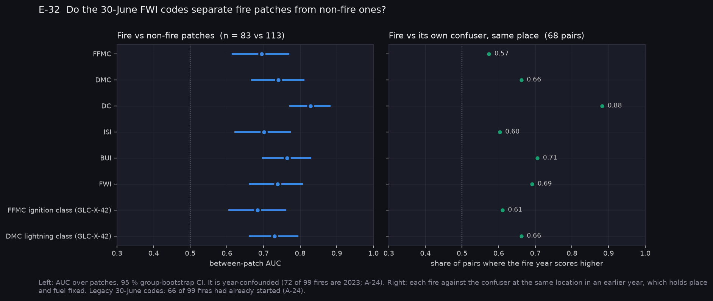
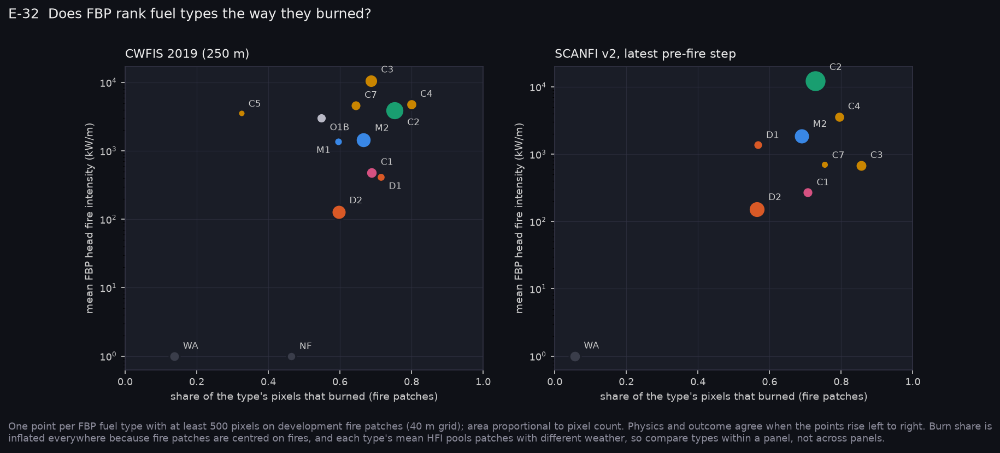
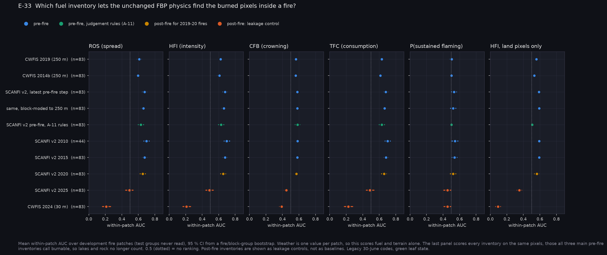
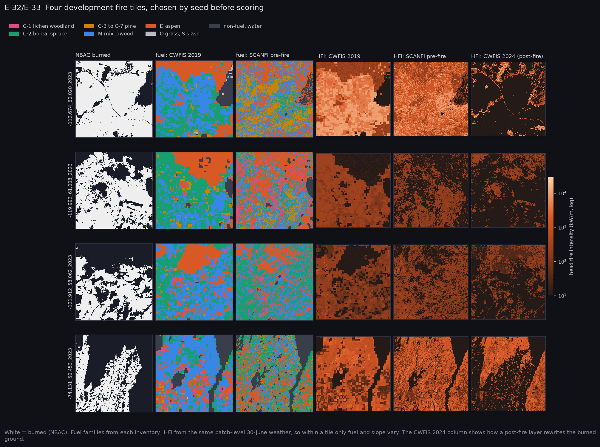
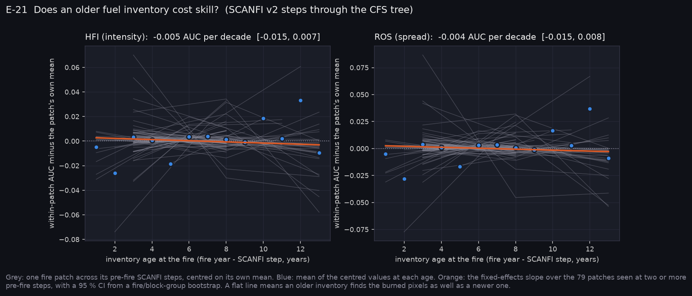

# P2: R0, CFFDRS as-is without learning (2026-10-24)

R0 is the non-learned CFFDRS reference that every later imagery result is measured against. It runs FBP1992 spread and intensity and Beverly & Wotton (2007) ignition per pixel, using operational inputs only, for every fuel inventory we hold. Outputs are scored against NBAC burned area.

**Scope of this run:**

- **Design.** Legacy: each patch's 30-June FWI1987 codes and a "green" leaf state. 66 of the 99 fires had already started by 30 June (A-24), so the weather half is provisional until P3 re-dates it.
- **Patches.** 196 development patches (train and val): 83 fire, 113 confuser or unburned. The 35 frozen test patches were not read.

Register: E-32, E-33, E-21. Tables are in [`tables.md`](tables.md), with CSVs alongside.

## What R0 says

### 1. CFFDRS ranks both axes above chance (E-32: supported)

| | AUC | 95 % CI |
|---|---|---|
| Within fire patches, FBP head-fire intensity, pre-fire SCANFI | 0.676 | 0.65–0.70 |
| Within fire patches, same, operational CWFIS 2019 | 0.623 | 0.60–0.65 |
| Fire vs non-fire patches, FWI | 0.738 | 0.66–0.81 |
| Fire vs non-fire patches, BUI | 0.765 | 0.70–0.83 |
| Fire vs non-fire patches, DC | **0.828** | 0.77–0.88 |



**Between patches, the drought codes carry the signal.** The paired comparison (each fire against the confuser at the same location in an earlier year) holds place and fuel fixed:

| Code | Fire year wins |
|---|---|
| DC | 88 % of 68 pairs |
| BUI | 71 % |
| FWI | 69 % |
| FFMC | 57 % |

So the slow codes separate fire years from non-fire years far better than the fast ones.

**Fuel adds nothing between patches.** The patch-mean FBP intensity scores 0.74–0.76, the same as FWI alone.

**Two caveats apply until P3:**
- **Year confound.** 72 of the 99 fires are from 2023.
- **Timing.** The codes are read on 30 June, after most fires had started.

### 2. Half of the within-patch skill is lakes and rock

Weather is one value per patch, so within-patch AUC scores fuel and terrain alone. When every inventory is scored on the same land pixels (those all three main pre-fire inventories call burnable), the margin above chance roughly halves:

| Inventory | All pixels | Land only |
|---|---|---|
| SCANFI v2 pre-fire, CFS tree | 0.676 | **0.589** [0.57, 0.61] |
| CWFIS 2019 | 0.623 | 0.558 [0.54, 0.58] |
| CWFIS 2014b | 0.608 | 0.532 [0.51, 0.55] |
| SCANFI v2 pre-fire, A-11 rules | 0.628 | **0.508** [0.49, 0.53] |

**FBP's fuel ordering barely matches what burned.** The rank correlation between a fuel type's mean FBP intensity and its burned share is weak and not significant: ρ = 0.26 for CWFIS 2019, 0.29 for SCANFI and 0.02 for 2014b. What carries is the coarse contrast between fuel and non-fuel, and between conifer and aspen. D-2 is lowest on both axes; C-1 burned like C-2 at a tenth of C-2's predicted intensity (`fuel_types.png`).



### 3. Which inventory: content matters, resolution and age do not (E-33)

The table gives paired differences in within-patch HFI AUC on the same 83 fire patches (`T-paired`, `T-paired-land`):

| Comparison | All pixels | Land only |
|---|---|---|
| SCANFI (CFS tree) vs operational CWFIS 2019 | +0.053 [+0.037, +0.071] | **+0.031** [+0.014, +0.050] |
| Same, with SCANFI block-moded to 250 m | +0.039 | +0.032 |
| 30 m vs 250 m, resolution alone | +0.014 [+0.005, +0.024] | **−0.001** [−0.009, +0.008] |
| CFS tree vs A-11 judgement rules, same SCANFI step | +0.048 | **+0.081** [+0.060, +0.104] |
| CWFIS 2019 vs 2014b | +0.016 (n.s.) | +0.026 (n.s.) |



- **SCANFI fed through the CFS tree is a better pre-fire fuel reference than the operational layer.** The advantage survives at 250 m and on land pixels, so it comes from inventory content, not from pixel size.
- **The 30 m advantage was the water mask.** SCANFI's water comes from 10 m WorldCover. Once lakes are out, FBP fuel types at 30 m and 250 m score the same.
- **Retire the A-11 thresholds for fuel typing.** On land they carry nothing (0.508). The CFS tree (A-31) is now the SCANFI fuel reference.

### 4. Post-fire inventories invert the physics (E-33 prediction refuted in direction)

E-33 predicted that post-fire inventories would inflate R0. They do the opposite:

| Inventory | Within-patch HFI AUC, all pixels | Land only |
|---|---|---|
| CWFIS 2024 | **0.21** | 0.09 |
| SCANFI 2025 | 0.49 | 0.35 |

A post-fire layer knows where the fire went: CWFIS 2024 calls 69 % of burned pixels non-fuel. FBP turns that knowledge into "no intensity here". The leak is real and large (+0.41 AUC between CWFIS 2019 and 2024), but for unlearned physics it points backwards. A learned model would read it either way, so the rule stands: no post-fire inventory on burned ground, at any rung. The `tiles.png` panels show the burned ground rewritten.



### 5. Inventory age costs nothing measurable (E-21, inventory half)

Within-patch AUC changes by **−0.005 per decade** of inventory age [−0.015, +0.007] for HFI, and the same for ROS. This uses patch fixed effects over 79 fire patches seen at two or more pre-fire SCANFI steps, at ages 1 to 13 years.



E-21 predicts that a refreshed estimate gains more the staler the inventory. That needs a staleness cost to recover, and on this sample there is none to detect. The prediction is therefore at risk before its learned half (E-22) runs.

**Caveat.** Consecutive SCANFI steps share a model and inputs, so they may understate real change. The 2010 step covers 44 fires so far and the 2005 step none (the fetch is still running).

### 6. Ignition: R0 has nothing to say inside a patch

P(sustained flaming) scores 0.50–0.54 within patches. With one weather value per patch it reduces to a fuel-category ranking, and Beverly & Wotton's categories do not order burned area. Between patches, the GLC-X-42 classes give 0.68 (FFMC) and 0.73 (DMC), no better than the raw codes.

NBAC burned area is a spread-and-consumption outcome, not an ignition one, so this is not a test of the ignition branch. Stage C (E-44) is.

## What this changes for the CubeSat decisions

- **The bar for a fuel-type slot.** An imagery-derived fuel map must beat **0.589 within-patch AUC on land** (and 0.676 on all pixels) under the same physics. Mapping water and rock well is worth about as much again, but it is cheap and already done by 10 m products.
- **GSD.** Under unlearned FBP, 30 m buys nothing over 250 m once water is masked. Any resolution argument for the fuel slots must come from a learned model (R2 onward), not from the physics.
- **Fuel recency.** On this sample, a recent fuel map earns no AUC through recency alone (finding 5). The imagery case for the fuel slots is better content (finding 3), and the dynamic slots: green-up, curing, foliar moisture and startup. None of those is scored yet.
- **Weather dominates between patches.** That is P3's job to re-measure with dated weather. Imagery cannot replace DC, but the startup slot (G4) feeds it.

## Decisions recorded

- **A-30:** ignition from Beverly & Wotton (2007), and how FBP fuel types map onto their categories.
- **A-31:** the CFS decision tree on SCANFI, with its deviations.
- **Q26:** partly answered (one paper in hand, one requested, one read with no coefficients).

## Not done in P2

- The SCANFI v1 2020 adapter (E-33's version comparison).
- The 2005 step, and 2010 for the remaining fires. The fetch is running; rerunning R0 takes about 15 minutes.
- The dated design (P3).

## Reproduce

Run from Fire_Risk_Model at commit `6485f95`:

```bash
python scripts/python/eval_cffdrs_reference.py --out ../Fire_Risk_Statistics/runs/20261024-1430_cffdrs_r0
# then, in Fire_Risk_Statistics:
python scripts/make_results_package.py --phase P2 --run runs/20261024-1430_cffdrs_r0
```

The run directory is git-ignored. `run.json` here records its config, the qualitative tile stems (fixed by seed before scoring) and the freeze hash.

## Files

- **Fire_Risk_Model:**
  - `src/data/ignition.py`: Beverly & Wotton P(sustained flaming).
  - `src/data/fuel_tree.py`: the CFS tree.
  - `src/data/fbp_fuel_layer.fbp_inputs`.
  - `scripts/python/eval_cffdrs_reference.py`.
  - Tests: `test_ignition.py`, `test_fuel_tree.py`.
- **Fire_Risk_Statistics:**
  - `scripts/make_results_package.py --phase P2`.
  - This folder.
