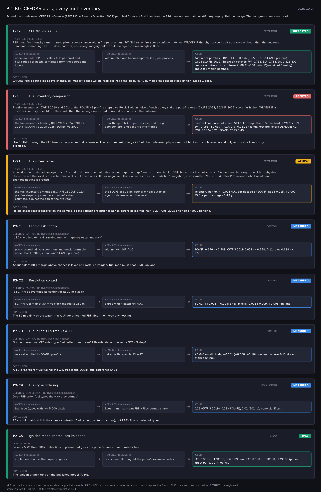

# P2: R0: CFFDRS as is, every fuel inventory (2026-10-24)

What this phase ran and concluded. Generated by `scripts/make_phase_docs.py` from `src/safari_bands/phases.py`; registered hypotheses are quoted from the register, verbatim. Full results: [README.md](README.md).

Scored the non-learned CFFDRS reference (FBP1992 + Beverly & Wotton 2007) per pixel for every fuel inventory, on 196 development patches (83 fire), legacy 30-June design. The test groups were not read.

## E-32: CFFDRS as is (R0) (experiment): **SUPPORTED**

| | |
|---|---|
| Hypothesis (registered) | FBP head-fire intensity ranks burned pixels above chance within fire patches, and FWI/BUI ranks fire above confuser patches. WRONG IF the physics scores sit at chance on both: then the outcome measures something CFFDRS does not rate, and every imagery delta would be against a meaningless floor. |
| Varied (independent) | none learned: FBP ROS / HFI / CFB per pixel and FWI codes per patch, computed from the operational inputs |
| Measured (dependent) | within-patch and between-patch AUC, per process |
| Result | Within fire patches, FBP HFI AUC 0.676 [0.65, 0.70] (SCANFI pre-fire), 0.623 (CWFIS 2019). Between patches FWI 0.738, BUI 0.765, DC 0.828; DC beats each fire's own confuser in 88 % of 68 pairs. P(sustained flaming) about 0.5 within patches. |
| Verdict | **SUPPORTED**: the registered prediction held |
| Conclusion | CFFDRS ranks both axes above chance, so imagery deltas will be read against a real floor. NBAC burned area does not test ignition; Stage C does. |

## E-33: Fuel inventory comparison (experiment): **REFUTED**

| | |
|---|---|
| Hypothesis (registered) | Pre-fire inventories (CWFIS 2019 and 2014b, the SCANFI v2 pre-fire step) give R0 skill within noise of each other, and the post-fire ones (CWFIS 2024, SCANFI 2025) score far higher. WRONG IF a post-fire inventory does NOT inflate skill: then the leakage measured in A-25 does not reach the outcome. |
| Varied (independent) | the fuel inventory feeding R0: CWFIS 2024 / 2019 / 2014b, SCANFI v2 2005-2025, SCANFI v1 2020 |
| Measured (dependent) | R0 within-patch AUC per process, and the gap between pre- and post-fire inventories |
| Result | Pre-fire layers are not equal: SCANFI through the CFS tree beats CWFIS 2019 by +0.053 [+0.037, +0.071] (+0.031 on land). Post-fire layers DEFLATE R0: CWFIS 2024 0.21, SCANFI 2025 0.49. |
| Verdict | **REFUTED**: the registered prediction failed |
| Conclusion | Use SCANFI through the CFS tree as the pre-fire fuel reference. The post-fire leak is large (+0.41) but unlearned physics reads it backwards; a learner would not, so post-fire layers stay excluded. |

## E-21: Fuel-layer refresh (experiment): **AT RISK**

| | |
|---|---|
| Hypothesis (registered) | A positive slope: the advantage of a refreshed estimate grows with the staleness gap. At gap 0 our estimate should LOSE, because it is a noisy copy of its own training target -- which is why the slope and not the level is the estimator. WRONG IF the slope is flat or negative. (This clause restates the prediction's negation; it was written 2026-10-24, after P2's inventory-half result, and changes nothing it predicts.) |
| Varied (independent) | the fuel inventory's vintage (SCANFI v2 2005-2020, pre-fire steps only), and later our refreshed estimate, against the gap to the fire year |
| Measured (dependent) | the SLOPE of auc_px, scenario-held-out folds against staleness, not the level |
| Result | Inventory half only: -0.005 AUC per decade of SCANFI age [-0.015, +0.007], 79 fire patches, ages 1-13 y. |
| Verdict | **AT RISK**: the half that could run removes what the prediction needs |
| Conclusion | No staleness cost to recover on this sample, so the refresh prediction is at risk before its learned half (E-22) runs. 2005 and half of 2010 pending. |

## P2-C1: Land-mask control (control): **MEASURED**

| | |
|---|---|
| Question (control; no hypothesis registered) | Is R0's within-patch skill ranking fuel, or mapping water and rock? |
| Varied (independent) | pixels scored: all vs a common land mask (burnable under CWFIS 2019, 2014b and SCANFI pre-fire) |
| Measured (dependent) | within-patch HFI AUC |
| Result | SCANFI 0.676 -> 0.589; CWFIS 2019 0.623 -> 0.558; A-11 rules 0.628 -> 0.508. |
| Verdict | **MEASURED**: no hypothesis: a measurement or control, reported as found |
| Conclusion | About half of R0's margin above chance is lakes and rock. An imagery fuel map must beat 0.589 on land. |

## P2-C2: Resolution control (control): **MEASURED**

| | |
|---|---|
| Question (control; no hypothesis registered) | Is SCANFI's advantage its content or its 30 m pixels? |
| Varied (independent) | SCANFI fuel map at 30 m vs block-moded to 250 m |
| Measured (dependent) | paired within-patch HFI AUC |
| Result | +0.014 [+0.005, +0.024] on all pixels; -0.001 [-0.009, +0.008] on land. |
| Verdict | **MEASURED**: no hypothesis: a measurement or control, reported as found |
| Conclusion | The 30 m gain was the water mask. Under unlearned FBP, finer fuel types buy nothing. |

## P2-C3: Fuel rules: CFS tree vs A-11 (control): **MEASURED**

| | |
|---|---|
| Question (control; no hypothesis registered) | Do the operational CFS rules type fuel better than our A-11 thresholds, on the same SCANFI step? |
| Varied (independent) | rule set applied to SCANFI pre-fire |
| Measured (dependent) | paired within-patch HFI AUC |
| Result | +0.048 on all pixels; +0.081 [+0.060, +0.104] on land, where A-11 sits at chance (0.508). |
| Verdict | **MEASURED**: no hypothesis: a measurement or control, reported as found |
| Conclusion | A-11 is retired for fuel typing; the CFS tree is the SCANFI fuel reference (A-31). |

## P2-C4: Fuel-type ordering (measurement): **MEASURED**

| | |
|---|---|
| Question (measurement; no hypothesis registered) | Does FBP order fuel types the way they burned? |
| Varied (independent) | fuel type (types with >= 5,000 pixels) |
| Measured (dependent) | Spearman rho: mean FBP HFI vs burned share |
| Result | 0.26 (CWFIS 2019), 0.29 (SCANFI), 0.02 (2014b); none significant. |
| Verdict | **MEASURED**: no hypothesis: a measurement or control, reported as found |
| Conclusion | R0's within-patch skill is the coarse contrasts (fuel vs not, conifer vs aspen), not FBP's fine ordering of types. |

## P2-C5: Ignition model reproduces its paper (check): **PASS**

| | |
|---|---|
| Pass criterion | Beverly & Wotton (2007) Table 6 as implemented gives the paper's own worked probabilities. |
| Varied (independent) | implementation vs the paper's figures |
| Measured (dependent) | P(sustained flaming) at the paper's example codes |
| Result | FC3 0.895 at FFMC 86; FC6 0.895 and FC8 0.960 at DMC 80, FFMC 89 (paper: about 90 %, 90 %, 96 %). |
| Verdict | **PASS**: the check met its criterion |
| Conclusion | The ignition branch runs on the published model (A-30). |
